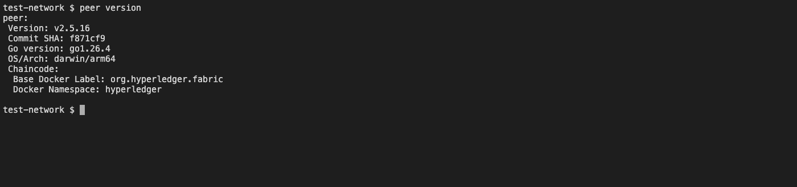
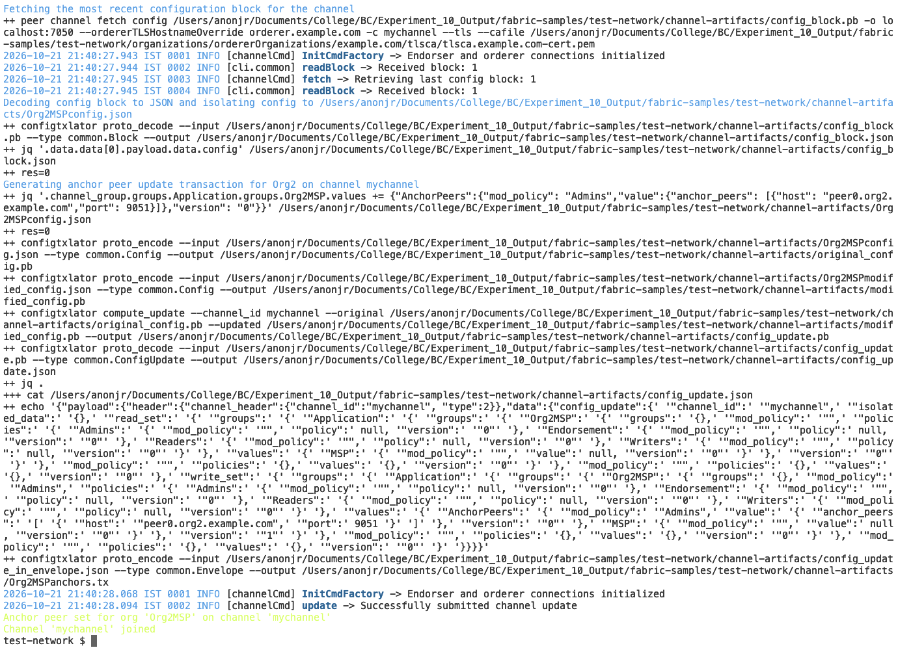
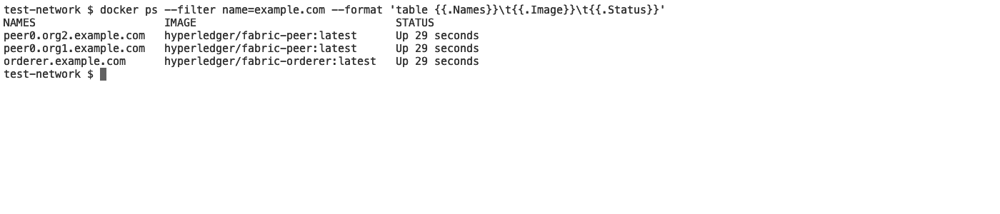
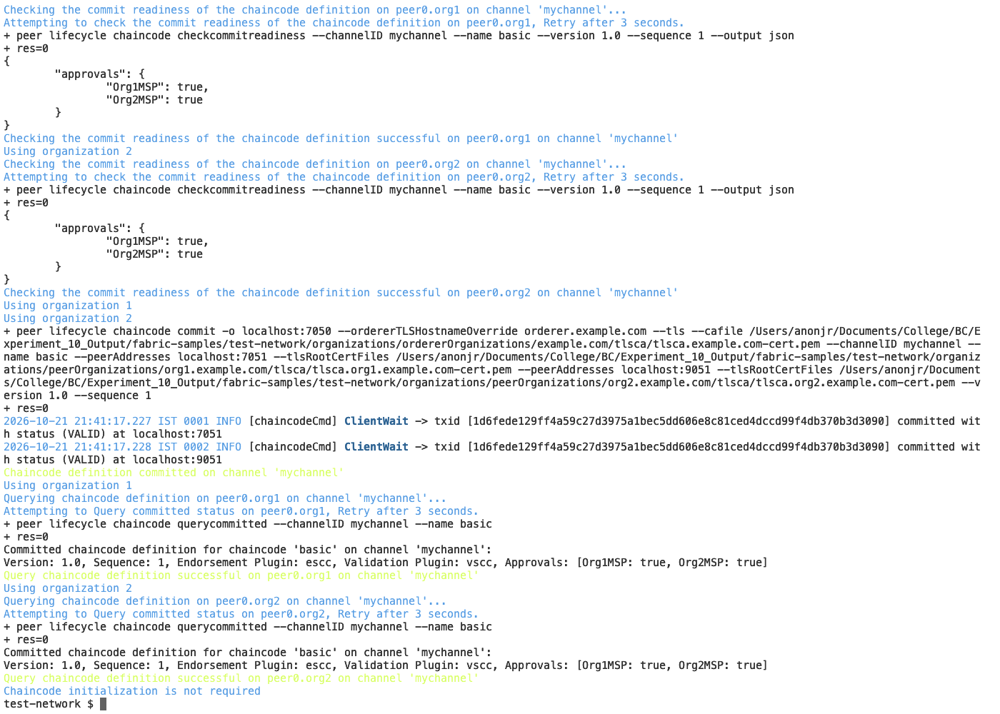
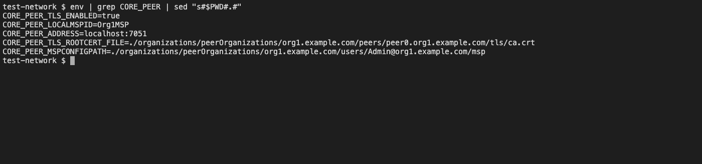
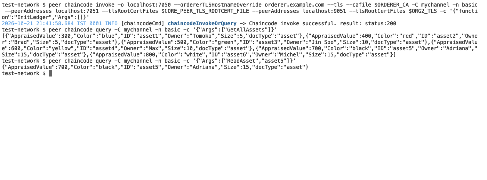
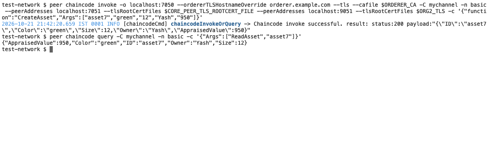
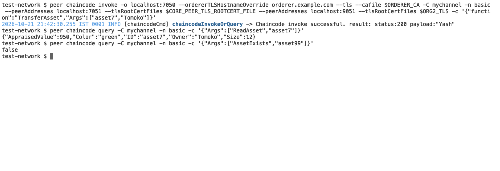
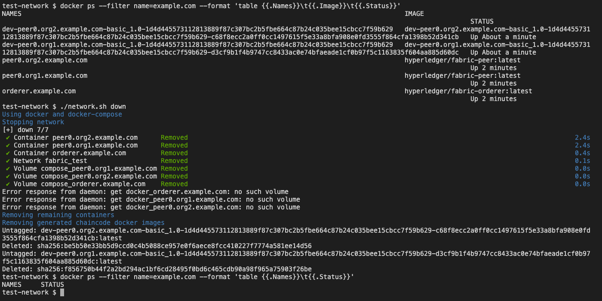

# Experiment 10

## Implementation of Hyperledger Fabric Network and Asset Management using Chaincode

## Aim

To implement a Hyperledger Fabric network, deploy chaincode, and perform asset creation, querying, and transfer operations.

## Tasks Performed

1. Prepared the environment (Docker, Git, Node.js, npm, `jq`, `curl`) and cloned `hyperledger/fabric-samples`.
2. Installed the Fabric binaries and Docker images with `install-fabric.sh`, and set `PATH` and `FABRIC_CFG_PATH` (`peer version`).
3. Started the test network and created the channel: `./network.sh up createChannel`.
4. Deployed the `asset-transfer-basic` JavaScript chaincode: `./network.sh deployCC`.
5. Set the Org1 peer environment, initialised the ledger (`InitLedger`) and queried all assets and `asset5`.
6. Created a new asset (`CreateAsset`) and transferred it (`TransferAsset`), checking the ledger after each step.
7. Stopped the network with `./network.sh down`.

## Theory

**Hyperledger Fabric** is a permissioned, enterprise blockchain framework: every participant has an identity issued by a certificate authority and belongs to an organization, unlike public chains where anyone can join. Its main components are:

- **Peers** — hold a copy of the ledger and execute chaincode to endorse transactions. The test network has `peer0.org1.example.com` (Org1MSP) and `peer0.org2.example.com` (Org2MSP).
- **Orderer** — orders endorsed transactions into blocks (`orderer.example.com`); it does not execute chaincode.
- **Channel** — a private ledger shared by chosen organizations; here `mychannel`.
- **Chaincode (smart contract)** — business logic installed on peers; here the `asset-transfer-basic` JavaScript chaincode, which manages assets with the fields ID, Color, Size, Owner and AppraisedValue.
- **Membership Service Provider (MSP)** and **TLS certificates** — identities and secured communication; the `CORE_PEER_*` variables select which identity the `peer` CLI acts as.

Fabric transactions follow *execute-order-validate*: a client sends a proposal to endorsing peers, which simulate it and sign the result; the client submits the endorsed transaction to the orderer, which puts it in a block; peers then validate and commit it. This is why `peer chaincode invoke` must name the orderer and the endorsing peers of **both** organizations (the chaincode's endorsement policy), whereas `peer chaincode query` is read-only and only talks to the local peer.

**Tools used:** Hyperledger Fabric 2.5.16 binaries and Docker images, `fabric-samples` `test-network` (2 peer organizations, 1 orderer, channel `mychannel`), the `asset-transfer-basic` JavaScript chaincode, Docker (OrbStack) on macOS. The manual's Windows Subsystem for Linux + Ubuntu environment was not used; the same commands were run natively on macOS through `run_fabric.sh`, with the elided `peer chaincode invoke ...` flags written out in full.

## Program

Commands from the manual (steps 6 to 15), run in one script, `run_fabric.sh`:

::: code2
```bash
#!/bin/bash
# Experiment 10: Hyperledger Fabric test-network + asset-transfer-basic chaincode (steps 6-15 of the manual)
set -x
export PATH=$PWD/fabric-samples/bin:$PATH
export FABRIC_CFG_PATH=$PWD/fabric-samples/config
peer version
cd fabric-samples/test-network
./network.sh down
./network.sh up createChannel
./network.sh deployCC -ccn basic -ccp ../asset-transfer-basic/chaincode-javascript -ccl javascript

export CORE_PEER_TLS_ENABLED=true
export CORE_PEER_LOCALMSPID=Org1MSP
export CORE_PEER_TLS_ROOTCERT_FILE=$PWD/organizations/peerOrganizations/org1.example.com/peers/peer0.org1.example.com/tls/ca.crt
export CORE_PEER_MSPCONFIGPATH=$PWD/organizations/peerOrganizations/org1.example.com/users/Admin@org1.example.com/msp
export CORE_PEER_ADDRESS=localhost:7051
ORDERER_CA=$PWD/organizations/ordererOrganizations/example.com/orderers/orderer.example.com/msp/tlscacerts/tlsca.example.com-cert.pem
ORG2_TLS=$PWD/organizations/peerOrganizations/org2.example.com/peers/peer0.org2.example.com/tls/ca.crt
INVOKE=(peer chaincode invoke -o localhost:7050 --ordererTLSHostnameOverride orderer.example.com --tls --cafile "$ORDERER_CA" -C mychannel -n basic
  --peerAddresses localhost:7051 --tlsRootCertFiles "$CORE_PEER_TLS_ROOTCERT_FILE" --peerAddresses localhost:9051 --tlsRootCertFiles "$ORG2_TLS")

"${INVOKE[@]}" -c '{"function":"InitLedger","Args":[]}'
sleep 3
peer chaincode query -C mychannel -n basic -c '{"Args":["GetAllAssets"]}'
peer chaincode query -C mychannel -n basic -c '{"Args":["ReadAsset","asset5"]}'
"${INVOKE[@]}" -c '{"function":"CreateAsset","Args":["asset7","green","12","Yash","950"]}'
sleep 3
peer chaincode query -C mychannel -n basic -c '{"Args":["ReadAsset","asset7"]}'
"${INVOKE[@]}" -c '{"function":"TransferAsset","Args":["asset7","Tomoko"]}'
sleep 3
peer chaincode query -C mychannel -n basic -c '{"Args":["ReadAsset","asset7"]}'
peer chaincode query -C mychannel -n basic -c '{"Args":["AssetExists","asset99"]}'
docker ps --format 'table {{.Names}}\t{{.Image}}\t{{.Status}}'
./network.sh down
```
:::

## Output


*The Fabric CLI is on the `PATH` with `FABRIC_CFG_PATH` set (manual step 6); `peer version` reports v2.5.16 on darwin/arm64.*


*Step 7: `./network.sh up createChannel` generates the certificates, starts the containers, creates `mychannel`, joins both peers and sets the anchor peers. The last lines of its output are shown: "Anchor peer set for org 'Org2MSP'" and "Channel 'mychannel' joined".*


*`docker ps` shows the two peers (`peer0.org1`, `peer0.org2`) and the orderer running.*


*Step 8: `./network.sh deployCC` packages, installs, approves and commits the `basic` chaincode. Both organizations show `true` in the commit-readiness check, and "Committed chaincode definition for chaincode 'basic' on channel 'mychannel'" confirms Version 1.0, Sequence 1, Approvals [Org1MSP: true, Org2MSP: true].*


*The `CORE_PEER_*` variables make the `peer` CLI act as the Org1 admin against `peer0.org1` with TLS enabled.*


*Steps 10 to 12: the `InitLedger` invoke (naming the orderer and the endorsing peers of both organizations) returns "Chaincode invoke successful. result: status:200". `GetAllAssets` lists the six sample assets and `ReadAsset` returns `asset5`.*


*Step 13: `CreateAsset` adds `asset7` (green, size 12, owner Yash, value 950), and a `ReadAsset` query confirms it is on the ledger.*


*Step 14: `TransferAsset` returns the previous owner ("Yash"). `ReadAsset` then shows the owner is Tomoko, and `AssetExists` for a non-existent ID returns `false`.*


*Step 15: before shutdown, `docker ps` lists the peers, the orderer and the two chaincode containers. `./network.sh down` removes them, along with the volumes and the generated chaincode images, and a final `docker ps` shows no Fabric containers left.*

*(The run log for an earlier pass of the same commands is saved as `fabric_run_clean.log`, produced by `run_fabric.sh`, both in this folder.)*

## Conclusion

This experiment implemented a Hyperledger Fabric network (two peer organizations, one orderer and a channel, `mychannel`) and deployed the `asset-transfer-basic` chaincode with both organizations approving the definition. Asset management was demonstrated end to end: the ledger was initialized with six assets, queried (all assets and one by ID), a new asset `asset7` was created with owner Yash, and ownership was then transferred to Tomoko, with a read-back after each transaction confirming the committed state. Read operations (`query`) worked directly against one peer, while writes (`invoke`) had to be endorsed by both organizations and ordered into a block, illustrating Fabric's execute-order-validate model and the difference from the public, Proof-of-Work chains of the earlier experiments. The run was done natively on macOS rather than in WSL/Ubuntu as the manual assumes, and used the standard sample asset case study with the asset owned by the author, not a separately designed case.
