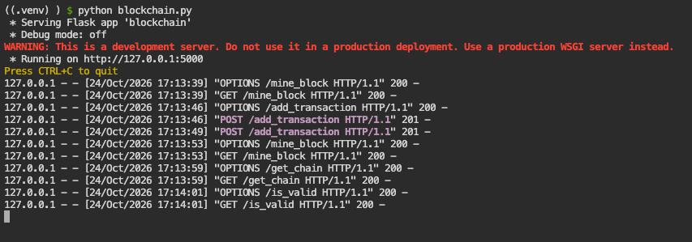
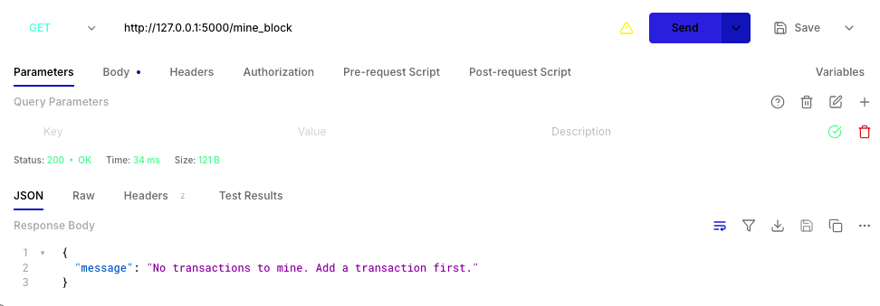
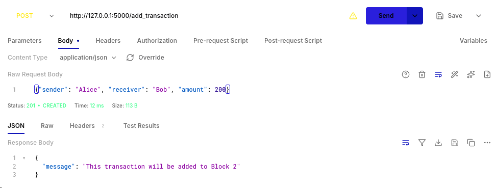
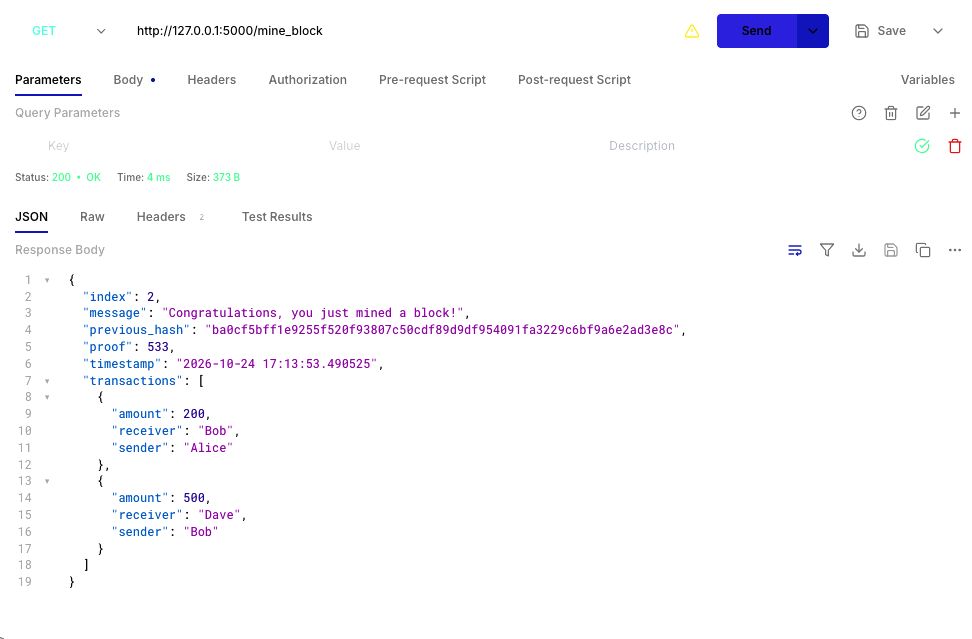
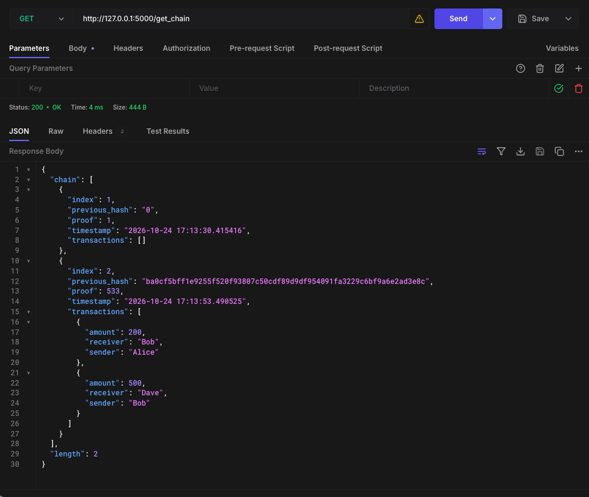
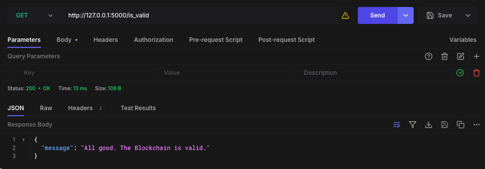

# Experiment 2

## Create a Blockchain using Python

## Aim

To create a Blockchain in Python with block creation, Proof-of-Work mining, chain validation and pending-transaction handling, and to demonstrate it through a Flask HTTP API driven by an API client.

## Tasks Performed

1. Took the base `blockchain.py` module (blocks, Proof-of-Work, chain validation and the Flask API) and fixed it to run.
2. Added the method `create_Transactions`, which queues a transaction in the pending list.
3. Made `/mine_block` mine only when the transaction list is not empty.
4. Removed the transactions from the pending list once they go into a block (inside `create_block`), so they cannot be mined twice.
5. Changed `proof_of_work()` to search for the golden nonce for the puzzle "`000` leading zeros in the block hash".
6. Ran the server with Flask and exercised every route from an API client: mine with nothing pending, add two transactions, mine, fetch the chain and check validity.

## Theory

A blockchain is a distributed, append-only ledger made of blocks linked by hash: each block stores an index, a timestamp, a Proof-of-Work value, the hash of the previous block, and the transactions it contains. Linking blocks by the previous block's hash makes the chain tamper-evident, because changing any old block changes its hash and breaks every `previous_hash` after it.

**Proof-of-Work** is the puzzle a miner must solve to add a block: find a number `new_proof` such that SHA-256 of `new_proof² − previous_proof²` starts with `000`. Finding it takes many attempts (the golden nonce), but checking it takes one hash. **Mining** is this search plus appending the block. **Validity** is checked by `is_chain_valid()`, which walks the chain and verifies that each block's `previous_hash` equals the hash of the block before it and that each block's proof satisfies the puzzle.

The Flask routes expose this over HTTP: `/add_transaction` (POST), `/mine_block`, `/get_chain` and `/is_valid` (GET).

**Tools used:** Python 3.12, `hashlib`, `datetime`, `json`, Flask 3.1, and the Hoppscotch web client (hoppscotch.io) as the API client in place of the Postman desktop app; both send the same HTTP requests. The server adds an `Access-Control-Allow-Origin` response header so that a browser-based client may call it.

## Program

`blockchain.py`, with the changes from Tasks 2 to 5:

::: code2
```python
# Module 1 - Create a Blockchain (Lab 2), with the changes asked in the task sheet:
#   * create_Transactions() method          * mine only when the transaction list is not empty
#   * transactions removed from the list    * proof_of_work() searches for a golden nonce with "000"
import datetime
import hashlib
import json
from flask import Flask, jsonify, request


class Blockchain:
    def __init__(self):
        self.chain = []
        self.transactions = []
        self.create_block(proof=1, previous_hash='0')

    def create_block(self, proof, previous_hash):
        block = {'index': len(self.chain) + 1,
                 'timestamp': str(datetime.datetime.now()),
                 'proof': proof,
                 'previous_hash': previous_hash,
                 'transactions': self.transactions}
        self.transactions = []          # removed from the pending list once they are in a block
        self.chain.append(block)
        return block

    def create_Transactions(self, sender, receiver, amount):
        self.transactions.append({'sender': sender, 'receiver': receiver, 'amount': amount})
        return self.get_previous_block()['index'] + 1

    def get_previous_block(self):
        return self.chain[-1]

    def proof_of_work(self, previous_proof):
        new_proof = 1
        check_proof = False
        while check_proof is False:
            hash_operation = hashlib.sha256(str(new_proof**2 - previous_proof**2).encode()).hexdigest()
            if hash_operation[:3] == '000':     # cryptographic puzzle: "000" leading zeros
                check_proof = True
            else:
                new_proof += 1
        return new_proof

    def hash(self, block):
        return hashlib.sha256(json.dumps(block, sort_keys=True).encode()).hexdigest()

    def is_chain_valid(self, chain):
        previous_block = chain[0]
        block_index = 1
        while block_index < len(chain):
            block = chain[block_index]
            if block['previous_hash'] != self.hash(previous_block):
                return False
            hash_operation = hashlib.sha256(
                str(block['proof']**2 - previous_block['proof']**2).encode()).hexdigest()
            if hash_operation[:3] != '000':
                return False
            previous_block = block
            block_index += 1
        return True


app = Flask(__name__)
blockchain = Blockchain()


@app.after_request
def allow_browser_clients(response):       # lets a browser-based API client call this server
    response.headers['Access-Control-Allow-Origin'] = '*'
    response.headers['Access-Control-Allow-Headers'] = 'Content-Type'
    response.headers['Access-Control-Allow-Private-Network'] = 'true'
    return response


@app.route('/add_transaction', methods=['POST'])
def add_transaction():
    data = request.get_json()
    if not all(k in data for k in ('sender', 'receiver', 'amount')):
        return 'Some elements of the transaction are missing', 400
    index = blockchain.create_Transactions(data['sender'], data['receiver'], data['amount'])
    return jsonify({'message': f'This transaction will be added to Block {index}'}), 201


@app.route('/mine_block', methods=['GET'])
def mine_block():
    if not blockchain.transactions:          # mine only when the transaction list is not empty
        return jsonify({'message': 'No transactions to mine. Add a transaction first.'}), 200
    previous_block = blockchain.get_previous_block()
    proof = blockchain.proof_of_work(previous_block['proof'])
    block = blockchain.create_block(proof, blockchain.hash(previous_block))
    return jsonify({'message': 'Congratulations, you just mined a block!', **block}), 200


@app.route('/get_chain', methods=['GET'])
def get_chain():
    return jsonify({'chain': blockchain.chain, 'length': len(blockchain.chain)}), 200


@app.route('/is_valid', methods=['GET'])
def is_valid():
    if blockchain.is_chain_valid(blockchain.chain):
        return jsonify({'message': 'All good. The Blockchain is valid.'}), 200
    return jsonify({'message': 'Houston, we have a problem. The Blockchain is not valid.'}), 200


app.run(host='127.0.0.1', port=5000)
```
:::

## Output

The server was started in a terminal with `python blockchain.py`. Its log (below) lists every request the client sent, in order.


*The Flask server on `http://127.0.0.1:5000`. Each `OPTIONS` line is the browser's preflight for the client's request, followed by the request itself.*


*Task 3: mining with an empty transaction list is refused: "No transactions to mine. Add a transaction first."*


*Task 2: `create_Transactions` queues the first transaction (status 201), to be added to Block 2.*


*A second transaction is queued for the same block.*


*Tasks 3 to 5: with two transactions pending, the block is mined. The golden nonce for `000` is `proof` 533, and both transactions are sealed into block 2.*


*The chain has length 2: the genesis block with no transactions, and block 2 holding both transactions. The pending list was cleared when block 2 was created (Task 4).*


*`is_chain_valid` confirms the chain: "All good. The Blockchain is valid."*

## Conclusion

This experiment built a working Blockchain in Python and served it over HTTP with Flask. Tightening the Proof-of-Work puzzle to `000` leading zeros gave a golden nonce of 533 for block 2, far fewer attempts than the 4-zero puzzle in Experiment 1 (53,370). Refusing to mine an empty transaction list stops wasted mining, and clearing the pending list inside `create_block` stops the same transactions being mined twice. The API client showed this end to end: mining was refused with nothing pending, two queued transactions were sealed into block 2, and `/is_valid` confirmed that the chain was intact.
