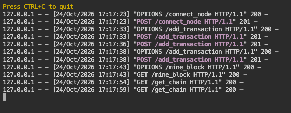
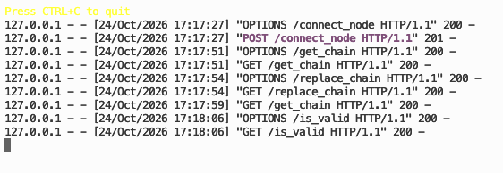
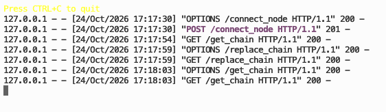
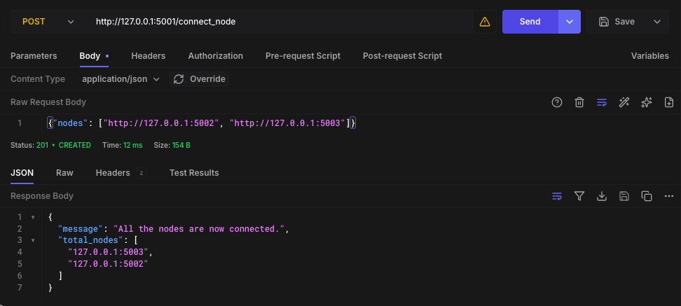
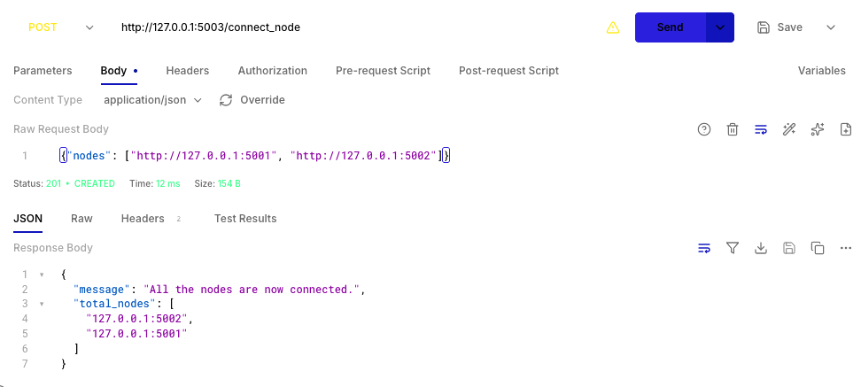
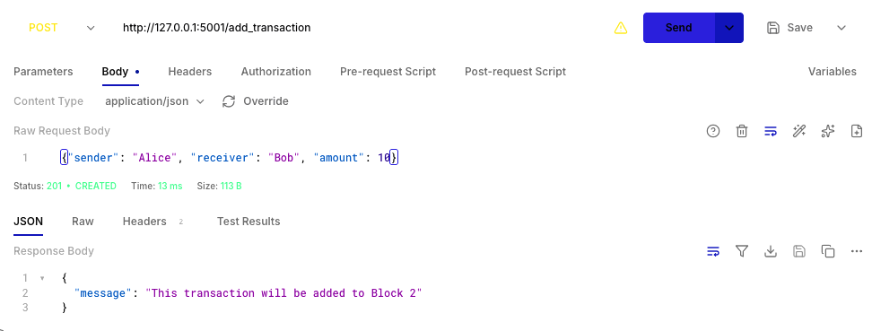
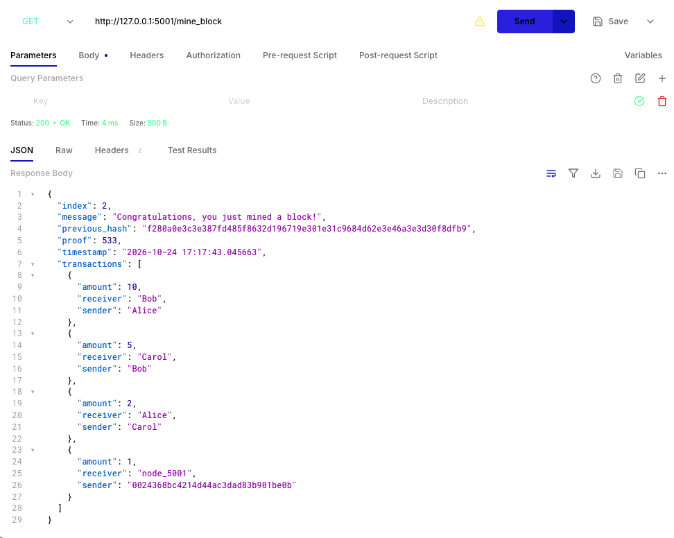
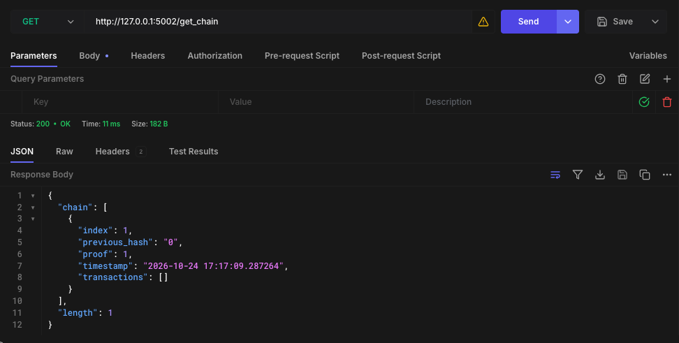
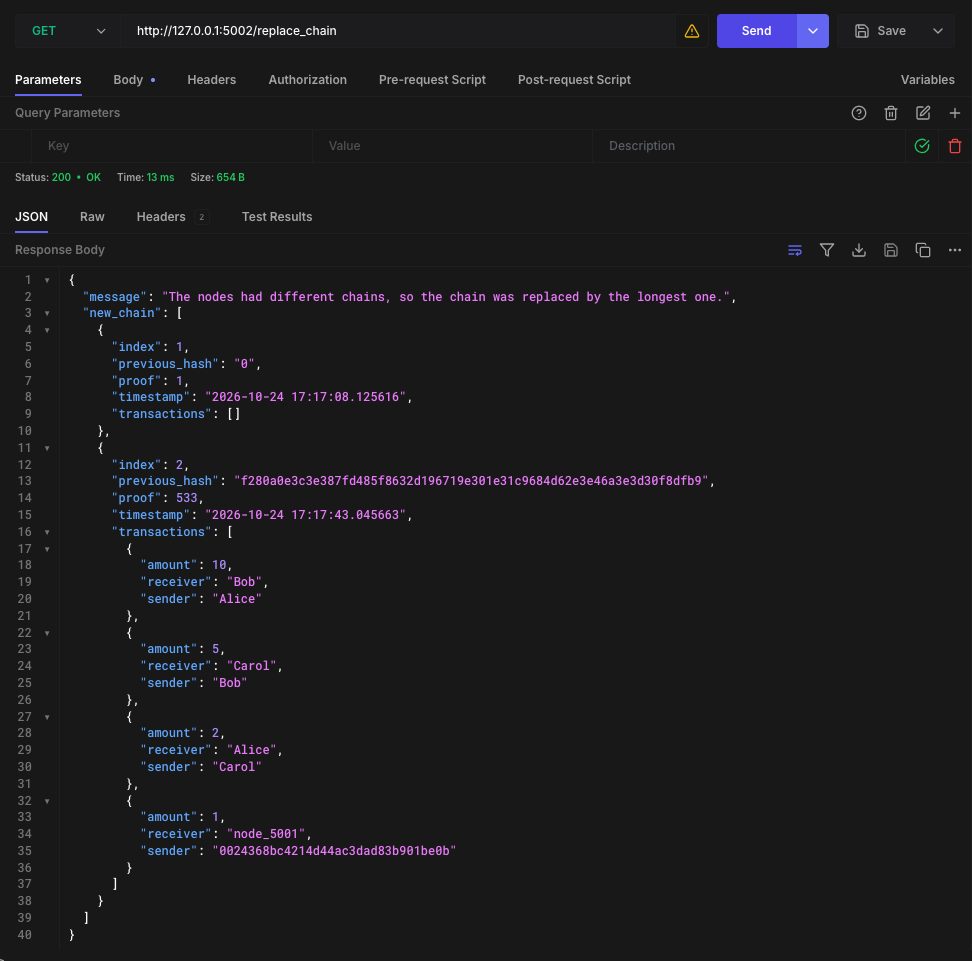
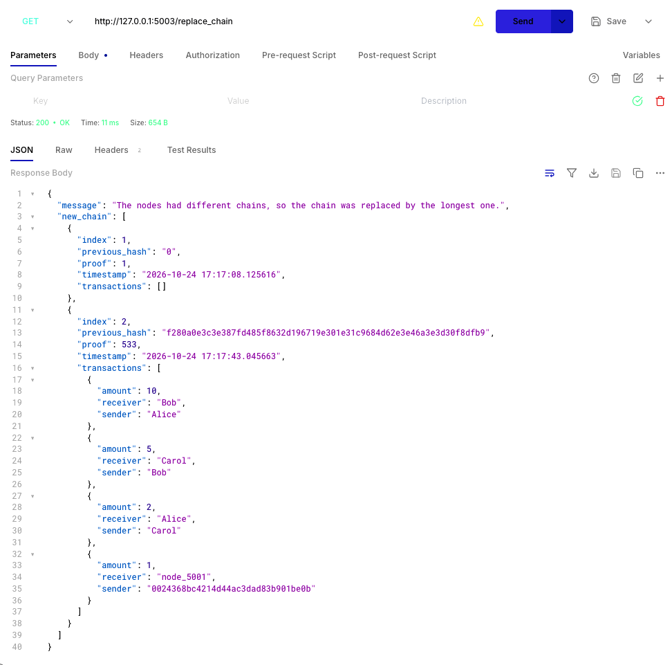

# Experiment 3

## Create a Cryptocurrency using Python and perform mining in the Blockchain created

## Aim

To create a peer-to-peer cryptocurrency ("Hadcoin") in Python and demonstrate transactions, mining and the longest-chain consensus across a network of three nodes.

## Tasks Performed

1. Took the Lab 3 code (`hadcoin_node_5001.py`, `hadcoin_node_5002.py`, `hadcoin_node_5003.py`) and installed `requests` in the virtual environment from Lab 2.
2. Ran the three node files in three different terminals (ports 5001, 5002, 5003).
3. From an API client, called `connect_node()` as a POST request on each node, passing the other two nodes as peers.
4. Added transactions with `add_transaction()` (POST), mined a block with `mine_block()`, fetched the chain with `get_chain()`, and brought the other nodes up to date with `replace_chain()`.
5. Made sure that transactions are removed from the pending list once they are added to a block (`create_block` resets `self.transactions`).

## Theory

A real cryptocurrency network is many independent nodes, each with its own copy of the chain and its own pool of pending transactions, talking over HTTP. Here three Flask nodes run the same `Blockchain` class on ports 5001, 5002 and 5003, and each has a random UUID `node_address` that identifies it as a miner.

- **Peers and P2P challenges.** `connect_node` registers other nodes (`urlparse` reduces a URL to `host:port`, stored in a set so a peer is never added twice). Nodes may be slow, offline, or hold different chains, and nothing is shared unless they ask each other.
- **Transactions and the mempool.** `add_transaction` puts a transaction in the node's pending list (its mempool) until a miner includes it in a block. Once a block is created the list is emptied, so a transaction is never mined twice.
- **Mining.** `mine_block` solves the Proof-of-Work puzzle (four leading zeros), adds a reward transaction of 1 Hadcoin to the miner's own address, and seals all pending transactions into the new block.
- **Consensus.** `replace_chain` asks every peer for its chain and adopts the longest one that is valid (the longest-chain rule), so the nodes converge on one history without a central coordinator.

**Tools used:** Python 3.12, Flask 3.1, `requests` 2.34, `hashlib`, `uuid4`, `urlparse`, and the Hoppscotch web client (hoppscotch.io) as the API client in place of the Postman desktop app; both send the same HTTP requests. The nodes add an `Access-Control-Allow-Origin` response header so that a browser-based client may call them.

## Program

`hadcoin_node_5001.py`. The files for ports 5002 and 5003 are identical except for the port in `app.run(...)` and the name used as the reward receiver.

::: code2
```python
# Module 2 - Create a Cryptocurrency (Hadcoin), node on port 5001  (Lab 3)
# Change asked in the task sheet: transactions are removed from the pending list once they are added to a block.
import datetime
import hashlib
import json
from uuid import uuid4
from urllib.parse import urlparse
import requests
from flask import Flask, jsonify, request


class Blockchain:
    def __init__(self):
        self.chain = []
        self.transactions = []
        self.nodes = set()
        self.create_block(proof=1, previous_hash='0')

    def create_block(self, proof, previous_hash):
        block = {'index': len(self.chain) + 1,
                 'timestamp': str(datetime.datetime.now()),
                 'proof': proof,
                 'previous_hash': previous_hash,
                 'transactions': self.transactions}
        self.transactions = []          # removed from the pending list once they are in a block
        self.chain.append(block)
        return block

    def get_previous_block(self):
        return self.chain[-1]

    def proof_of_work(self, previous_proof):
        new_proof = 1
        check_proof = False
        while check_proof is False:
            hash_operation = hashlib.sha256(str(new_proof**2 - previous_proof**2).encode()).hexdigest()
            if hash_operation[:4] == '0000':
                check_proof = True
            else:
                new_proof += 1
        return new_proof

    def hash(self, block):
        return hashlib.sha256(json.dumps(block, sort_keys=True).encode()).hexdigest()

    def is_chain_valid(self, chain):
        previous_block = chain[0]
        block_index = 1
        while block_index < len(chain):
            block = chain[block_index]
            if block['previous_hash'] != self.hash(previous_block):
                return False
            hash_operation = hashlib.sha256(
                str(block['proof']**2 - previous_block['proof']**2).encode()).hexdigest()
            if hash_operation[:4] != '0000':
                return False
            previous_block = block
            block_index += 1
        return True

    def add_transaction(self, sender, receiver, amount):
        self.transactions.append({'sender': sender, 'receiver': receiver, 'amount': amount})
        return self.get_previous_block()['index'] + 1

    def add_node(self, address):
        self.nodes.add(urlparse(address).netloc)

    def replace_chain(self):
        longest_chain = None
        max_length = len(self.chain)
        for node in self.nodes:
            response = requests.get(f'http://{node}/get_chain')
            if response.status_code == 200:
                length = response.json()['length']
                chain = response.json()['chain']
                if length > max_length and self.is_chain_valid(chain):
                    max_length = length
                    longest_chain = chain
        if longest_chain:
            self.chain = longest_chain
            return True
        return False


app = Flask(__name__)
node_address = str(uuid4()).replace('-', '')     # address of this node, used for its mining reward
blockchain = Blockchain()


@app.after_request
def allow_browser_clients(response):       # lets a browser-based API client call this server
    response.headers['Access-Control-Allow-Origin'] = '*'
    response.headers['Access-Control-Allow-Headers'] = 'Content-Type'
    response.headers['Access-Control-Allow-Private-Network'] = 'true'
    return response


@app.route('/mine_block', methods=['GET'])
def mine_block():
    previous_block = blockchain.get_previous_block()
    proof = blockchain.proof_of_work(previous_block['proof'])
    blockchain.add_transaction(sender=node_address, receiver='node_5001', amount=1)    # mining reward
    block = blockchain.create_block(proof, blockchain.hash(previous_block))
    return jsonify({'message': 'Congratulations, you just mined a block!', **block}), 200


@app.route('/get_chain', methods=['GET'])
def get_chain():
    return jsonify({'chain': blockchain.chain, 'length': len(blockchain.chain)}), 200


@app.route('/is_valid', methods=['GET'])
def is_valid():
    ok = blockchain.is_chain_valid(blockchain.chain)
    return jsonify({'message': 'All good. The Blockchain is valid.' if ok else 'The Blockchain is not valid.'}), 200


@app.route('/add_transaction', methods=['POST'])
def add_transaction():
    data = request.get_json()
    if not all(k in data for k in ('sender', 'receiver', 'amount')):
        return 'Some elements of the transaction are missing', 400
    index = blockchain.add_transaction(data['sender'], data['receiver'], data['amount'])
    return jsonify({'message': f'This transaction will be added to Block {index}'}), 201


@app.route('/connect_node', methods=['POST'])
def connect_node():
    nodes = request.get_json().get('nodes')
    if nodes is None:
        return 'No node', 400
    for node in nodes:
        blockchain.add_node(node)
    return jsonify({'message': 'All the nodes are now connected.',
                    'total_nodes': list(blockchain.nodes)}), 201


@app.route('/replace_chain', methods=['GET'])
def replace_chain():
    if blockchain.replace_chain():
        return jsonify({'message': 'The nodes had different chains, so the chain was replaced by the longest one.',
                        'new_chain': blockchain.chain}), 200
    return jsonify({'message': 'All good. The chain is the largest one.', 'actual_chain': blockchain.chain}), 200


app.run(host='127.0.0.1', port=5001)
```
:::

## Output

Each node ran in its own terminal. Their logs, shown after the whole run, list the requests each node received.

::: shots

*Node 5001 (`python hadcoin_node_5001.py`): receives `connect_node`, three `add_transaction` calls, `mine_block` and `get_chain`.*


*Node 5002: `connect_node`, `get_chain` and `replace_chain`.*


*Node 5003: `connect_node` and `replace_chain`.*
:::

### Connecting the nodes (Task 3)


*Node 5001 is given 5002 and 5003 as peers (status 201).*


*Node 5002 is given 5001 and 5003 as peers.*


*Node 5003 is given 5001 and 5002 as peers.*

### Transactions and mining (Task 4)


*A transaction is queued on node 5001 (status 201). Three transactions were queued on 5001 in total (Alice to Bob 10, Bob to Carol 5, Carol to Alice 2); the other two use the same request.*


*Node 5001 mines block 2. The block holds the three queued transactions plus the 1 Hadcoin mining reward paid to the node's address, and the pending list is now empty (Task 5).*


*Only node 5001 mined, so node 5002 still has a chain of length 1 (the genesis block).*

### Consensus with replace_chain (Task 4)


*Node 5002 asks its peers for their chains, finds 5001's longer valid chain and adopts it: "The nodes had different chains, so the chain was replaced by the longest one."*


*Node 5003 does the same, so all three nodes now hold the same two-block chain.*

## Conclusion

This experiment ran a three-node Hadcoin network with each node in its own terminal and an API client sending the requests. Mining on node 5001 alone put it ahead (chain length 2 against 1), which is the situation a P2P network has to resolve. Calling `replace_chain` on the other two nodes made each fetch its peers' chains, validate the longest and adopt it, so all nodes agreed without any central coordinator. The mined block held the three queued transactions and the miner's reward, and the pending list was emptied when the block was created, so no transaction could be mined twice.
