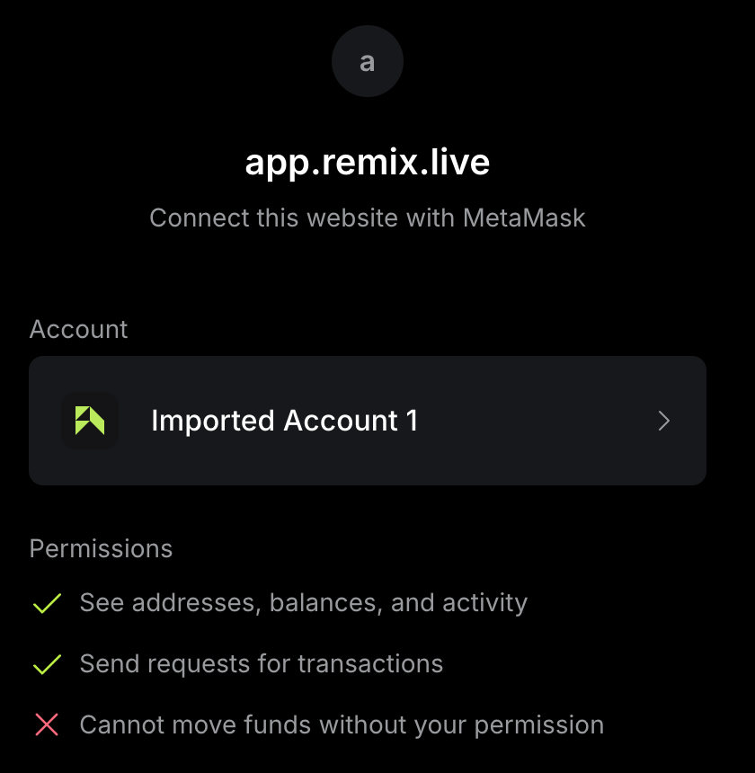
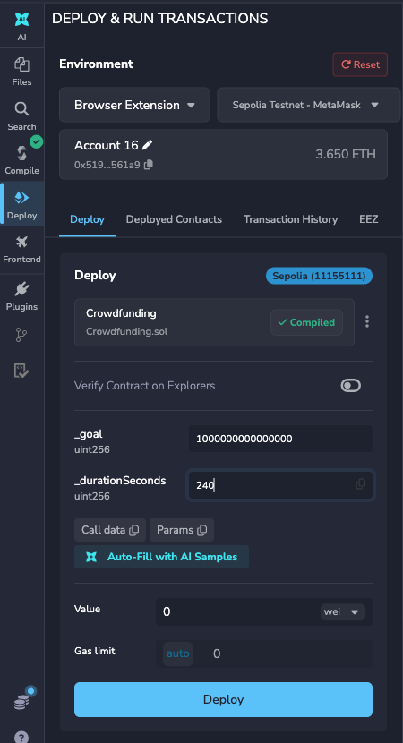
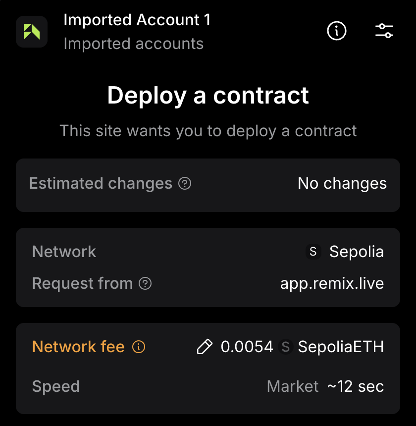
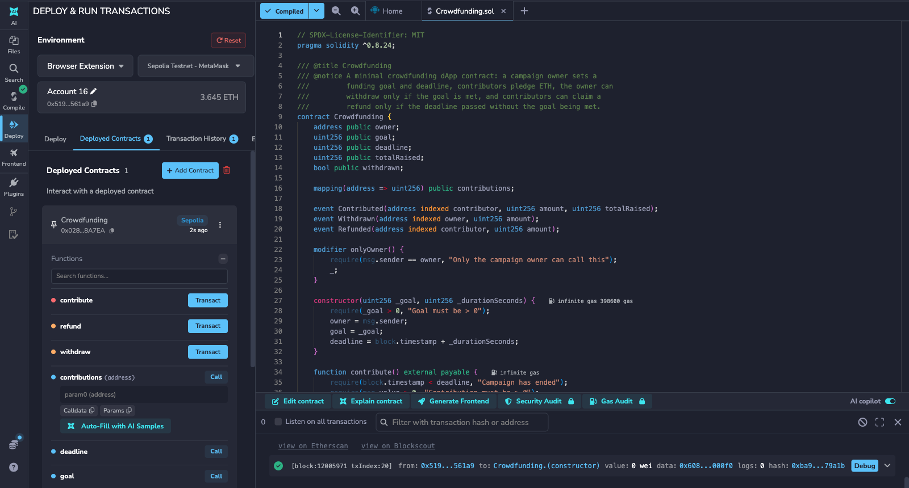
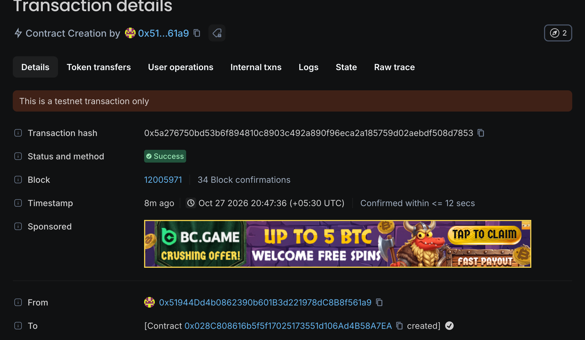
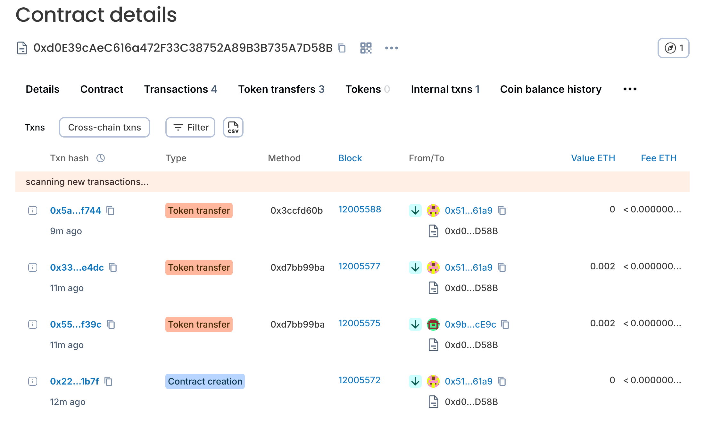
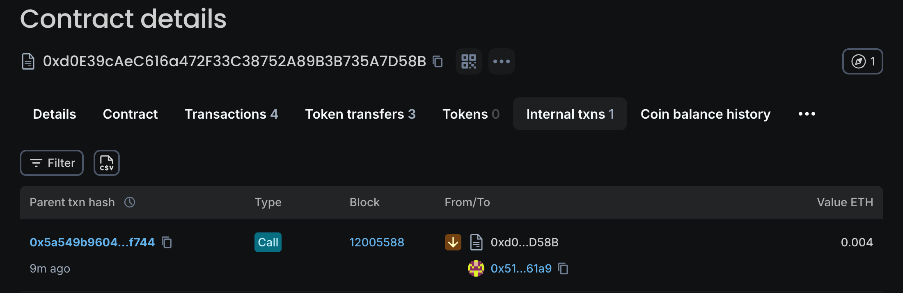
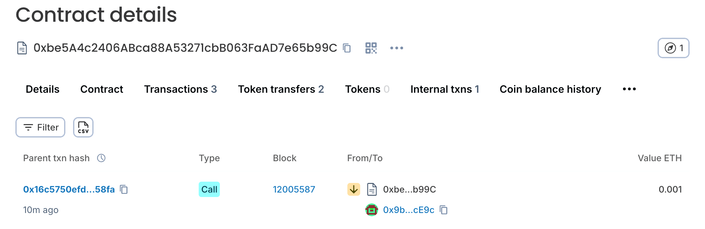

# Experiment 4

## Develop a blockchain-powered web application using Solidity and Remix IDE

## Aim

To develop a blockchain-powered application using the Solidity programming language in the Remix IDE with a MetaMask wallet, and deploy a Crowdfunding smart contract mini-project on the **Sepolia public testnet**: a campaign owner sets a funding goal and deadline, contributors pledge ETH, the owner can withdraw only if the goal is reached, and contributors can reclaim their funds if it is not.

## Tasks Performed

1. **Set up MetaMask:** installed the MetaMask extension, created and imported accounts, and funded the owner account with Sepolia test ETH (3.67 ETH from a faucet).
2. **Connected the Sepolia testnet to Remix:** in *Deploy & Run Transactions* the environment was set to *Browser Extension* with *Sepolia Testnet - MetaMask*, and the connection was approved in MetaMask.
3. **Created the mini-project contract:** `Crowdfunding.sol` (goal, deadline, `contribute`, `withdraw`, `refund`) and compiled it with Solidity 0.8.34.
4. **Deployed to Sepolia:** from Remix through MetaMask (Campaign C, goal 0.001 ETH, 240 s), and two further campaigns, A (goal 0.003 ETH, 150 s) and B (goal 1 ETH, 120 s), through the owner account.
5. **Interacted with the contracts on Sepolia:** transferred 0.02 ETH between accounts, contributed from a second "donor" account, waited for the deadlines, then withdrew the funds of A (goal reached) and refunded the donor of B (goal missed). Negative tests were run for withdrawing too early and withdrawing with the goal missed.
6. **Checked the transactions on a block explorer:** the contract pages, internal transactions and deploy transaction on the Sepolia explorer (Blockscout).

## Theory

**MetaMask** is a browser-extension wallet that holds the private keys of Ethereum accounts, shows each transaction for approval and signs it. A **testnet** such as Sepolia is a public blockchain that works exactly like Ethereum but whose ETH is free (from faucets) and has no value, so contracts can be tested safely with real network behaviour: real block times, gas and a public explorer. To connect MetaMask to Remix, install MetaMask, pick the Sepolia network, fund the account from a faucet, set Remix's environment to *Browser Extension / MetaMask*, approve the connection request, then deploy and call functions; each one opens a MetaMask confirmation.

The contract models the funding lifecycle of a crowdfunding dApp. The **constructor** records the `goal` (wei) and `deadline = block.timestamp + duration`. **`contribute()`** is `payable` and adds `msg.value` to the caller's entry in `contributions` and to `totalRaised`. **`withdraw()`** is `onlyOwner` and only works after the deadline when `totalRaised >= goal`; it sends the whole balance to the owner once. **`refund()`** works after the deadline only when the goal was missed; the contributor's balance is zeroed before the ETH is sent (checks-effects-interactions).

**Tools used:** Remix IDE 2.6.8, Solidity 0.8.34, MetaMask 13.53, ethers.js v6 and Hardhat 2.x (for compiling the artifact), and the Sepolia block explorer (Blockscout).

Campaign C was deployed from Remix through MetaMask. Campaigns A and B, whose contributions, withdrawal and refund are timed against their deadlines, were run with an ethers.js script (below).

## Program

`Crowdfunding.sol`:

::: code2
```solidity
// SPDX-License-Identifier: MIT
pragma solidity ^0.8.24;

/// @title Crowdfunding
/// @notice A minimal crowdfunding dApp contract: a campaign owner sets a
///         funding goal and deadline, contributors pledge ETH, the owner can
///         withdraw only if the goal is met, and contributors can claim a
///         refund only if the deadline passed without the goal being met.
contract Crowdfunding {
    address public owner;
    uint256 public goal;
    uint256 public deadline;
    uint256 public totalRaised;
    bool public withdrawn;

    mapping(address => uint256) public contributions;

    event Contributed(address indexed contributor, uint256 amount, uint256 totalRaised);
    event Withdrawn(address indexed owner, uint256 amount);
    event Refunded(address indexed contributor, uint256 amount);

    modifier onlyOwner() {
        require(msg.sender == owner, "Only the campaign owner can call this");
        _;
    }

    constructor(uint256 _goal, uint256 _durationSeconds) {
        require(_goal > 0, "Goal must be > 0");
        owner = msg.sender;
        goal = _goal;
        deadline = block.timestamp + _durationSeconds;
    }

    function contribute() external payable {
        require(block.timestamp < deadline, "Campaign has ended");
        require(msg.value > 0, "Contribution must be > 0");

        contributions[msg.sender] += msg.value;
        totalRaised += msg.value;

        emit Contributed(msg.sender, msg.value, totalRaised);
    }

    function withdraw() external onlyOwner {
        require(block.timestamp >= deadline, "Campaign still active");
        require(totalRaised >= goal, "Funding goal not reached");
        require(!withdrawn, "Already withdrawn");

        withdrawn = true;
        uint256 amount = address(this).balance;
        (bool sent, ) = owner.call{value: amount}("");
        require(sent, "Transfer to owner failed");

        emit Withdrawn(owner, amount);
    }

    function refund() external {
        require(block.timestamp >= deadline, "Campaign still active");
        require(totalRaised < goal, "Funding goal was reached, no refunds");

        uint256 amount = contributions[msg.sender];
        require(amount > 0, "No contribution to refund");

        contributions[msg.sender] = 0;
        (bool sent, ) = msg.sender.call{value: amount}("");
        require(sent, "Refund transfer failed");

        emit Refunded(msg.sender, amount);
    }

    function timeLeft() external view returns (uint256) {
        if (block.timestamp >= deadline) return 0;
        return deadline - block.timestamp;
    }

    function goalReached() external view returns (bool) {
        return totalRaised >= goal;
    }
}
```
:::

`scripts/sepolia_crowdfunding.js` (deploys and exercises both campaigns on Sepolia):

::: code2
```javascript
// Run: node --env-file=../.env --env-file=<donor.env> scripts/sepolia_crowdfunding.js
// SEPOLIA_PRIVATE_KEY = funded owner account, DONOR_PRIVATE_KEY = second account (contributor).
const { ethers } = require("ethers");
const artifact = require("../artifacts/contracts/Crowdfunding.sol/Crowdfunding.json");

const RPC = "https://ethereum-sepolia-rpc.publicnode.com";
const provider = new ethers.JsonRpcProvider(RPC);
const owner = new ethers.Wallet(process.env.SEPOLIA_PRIVATE_KEY, provider);
const donor = new ethers.Wallet(process.env.DONOR_PRIVATE_KEY, provider);
const eth = (v) => ethers.formatEther(v);
const sleep = (s) => new Promise((r) => setTimeout(r, s * 1000));
const log = {};

async function send(label, txPromise) {
  const tx = await txPromise;
  const rc = await tx.wait();
  log[label] = rc.hash;
  console.log(`${label.padEnd(28)} ${rc.hash}  block ${rc.blockNumber}`);
  return rc;
}

async function deploy(label, goalEth, seconds) {
  const f = new ethers.ContractFactory(artifact.abi, artifact.bytecode, owner);
  const c = await f.deploy(ethers.parseEther(goalEth), seconds);
  const rc = await c.deploymentTransaction().wait();
  log[label] = rc.hash;
  const addr = await c.getAddress();
  log[label + "_address"] = addr;
  console.log(`${label.padEnd(28)} ${addr}  (goal ${goalEth} ETH, ${seconds}s)  tx ${rc.hash}`);
  return c;
}

async function main() {
  console.log("Network :", (await provider.getNetwork()).name, (await provider.getNetwork()).chainId);
  console.log("Owner   :", owner.address, eth(await provider.getBalance(owner.address)), "ETH");
  console.log("Donor   :", donor.address, eth(await provider.getBalance(donor.address)), "ETH");

  // 1. transfer between accounts: fund the donor
  await send("fund_donor", owner.sendTransaction({ to: donor.address, value: ethers.parseEther("0.02") }));

  // 2. two campaigns
  const A = await deploy("deploy_A", "0.003", 150); // goal reachable
  const B = await deploy("deploy_B", "1", 120); // goal unreachable
  log.deadlines = { A: Number(await A.deadline()), B: Number(await B.deadline()) };

  // 3. contributions
  await send("A_donor_contribute", A.connect(donor).contribute({ value: ethers.parseEther("0.002") }));
  await send("A_owner_contribute", A.connect(owner).contribute({ value: ethers.parseEther("0.002") }));
  await send("B_donor_contribute", B.connect(donor).contribute({ value: ethers.parseEther("0.001") }));
  console.log("A totalRaised:", eth(await A.totalRaised()), "goalReached:", await A.goalReached());
  console.log("B totalRaised:", eth(await B.totalRaised()), "goalReached:", await B.goalReached());

  // 4. negative test while the campaign is still active
  try { await A.connect(owner).withdraw.staticCall(); } catch (e) { console.log("withdraw before deadline ->", e.reason || e.shortMessage); }

  // 5. wait for deadline of A, then withdraw
  const waitFor = async (c) => {
    const left = Number(await c.timeLeft());
    if (left > 0) { console.log(`waiting ${left + 15}s ...`); await sleep(left + 15); }
  };
  await waitFor(B);
  try { await B.connect(owner).withdraw.staticCall(); } catch (e) { console.log("B withdraw (goal missed) ->", e.reason || e.shortMessage); }
  await send("B_donor_refund", B.connect(donor).refund());
  console.log("B donor contribution after refund:", eth(await B.contributions(donor.address)));

  await waitFor(A);
  const before = await provider.getBalance(owner.address);
  await send("A_owner_withdraw", A.connect(owner).withdraw());
  console.log("A contract balance after withdraw:", eth(await provider.getBalance(await A.getAddress())));
  console.log("A withdrawn flag:", await A.withdrawn());
  console.log(JSON.stringify(log, null, 2));
}

main().catch((e) => { console.error(e); process.exit(1); });
```
:::

## Output


*`Crowdfunding.sol` compiles with no errors in Remix.*

### MetaMask connected to Remix on Sepolia

::: shots

*MetaMask asks to connect the funded account to Remix.*


*Remix: Browser Extension, Sepolia (11155111), the account with 3.65 ETH, goal 0.001 ETH and 240 s.*


*MetaMask's "Deploy a contract" request on the Sepolia network, from app.remix.live.*
:::


*After confirming, Remix lists `Crowdfunding` (0x028C...A7EA) on Sepolia and the terminal logs the constructor transaction, mined in block 12005971.*


*The same transaction on the explorer: Contract Creation, status Success, from the owner account.*

### Full lifecycle on the Sepolia testnet (Campaigns A and B)

Output of `sepolia_crowdfunding.js` (chain ID 11155111; each transaction hash opens on the explorer):

```text
Network : sepolia 11155111n
Owner   : 0x51944Dd4b0862390b601B3d221978dC8B8f561a9 3.668990075471971624 ETH
Donor   : 0x9bC6F8fc5D3956d50964Fafe5D5C20F544EFcE9c 0.0 ETH
fund_donor                   0xc47584df7592e7c866840bb4c466ba8ee8aa2f1c74e357d27491d0ac3a55c893  block 12005570
deploy_A                     0xd0E39cAeC616a472F33C38752A89B3B735A7D58B  (goal 0.003 ETH, 150s)  tx 0x2254f7808f8fd771275f66a4f813b2f2cb079d935efcddfd4553468b001e1b7f
deploy_B                     0xbe5A4c2406ABca88A53271cbB063FaAD7e65b99C  (goal 1 ETH, 120s)  tx 0x79b2990aabb00777ff8d197cb9e8910da64dbe43e40ca4afd723b743f156ded8
A_donor_contribute           0x553dc5fd81498aa21705c98ea47008622cdf163f0826889d27407e742294f39c  block 12005575
A_owner_contribute           0x3391552fd54157030f699d7d81821cc0009e0b169a44ddcaebb628932546e4dc  block 12005577
B_donor_contribute           0x6a6d9b91267562e24f57f7bbb61410b574ec214ecb267de11f86b47901179b50  block 12005578
A totalRaised: 0.004 goalReached: true
B totalRaised: 0.001 goalReached: false
withdraw before deadline -> Campaign still active
waiting 87s ...
B withdraw (goal missed) -> Funding goal not reached
B_donor_refund               0x16c5750efd5666997a88898af30b5580ac7c68085d08da5d5a0586e7f1f758fa  block 12005587
B donor contribution after refund: 0.0
A_owner_withdraw             0x5a549b9604f489a259fe517618c98ca68738b9b8a6ca90f29860484f9f20f744  block 12005588
A contract balance after withdraw: 0.0
A withdrawn flag: true
```


*Campaign A (`0xd0E3...D58B`): the contract creation, the donor's and the owner's 0.002 ETH contributions, and the owner's `withdraw` call.*


*Internal transactions of Campaign A: the contract paid 0.004 ETH (the whole pot) to the owner when `withdraw()` ran after the deadline.*


*Campaign B (goal not reached): the contract paid 0.001 ETH back to the donor's account `0x9b...cE9c` through `refund()`.*

## Conclusion

A Crowdfunding smart contract was written, compiled in Remix and deployed to the public **Sepolia testnet**, and its full lifecycle was exercised on the live network. Campaign A reached its goal (0.004 ETH raised against 0.003 ETH) and the owner's `withdraw()` moved the whole balance out once the deadline passed; Campaign B missed its goal and the donor recovered the full 0.001 ETH through `refund()`. The negative tests reverted with the expected reasons ("Campaign still active" before the deadline, "Funding goal not reached" for a withdrawal when the goal was missed), and the explorer's internal transactions confirm that the funds moved as the contract states. MetaMask was embedded in the Remix workflow: the wallet approved the connection and signed the Sepolia deployment requested from Remix.
