# Experiment 4

## Develop a blockchain-powered web application using Solidity and Remix IDE

## Aim

To develop a blockchain-powered application using the Solidity programming language in the Remix IDE, and deploy a Crowdfunding smart contract mini-project: a campaign owner sets a funding goal and deadline, contributors pledge ETH, the owner can withdraw only if the goal is reached, and contributors can reclaim their funds if it is not.

## Theory

Remix IDE lets a developer compile a Solidity contract in the browser and deploy it to an execution environment of choice: an injected wallet such as MetaMask connected to a local blockchain or public testnet, or the *Remix VM*, an in-browser test blockchain with pre-funded accounts. This experiment documents the MetaMask connection and the whole crowdfunding flow driven through MetaMask on a local **Ganache** chain, plus the complete crowdfunding lifecycle tests on the **Remix VM**. In the lifecycle tests, a short script run from Remix's own terminal (using the built-in ethers.js library) plays the role of several wallet users by signing transactions from different Remix VM accounts.

With MetaMask, Remix requests access to selected wallet accounts and uses the **Browser Extension / MetaMask** environment to submit transaction requests. MetaMask shows the account, network, amount and estimated fee for approval, and only a confirmed request is signed and sent to the chain. The MetaMask screenshots show a funded account, a 1 ETH transfer between two accounts, the contract-deployment request, a 1.5 ETH `contribute()` request, and the owner's `withdraw()`.

The mini-project contract, `Crowdfunding.sol`, models the funding lifecycle of a typical crowdfunding dApp:

- The **constructor** takes a `goal` (in wei) and a `durationSeconds`, and records `deadline = block.timestamp + durationSeconds`.
- **`contribute()`** is `payable`; anyone can call it before the deadline, and each call adds `msg.value` to both a per-address `contributions` mapping and the running `totalRaised`.
- **`withdraw()`**, guarded by an `onlyOwner` modifier, only succeeds once the deadline has passed *and* `totalRaised >= goal`; it forwards the full contract balance to the owner and sets a `withdrawn` flag so it cannot be called twice.
- **`refund()`** is the mirror case: once the deadline has passed *without* the goal being met, each contributor can reclaim exactly what they put in; a contributor's balance is zeroed before the ETH transfer (checks-effects-interactions) to prevent re-entrancy, and a second call for the same address reverts with "No contribution to refund".

Because the deadline check depends on `block.timestamp`, the script creates each campaign with a short duration (40 to 60 seconds) and genuinely waits for the deadline to pass before calling `withdraw()` or `refund()`. The Remix VM stamps each block with the real clock, so no special time-travel tools are needed.

**Tools used:** Remix IDE (web, v2.6.8), Solidity compiler 0.8.34 (the contract declares `pragma solidity ^0.8.24`), the in-browser *Remix VM (Osaka)* test blockchain with its pre-funded accounts, and a JavaScript script run from Remix's terminal with the built-in ethers.js v6 runner.

**Wallet integration:** MetaMask 13.53 connected to a local Ganache chain (`ganache --server.port 7545 --chain.chainId 5777 --wallet.deterministic`, RPC `http://127.0.0.1:7545`), with Ganache accounts imported by private key as "DApp Owner" and "Donor". Remix IDE v2.6.8 uses its Browser Extension / MetaMask environment, with the compiler EVM version set to Shanghai (the newest fork Ganache supports). The chain is local, not a public testnet, so no faucet funds were used.

## Output

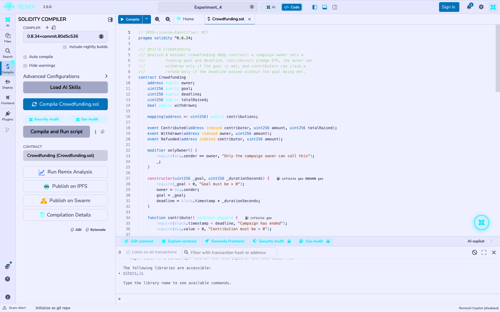
*`Crowdfunding.sol` compiles with no errors in Remix; the green tick on the Solidity Compiler icon confirms it.*

### MetaMask connection and transactions on Ganache

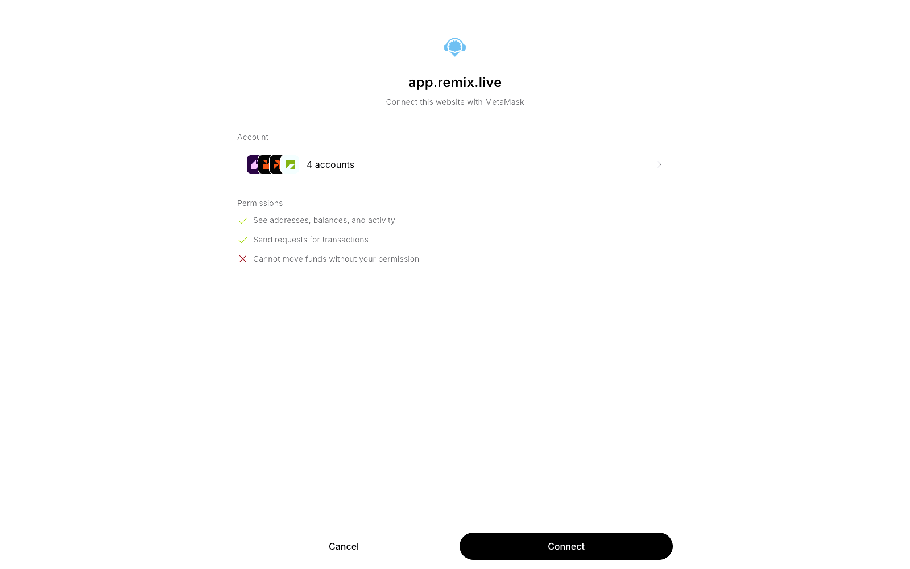
*Remix requests permission to connect selected MetaMask accounts. The permission screen lists access to addresses, balances and activity, and the ability to request transactions that require wallet approval.*

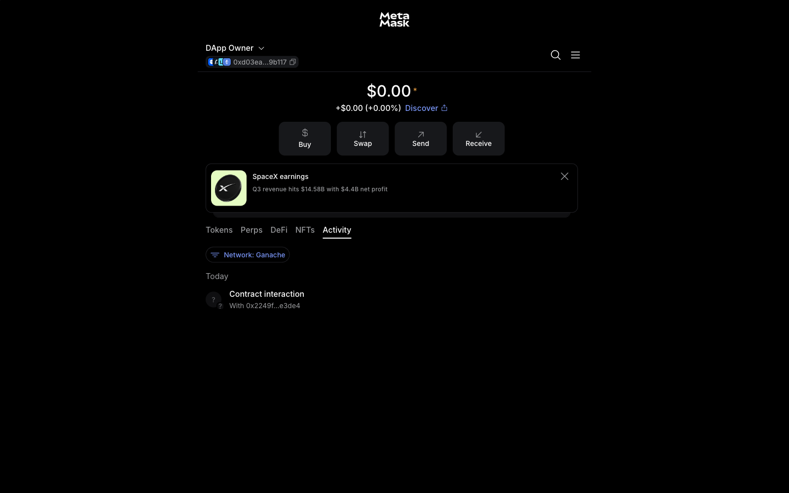
*The "DApp Owner" account on the Ganache network, with its Activity tab showing the earlier contract interaction.*

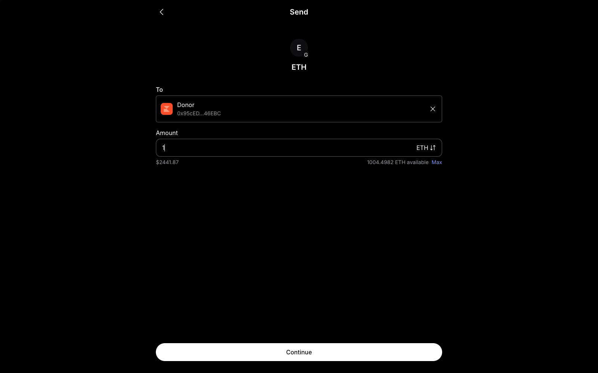
*Transferring ETH between accounts: the recipient is the "Donor" account and the amount is 1 ETH, with 1004.4982 ETH available.*

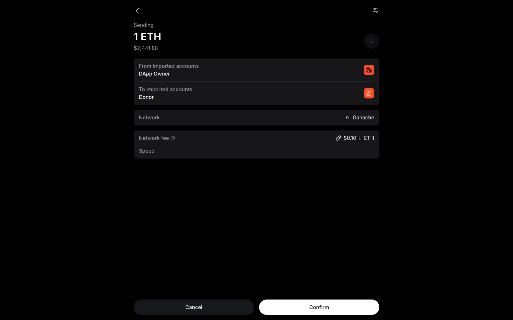
*The wallet shows the transfer from "DApp Owner" to "Donor" on the Ganache network with the network fee and the Confirm button.*

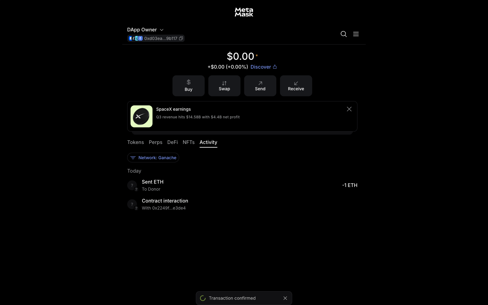
*After confirming, the Activity tab records "Sent ETH, To Donor, -1 ETH" and a "Transaction confirmed" notification.*

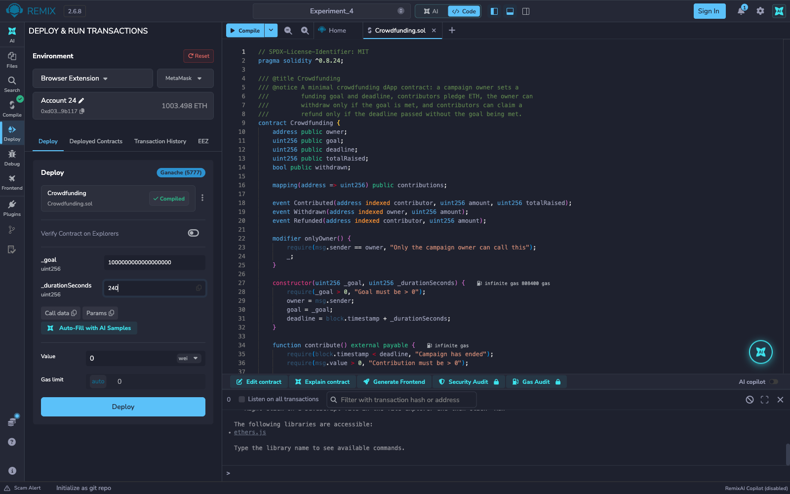
*Remix's Deploy & Run Transactions panel uses Browser Extension / MetaMask on "Ganache (5777)". The `Crowdfunding` constructor takes a goal of 1,000,000,000,000,000,000 wei (1 ETH) and a duration of 240 seconds.*

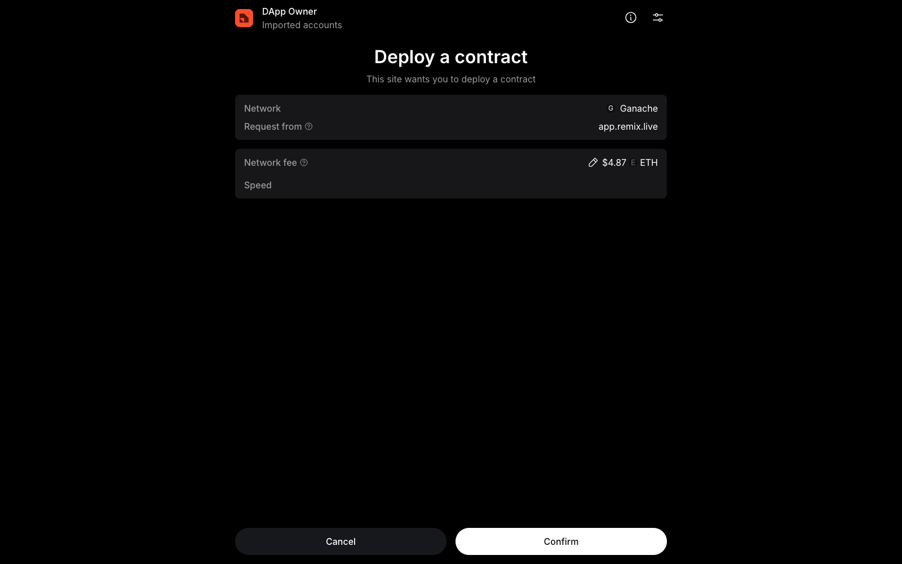
*MetaMask displays "Deploy a contract" for a request from app.remix.live on Ganache, signed by "DApp Owner", with the network fee and the Confirm button.*

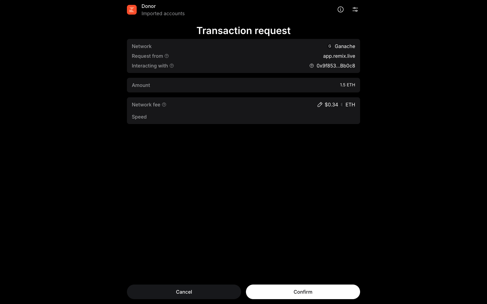
*After switching MetaMask to the "Donor" account and entering a Value of 1.5 ETH in Remix, `contribute()` shows a transaction request with the contract address and an **Amount of 1.5 ETH**.*

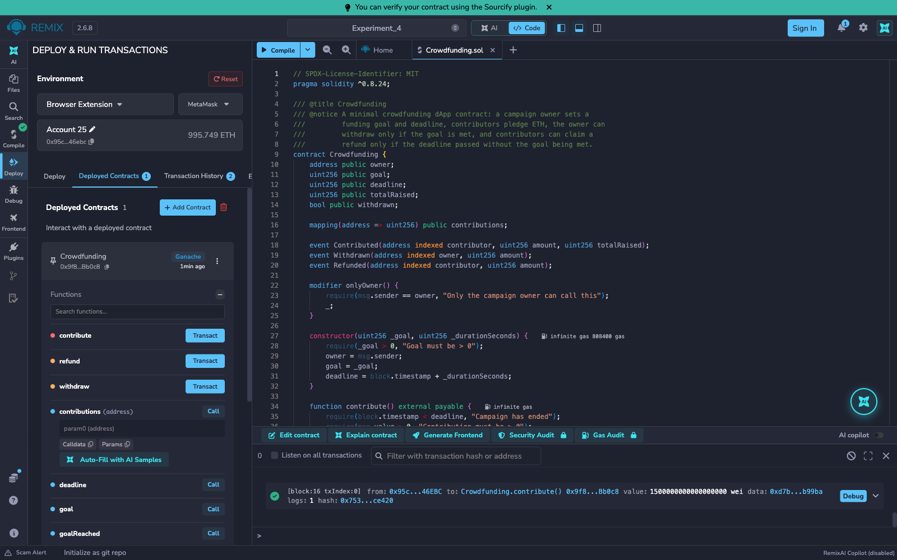
*The Remix terminal logs `Crowdfunding.contribute()` from the Donor account with a value of 1,500,000,000,000,000,000 wei, mined successfully (block 16).*

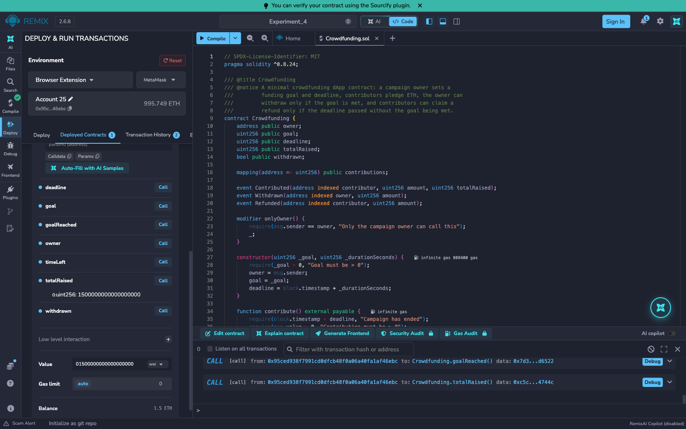
*Reading the contract from Remix: `totalRaised()` returns 1,500,000,000,000,000,000 wei and `goalReached()` returns true; the contract's balance shows 1.5 ETH.*

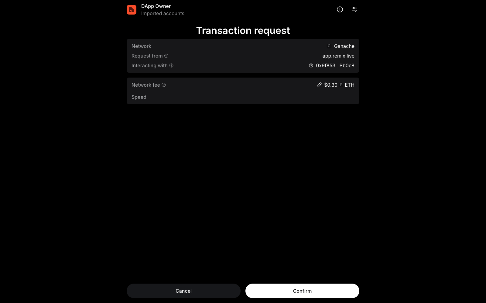
*Once the 240 second deadline has passed (`timeLeft()` returns 0), MetaMask shows the owner's `withdraw()` request from the "DApp Owner" account to the Crowdfunding contract.*

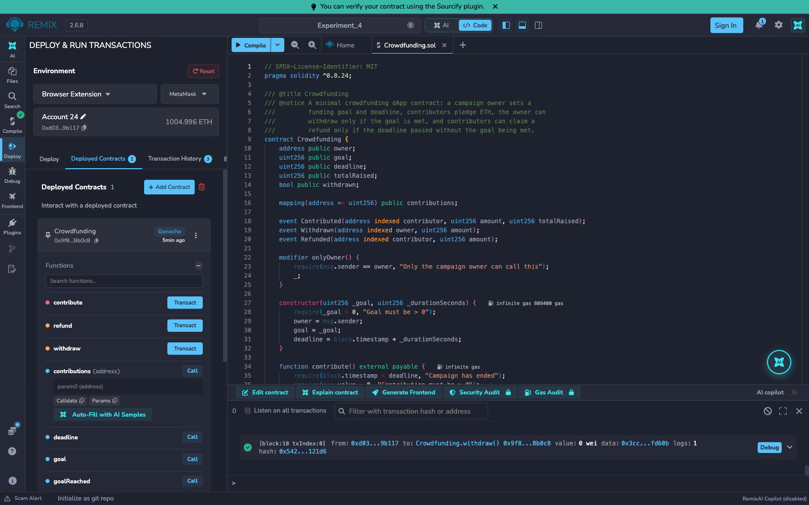
*`withdraw()` is mined in block 18 with value 0; the owner account in Remix rises from 1003.496 ETH to 1004.996 ETH, which is the 1.5 ETH raised, and the contract balance is empty.*

### Crowdfunding lifecycle tests on Remix VM

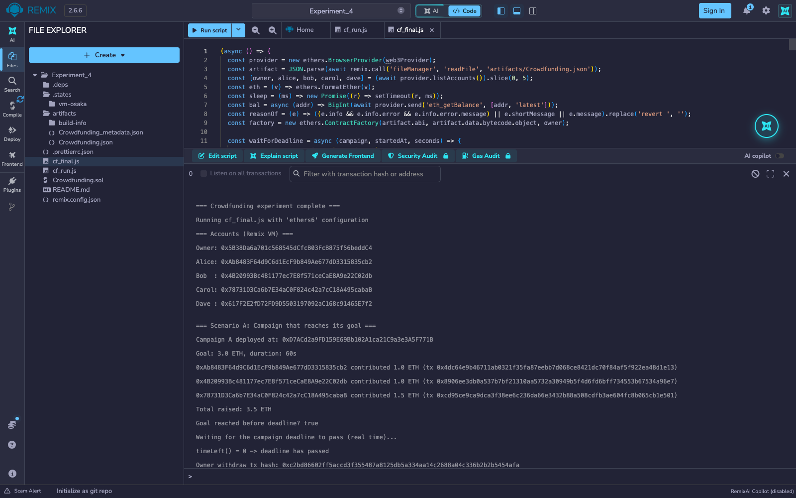
*The five Remix VM accounts, then Campaign A (goal 3 ETH, 60 s) deployed. Alice, Bob and Carol pledge 1.0, 1.0 and 1.5 ETH, so 3.5 ETH is raised against the 3 ETH goal while the campaign is still open.*

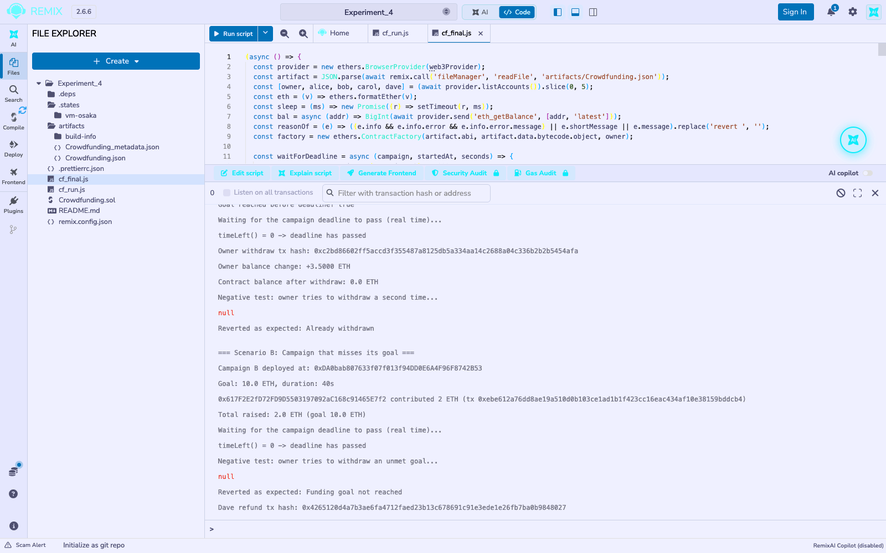
*After the deadline has passed in real time (`timeLeft() = 0`), the owner's `withdraw()` succeeds and the owner's balance rises by 3.5 ETH, leaving the contract empty. A second withdraw reverts with "Already withdrawn". Campaign B (goal 10 ETH) then receives only Dave's 2 ETH, and the owner's withdraw is rejected with "Funding goal not reached".*

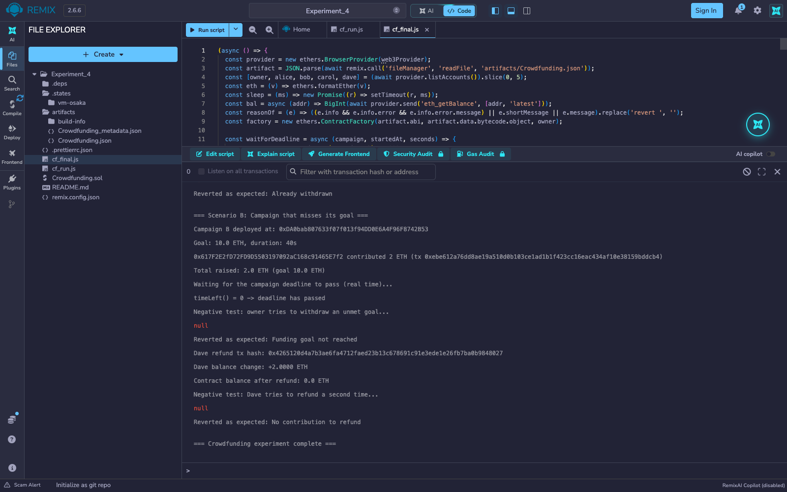
*Dave's `refund()` returns his full 2 ETH and empties the contract, and a repeat refund reverts with "No contribution to refund".*

## Conclusion

This experiment developed and deployed a Crowdfunding smart contract, a self-contained blockchain-powered application, in Remix IDE on the Remix VM. Two full campaign lifecycles were exercised end to end: a goal-reached campaign where three contributors' combined pledges exceeded the target and the owner withdrew the raised funds exactly once, and a goal-missed campaign where the sole contributor reclaimed their full pledge via `refund()` after the deadline passed. Every guard condition in the contract (`onlyOwner`, the deadline check, the goal-reached check, and the double-withdraw and double-refund protections) was confirmed by a negative test that reverted with the expected reason string, demonstrating the fund-safety guarantees of the contract. The MetaMask screenshots show the same contract driven through a real wallet on a Ganache chain: deployment, a 1.5 ETH pledge from a donor account that reached the goal, and the owner's withdrawal after the deadline, each approved on a MetaMask confirmation screen.
