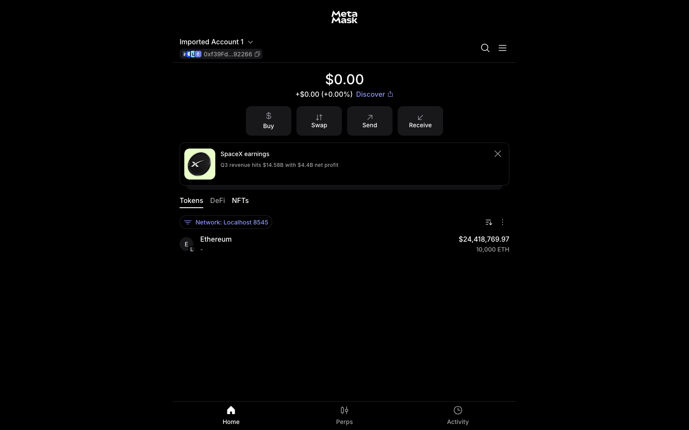
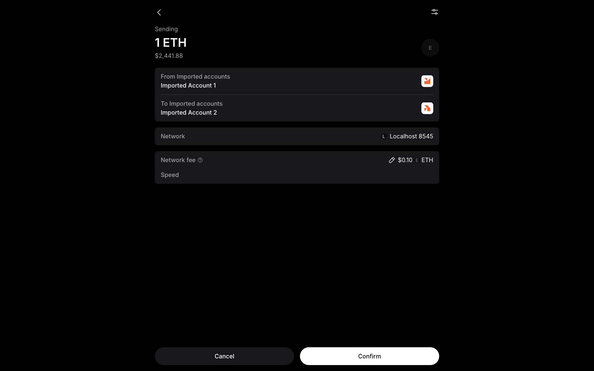
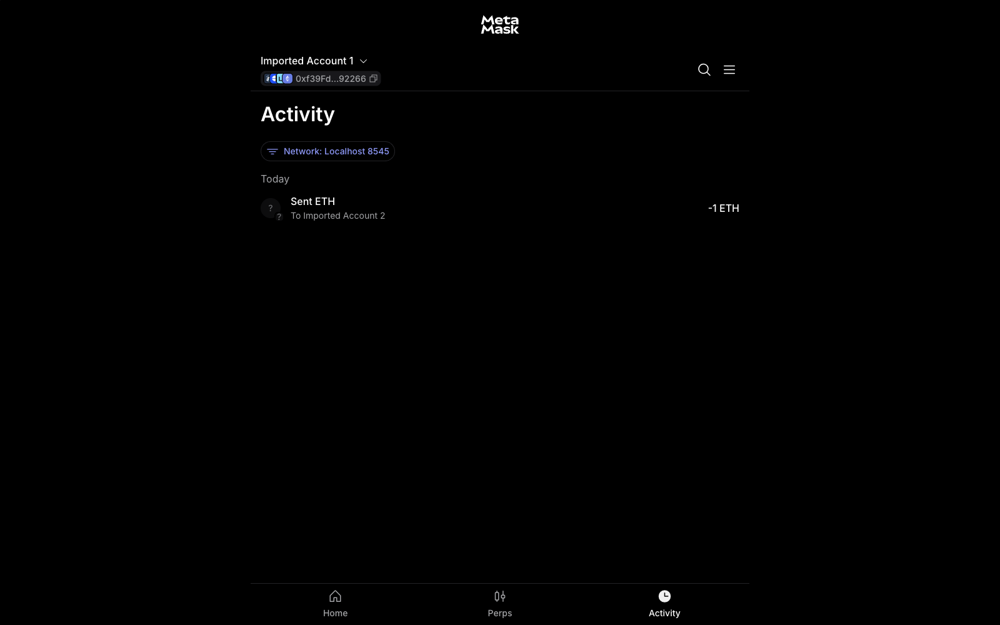
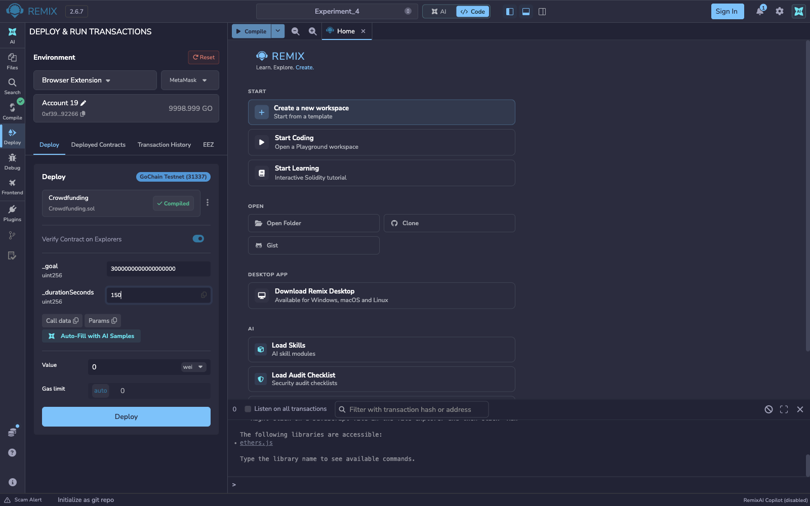
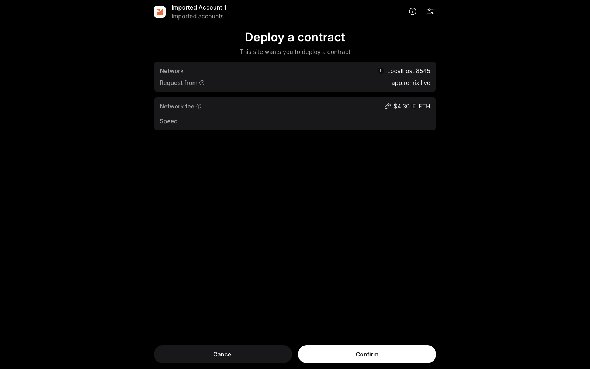

# Experiment 4

## Develop a blockchain-powered web application using Solidity and Remix IDE

## Aim

To develop a blockchain-powered application using the Solidity programming language in the Remix IDE, and deploy a Crowdfunding smart contract mini-project: a campaign owner sets a funding goal and deadline, contributors pledge ETH, the owner can withdraw only if the goal is reached, and contributors can reclaim their funds if it is not.

## Theory

Remix IDE lets a developer compile a Solidity contract in the browser and deploy it to an execution environment of choice: an injected wallet such as MetaMask connected to a local blockchain or public testnet, or the *Remix VM*, an in-browser test blockchain with pre-funded accounts. This experiment documents both the MetaMask connection and transaction-approval workflow on **Localhost 8545**, and the complete crowdfunding lifecycle tests on the **Remix VM**. In the lifecycle tests, a short script run from Remix's own terminal (using the built-in ethers.js library) plays the role of several wallet users by signing transactions from different Remix VM accounts.

With MetaMask, Remix requests access to selected wallet accounts and uses the **Browser Extension / MetaMask** environment to submit transaction requests. The wallet displays the account, network and estimated fee for approval. The screenshots show a funded local account, a 1 ETH transfer between imported accounts, and a contract-deployment confirmation request from Remix.

The mini-project contract, `Crowdfunding.sol`, models the funding lifecycle of a typical crowdfunding dApp:

- The **constructor** takes a `goal` (in wei) and a `durationSeconds`, and records `deadline = block.timestamp + durationSeconds`.
- **`contribute()`** is `payable`; anyone can call it before the deadline, and each call adds `msg.value` to both a per-address `contributions` mapping and the running `totalRaised`.
- **`withdraw()`**, guarded by an `onlyOwner` modifier, only succeeds once the deadline has passed *and* `totalRaised >= goal`; it forwards the full contract balance to the owner and sets a `withdrawn` flag so it cannot be called twice.
- **`refund()`** is the mirror case: once the deadline has passed *without* the goal being met, each contributor can reclaim exactly what they put in; a contributor's balance is zeroed before the ETH transfer (checks-effects-interactions) to prevent re-entrancy, and a second call for the same address reverts with "No contribution to refund".

Because the deadline check depends on `block.timestamp`, the script creates each campaign with a short duration (40 to 60 seconds) and genuinely waits for the deadline to pass before calling `withdraw()` or `refund()`. The Remix VM stamps each block with the real clock, so no special time-travel tools are needed.

**Tools used:** Remix IDE (web, v2.6.6), Solidity compiler 0.8.34 (the contract declares `pragma solidity ^0.8.24`), the in-browser *Remix VM (Osaka)* test blockchain with its pre-funded accounts, and a JavaScript script run from Remix's terminal with the built-in ethers.js v6 runner.

**Wallet integration:** MetaMask connected to Localhost 8545 with imported, funded accounts; the wallet screenshots use Remix IDE v2.6.7 and its Browser Extension / MetaMask environment.

## Output

*`Crowdfunding.sol` compiles with no errors in Remix; the green tick on the Solidity Compiler icon confirms it.*

### MetaMask connection and transaction approval

*Remix requests permission to connect four selected MetaMask accounts. The permission screen lists access to addresses, balances and activity, and the ability to request transactions that require wallet approval.*

*Imported Account 1 is selected on Localhost 8545 and shows a balance of 10,000 ETH for local testing.*

*The wallet presents a 1 ETH transfer from Imported Account 1 to Imported Account 2 on Localhost 8545, with the network fee and Confirm button visible.*

*The Activity tab records "Sent ETH" to Imported Account 2 with an amount of -1 ETH on the local network.*

*Remix's Deploy & Run Transactions panel uses Browser Extension / MetaMask with the connected account. The compiled Crowdfunding contract is selected with a goal of 3,000,000,000,000,000,000 wei (3 ETH) and a duration of 150 seconds.*

*MetaMask displays "Deploy a contract" for a request from app.remix.live on Localhost 8545, with the estimated network fee and Confirm button visible.*

### Crowdfunding lifecycle tests on Remix VM

*The five Remix VM accounts, then Campaign A (goal 3 ETH, 60 s) deployed. Alice, Bob and Carol pledge 1.0, 1.0 and 1.5 ETH, so 3.5 ETH is raised against the 3 ETH goal while the campaign is still open.*

*After the deadline has passed in real time (`timeLeft() = 0`), the owner's `withdraw()` succeeds and the owner's balance rises by 3.5 ETH, leaving the contract empty. A second withdraw reverts with "Already withdrawn". Campaign B (goal 10 ETH) then receives only Dave's 2 ETH, and the owner's withdraw is rejected with "Funding goal not reached".*

*Dave's `refund()` returns his full 2 ETH and empties the contract, and a repeat refund reverts with "No contribution to refund".*

## Conclusion

This experiment developed and deployed a Crowdfunding smart contract, a self-contained blockchain-powered application, in Remix IDE on the Remix VM. Two full campaign lifecycles were exercised end to end: a goal-reached campaign where three contributors' combined pledges exceeded the target and the owner withdrew the raised funds exactly once, and a goal-missed campaign where the sole contributor reclaimed their full pledge via `refund()` after the deadline passed. Every guard condition in the contract (`onlyOwner`, the deadline check, the goal-reached check, and the double-withdraw and double-refund protections) was confirmed by a negative test that reverted with the expected reason string, demonstrating the fund-safety guarantees of the contract. The additional MetaMask screenshots document the wallet connection to Remix, a local 1 ETH transfer, and the wallet's approval screen for a contract-deployment request.
