# Experiment 5

## Hands-on Solidity programming assignments for creating smart contracts

## Aim

To study the structure and basic constructs of Solidity programs, and to gain hands-on experience with writing, compiling and deploying smart contracts in Remix IDE, by completing the 19 assignments of the LearnEth "Solidity Basics" course and running a consolidated contract on the Remix VM.

## Tasks Performed

1. Opened the LearnEth tutorials in Remix IDE (`https://remix.ethereum.org/?#activate=udapp,solidity,LearnEth`).
2. Went through the Solidity Basics course ("Learneth Solidity Beginner Course"), which has 19 chapters.
3. Completed the assignments of all 19 chapters. Chapter 1 (Introduction) has no assignment, and each of the other 18 was checked with "Check Answer" until it returned "Well done! No errors."
4. Deployed a consolidated teaching contract (`SolidityBasics.sol`: data types, structs, mappings, events, modifiers, loops and function visibility) on the Remix VM and exercised it with transactions.

## Theory

The course covers the Solidity constructs below. Each is needed to write a smart contract, and each has an assignment in the Output.

- **Primitive data types, variables, `pure` and `view`.** `bool`, `uint`/`int`, `address`, `string` and `bytes` are the basic types. State variables are stored on the blockchain, local variables only live during the call, and global variables such as `msg.sender`, `msg.value` and `block.number` describe the call and the block. A `view` function only reads state, a `pure` function neither reads nor changes it.
- **Inputs and outputs.** Functions take parameters and can return several values, named or unnamed.
- **Visibility, modifiers and constructors.** `public`, `external`, `internal` and `private` control who can call a function or read a variable. A modifier (such as `onlyOwner`) wraps a function with a check, and the constructor runs once when the contract is deployed.
- **Control flow.** `if`/`else`, the ternary operator, and `for`, `while` and `do while` loops with `break` and `continue`.
- **Data structures.** Arrays, mappings (key to value), structs and enums.
- **Data locations.** `storage` is permanent contract state, `memory` is temporary data for one call, and `calldata` is read-only function input. Assigning between `storage` and `memory` copies the data, while a `storage` local variable is a reference.
- **Transactions.** Ether is counted in wei (1 gwei = 10^9 wei, 1 ether = 10^18 wei). A transaction pays gas (gas used times gas price) and fails if the gas limit is too low. Ether is sent with `transfer`, `send` or the recommended `call`, and a contract receives it through a `payable` function, `receive()` or `fallback()`.

**Tools used:** Remix IDE v2.6.8 with the LearnEth plugin, the Solidity compiler (0.8.3 for the assignments, 0.8.34 for the consolidated contract), the in-browser Remix VM, and a JavaScript script run in Remix's terminal with the built-in ethers.js v6 runner.

## Program

The code added to the starting contract of each assignment (the rest of each file is the tutorial's own code):

::: code2
```solidity
// 2. Basic Syntax
contract MyContract { string public name = "Alice"; }

// 3. Primitive Data Types
address public newAddr = 0x5B38Da6a701c568545dCfcB03FcB875f56beddC4;
int8 public neg = -5;
uint8 public newU = 0;

// 4. Variables
uint public blockNumber;                 // in doSomething():
blockNumber = block.number;

// 5.1 Reading and Writing a State Variable
bool public b = true;
function get_b() public view returns (bool) { return b; }

// 5.2 View and Pure
function addToX2(uint y) public { x = x + y; }

// 5.3 Modifiers and Constructors
modifier increaseAmount(uint _incr) {
    require(_incr > 0, "Value must be positive");
    x = x + _incr;
    _;
}
function increaseX(uint _incr) public increaseAmount(_incr) {}

// 5.4 Inputs and Outputs
function returnTwo() public pure returns (int i, bool b) { i = -2; b = true; }

// 6. Visibility (in contract Child)
function testInternalVar() public view returns (string memory, string memory) {
    return (internalVar, publicVar);
}

// 7.1 Control Flow: If/Else
function evenCheck(uint _x) public pure returns (bool) { return _x % 2 == 0 ? true : false; }

// 7.2 Control Flow: Loops
uint public count;                       // count++ at the end of each for iteration

// 8.1 Arrays
uint[3] public arr3 = [uint(0), 1, 2];
function getArr() public view returns (uint[3] memory) { return arr3; }

// 8.2 Mappings
mapping(address => uint) public balances;   // get, set and remove now use balances
function set(address _addr) public { balances[_addr] = _addr.balance; }

// 8.3 Structs
function remove(uint _index) public { delete todos[_index]; }

// 8.4 Enums
enum Size { S, M, L }
Size public sizes;
function getSize() public view returns (Size) { return sizes; }

// 9. Data Locations: f() sets myStruct.foo = 4 and returns
// (myStruct, myMemStruct2 (foo = 1), myMemStruct3 (foo = 3))

// 10.1 Ether and Wei
uint public oneGwei = 1 gwei;
bool public isOneGwei = 1 gwei == 1e9;

// 10.2 Gas and Gas Price
uint public cost = 170367;

// 10.3 Sending Ether
contract Charity {
    address public owner;
    constructor() { owner = msg.sender; }
    function donate() public payable {}
    function withdraw() public {
        uint amount = address(this).balance;
        (bool sent, ) = owner.call{value: amount}("");
        require(sent, "Failed to send Ether");
    }
}
```
:::

The consolidated contract deployed in Task 4 is `contracts/SolidityBasics.sol` and its script is `scripts/deploy_and_interact.js`, both in this folder.

## Output

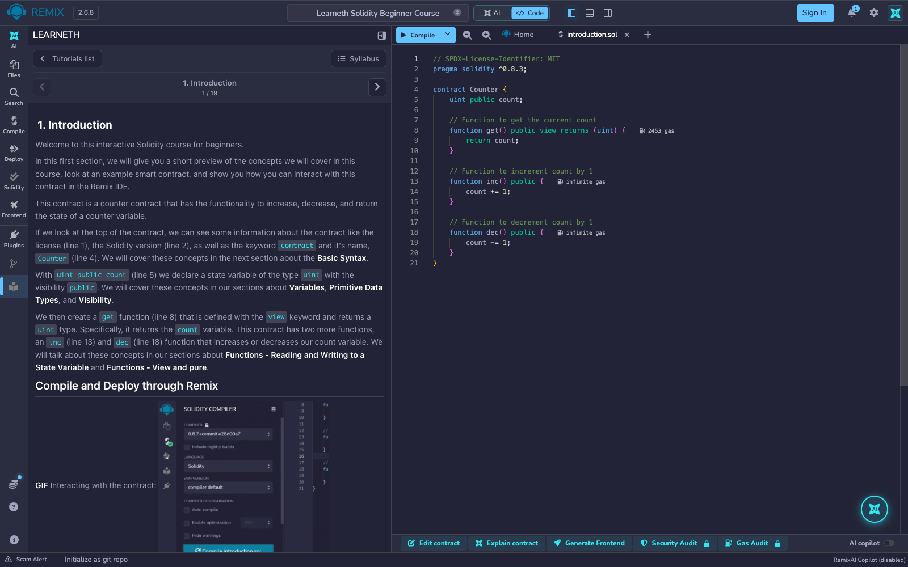
*The course opened in Remix: chapter 1 of 19, with the contract shown in the editor.*

### The 18 assignments, each passing "Check Answer"

::: shots
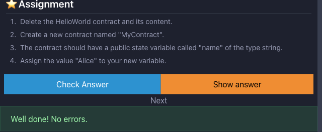
*2. Basic Syntax: `MyContract` with a public `string name = "Alice"`. "Well done! No errors."*

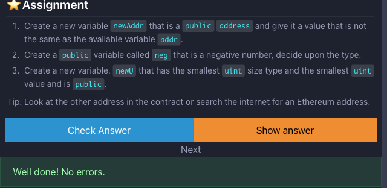
*3. Primitive Data Types: `newAddr` (address), `neg` (int8 = -5) and `newU` (uint8 = 0). "Well done! No errors."*

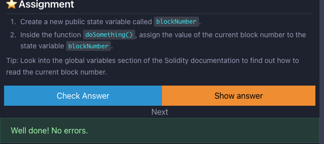
*4. Variables: `blockNumber` set from `block.number` inside `doSomething()`. "Well done! No errors."*

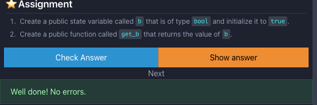
*5.1 Reading and Writing a State Variable: `bool public b = true` and the getter `get_b()`. "Well done! No errors."*

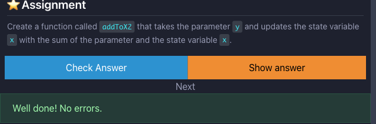
*5.2 View and Pure: `addToX2(y)` updates `x` with `x + y`. "Well done! No errors."*

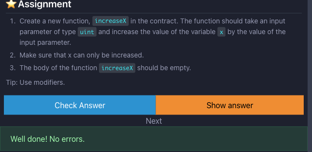
*5.3 Modifiers and Constructors: Modifier `increaseAmount` with an empty-bodied `increaseX`. "Well done! No errors."*

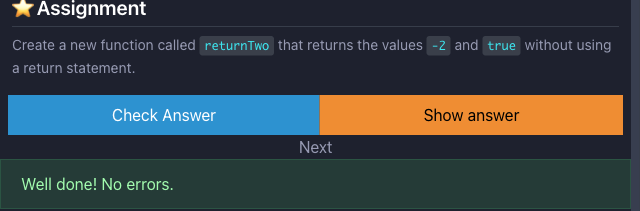
*5.4 Inputs and Outputs: `returnTwo()` returns `-2` and `true` using named returns. "Well done! No errors."*

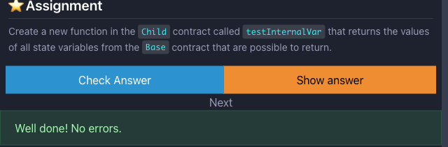
*6. Visibility: `testInternalVar()` in `Child` returns the internal and public strings. "Well done! No errors."*

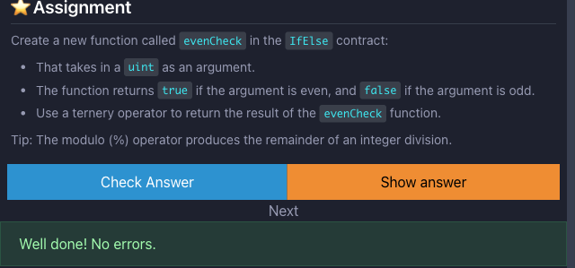
*7.1 Control Flow: If/Else: `evenCheck(uint)` using a ternary operator. "Well done! No errors."*

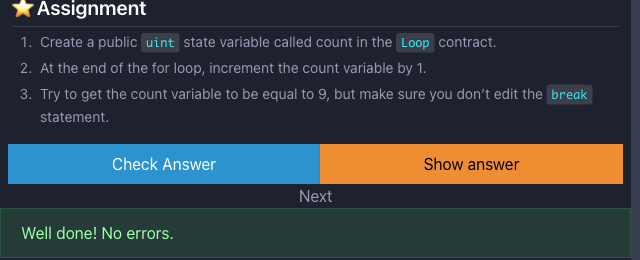
*7.2 Control Flow: Loops: `count` incremented at the end of each `for` iteration. "Well done! No errors."*

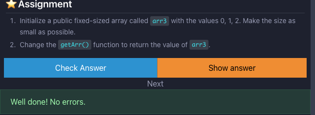
*8.1 Arrays: Fixed-size `arr3 = [0, 1, 2]` returned by `getArr()`. "Well done! No errors."*

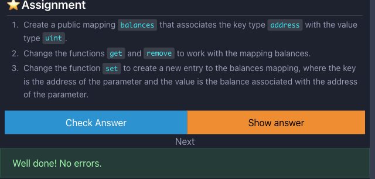
*8.2 Mappings: `balances` mapping used by `get`, `set` and `remove`. "Well done! No errors."*

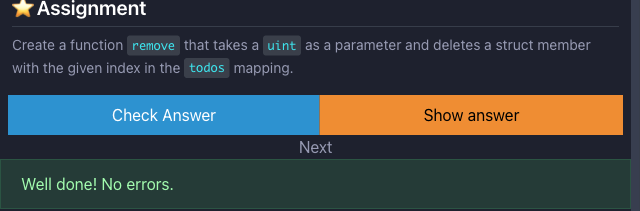
*8.3 Structs: `remove(uint)` deletes a `Todo` by index. "Well done! No errors."*

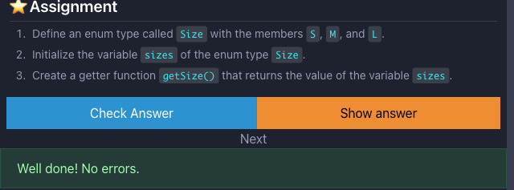
*8.4 Enums: `enum Size {S, M, L}`, `sizes` and `getSize()`. "Well done! No errors."*

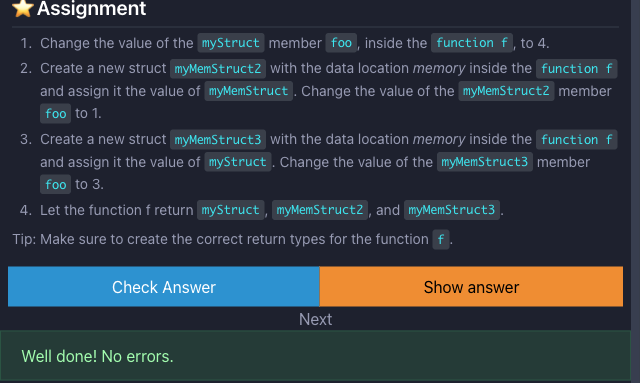
*9. Data Locations: `f()` returns `myStruct` and two memory copies. "Well done! No errors."*

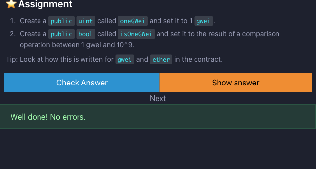
*10.1 Ether and Wei: `oneGwei` and `isOneGwei` (1 gwei equals 1e9 wei). "Well done! No errors."*

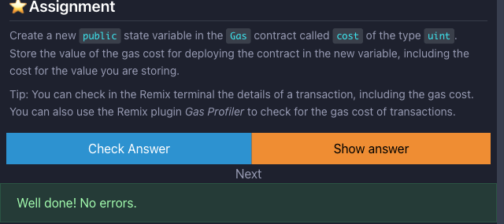
*10.2 Gas and Gas Price: `cost` stores the gas cost of deploying the contract. "Well done! No errors."*

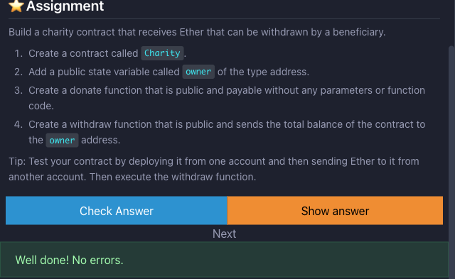
*10.3 Sending Ether: `Charity` contract with `owner`, `donate()` and `withdraw()`. "Well done! No errors."*

:::

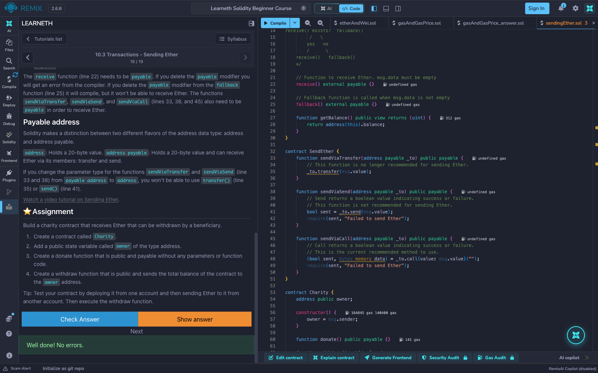
*Chapter 19 of 19 passes. The editor shows the finished `sendingEther.sol` with the new `Charity` contract at the bottom.*

### Deploying and running a consolidated contract on the Remix VM


*`SolidityBasics.sol` compiles with no errors (compiler 0.8.34).*

::: shots

*Deployment on the Remix VM and the state variables read back. The `GreetingChanged` event is decoded, and a non-owner call to the `onlyOwner` function reverts with "Not the owner".*


*A 0.5 ETH deposit through a `payable` function, four `Student` structs, `averageMarks()` from a `for` loop and `classify()` using `if`/`else`.*
:::


*The `pure` functions return the expected values, and three transactions to `bumpCounter()` advance a `private` counter that has no public getter.*

## Conclusion

All 19 chapters of the LearnEth Solidity Basics course were worked through, and the assignment of each of the 18 chapters that has one passed "Check Answer": data types, variables, functions (`view`, `pure`, inputs and outputs), visibility, modifiers and constructors, control flow, arrays, mappings, structs, enums, data locations, and Ether, gas and sending Ether. Two assignments needed a second attempt (8.1, where a `uint8[3]` array did not match the `uint` type the test expected, and 10.1, where the variable names are case-sensitive), which showed how strict Solidity's types and names are. A consolidated contract deployed on the Remix VM then used the same constructs in real transactions, including a revert from a modifier and a `payable` deposit, so the basics were shown both in the guided exercises and in a working contract.
