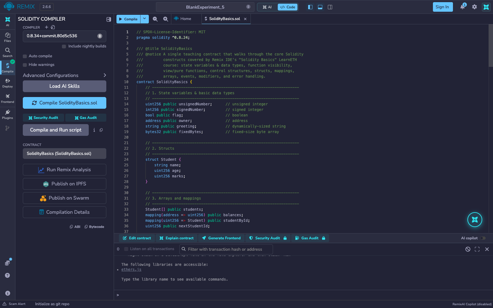
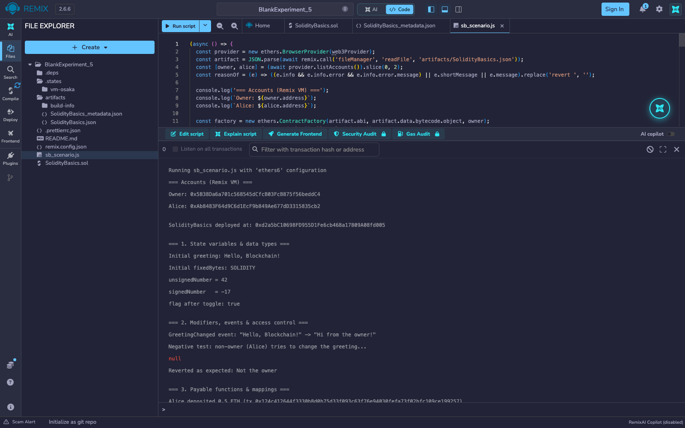
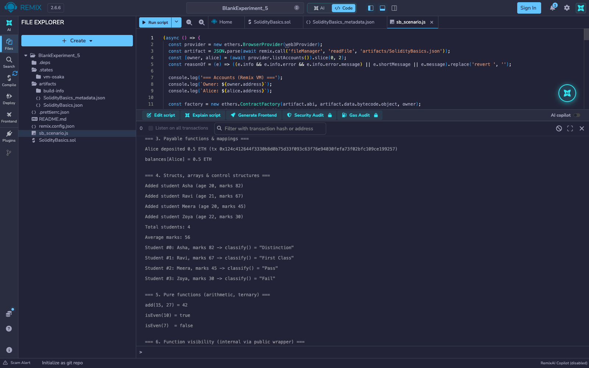
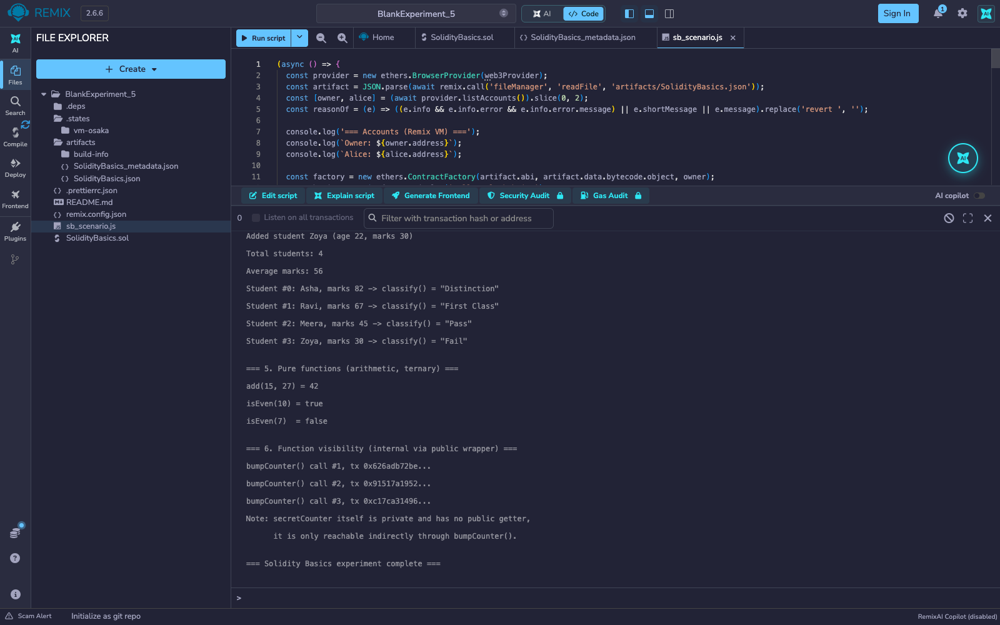

# Experiment 5

## Hands-on Solidity programming assignments for creating smart contracts

## Aim

To gain hands-on experience with core Solidity programming constructs — the same ground covered by Remix IDE's LearnETH "Solidity Basics" course (19 guided assignments) — by writing, compiling, deploying, and exercising a single teaching contract that demonstrates each construct with a real, executed transaction on a local blockchain.

## Theory

Remix IDE's "Solidity Basics" LearnETH course walks a learner through Solidity's fundamentals one guided assignment at a time: declaring state variables of different types, writing functions with different visibility and mutability modifiers, control-flow constructs, structs and mappings for structured/keyed storage, arrays, events for on-chain logging, and modifiers for reusable access-control checks. Rather than stepping through the course's 19 separate assignments one at a time, this experiment consolidates the same set of constructs into one contract, `SolidityBasics.sol`, compiled and deployed in the Remix IDE itself and exercised with a short script run in Remix's terminal against the Remix VM:

- **State variables & data types** — `uint256`, `int256`, `bool`, `address`, `string`, and `bytes32` are all declared as public state variables, each auto-generating a getter.
- **Structs & arrays** — a `Student { name, age, marks }` struct is stored both in a dynamic array (`Student[] public students`) and in a `mapping(uint256 => Student)` keyed by an auto-incrementing id, showing the two common ways Solidity stores structured records.
- **Mappings** — `mapping(address => uint256) public balances` tracks per-address ETH deposits made through a `payable` function.
- **Events** — `GreetingChanged`, `StudentAdded`, and `Deposited` are emitted on state changes and decoded back client-side via `ethers.js`'s `interface.parseLog`.
- **Modifiers & access control** — `onlyOwner` restricts `setGreeting` to the deploying address; a non-owner call is shown reverting.
- **Control structures** — `classify()` uses an if/else-if/else chain to grade a student's marks, `averageMarks()` uses a `for` loop to sum an array, and `isEven()` uses a ternary expression.
- **Function visibility** — `view`, `pure`, `external`, `public`, `internal`, and `private` are all represented; a `private` counter (`secretCounter`) has no public getter and is only reachable indirectly through a `public` wrapper function (`bumpCounter`), demonstrating that Solidity's `private` keeps a variable's value out of any public getter while still leaving it readable off-chain via storage slots — a distinction the LearnETH course specifically covers.

**Tools used:** Remix IDE (web, v2.6.6), Solidity compiler 0.8.34 (the contract declares `pragma solidity ^0.8.24`), the in-browser *Remix VM (Osaka)* test blockchain with its pre-funded accounts, and a JavaScript script run from Remix's terminal with the built-in ethers.js v6 runner.

## Output

*`SolidityBasics.sol` compiles with no errors in Remix; the green tick on the Solidity Compiler icon confirms it.*

*The two Remix VM accounts and the deployed contract address, then the state variables (`string`, `bytes32`, `uint256`, `int256`, `bool`) read back after being set. The `GreetingChanged` event is decoded from the receipt, and Alice's attempt to call the `onlyOwner` function reverts with "Not the owner".*

*Alice's 0.5 ETH deposit through the `payable` function is recorded in the `balances` mapping. Four `Student` structs are added, `averageMarks()` returns 56 from its `for` loop, and `classify()` grades them Distinction, First Class, Pass and Fail.*

*The `pure` functions `add()` and `isEven()` return the expected values. Three transactions to `bumpCounter()` advance the `private` `secretCounter` that has no public getter, showing a private variable reachable only through its public wrapper.*

## Conclusion

This experiment covered the same ground as Remix IDE's LearnETH "Solidity Basics" course — state variables and data types, structs, mappings, arrays, events, modifiers, control structures, and the full range of function visibility/mutability keywords — by writing, compiling, and deploying a single consolidated `SolidityBasics` contract in Remix IDE and exercising every construct with a real transaction on the Remix VM rather than working through the course's assignments one at a time. Each construct's behaviour was independently verified: the owner-only `setGreeting` modifier correctly blocked a non-owner caller, the `for`-loop-based `averageMarks()` and if/else-chain `classify()` produced correct results against four struct records, and the `private` `secretCounter` was shown to be mutable only through its `public` wrapper — confirming that Solidity's access-control and visibility guarantees hold when the contract is driven from Remix.
