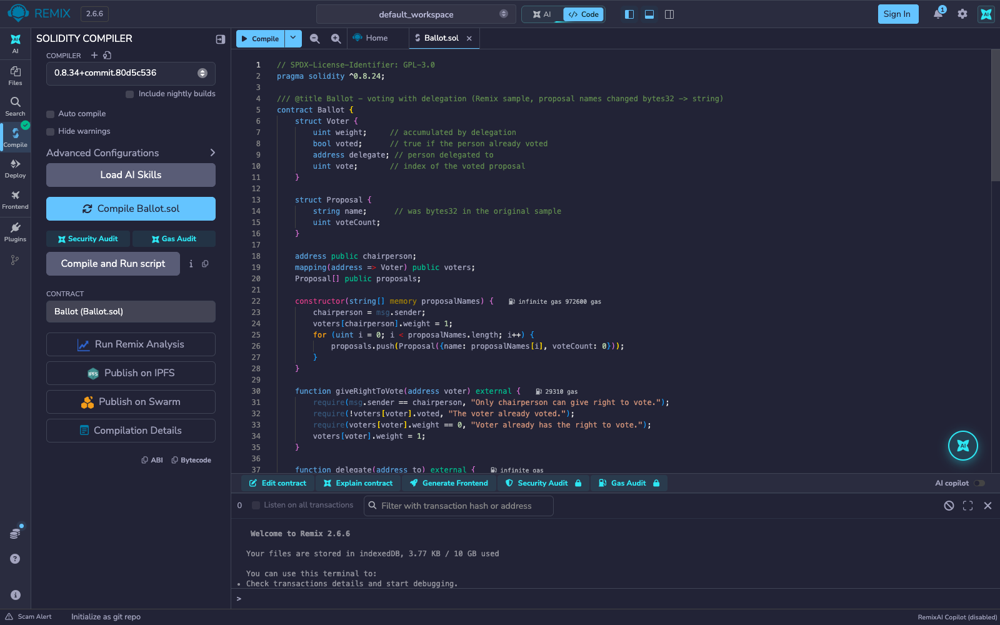
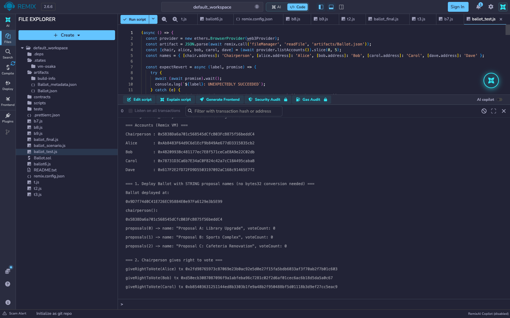
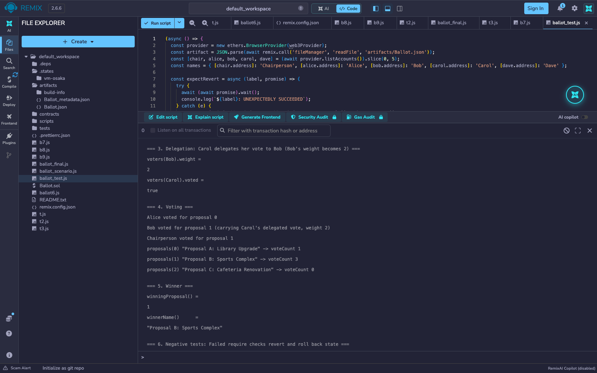
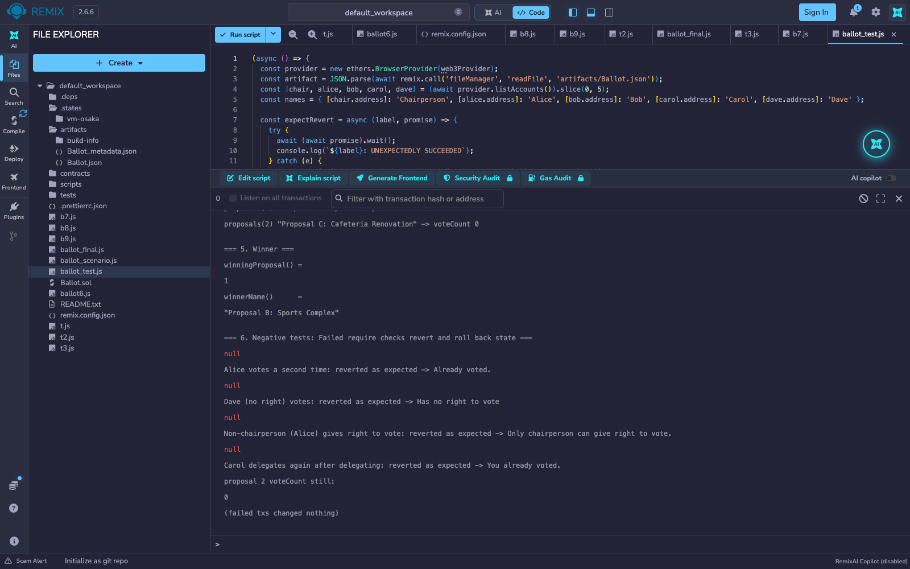

# Experiment 6

## Creation and Deployment of Smart Contract and Transactions using Solidity

## Aim

To understand and deploy the `Ballot` voting smart contract (the Remix IDE sample), changing the proposal names from `bytes32` to `string`, and to exercise its full flow of transactions: giving the right to vote, delegating, voting, and declaring a winner.

## Theory

`Ballot.sol` implements electronic voting with delegation. The chairperson (the deploying account) creates one `Proposal` per name and gives individual addresses the right to vote; each voter has a `weight` (1 by default, increased when others delegate to them), a `voted` flag, an optional `delegate`, and the index of the proposal they voted for. `vote()` adds the voter's weight to a proposal's `voteCount`; `winningProposal()` returns the index with the highest count, and `winnerName()` returns its name.

**Change made for this experiment:** the original sample stores each proposal name as `bytes32`, so deploying it in Remix needs every name converted to a hex string first (hence the web3-type-converter link in the manual). Here `Proposal.name` and the constructor argument are plain `string`, so names such as `"Proposal A: Library Upgrade"` are passed in as-is.

**Viva topics**

1. **Relevance of `require` statements.** `require(condition, "message")` is a guard: if the condition is false, execution stops, every state change made in that transaction is rolled back, and the message is returned to the caller. In `Ballot` it enforces who may act (`msg.sender == chairperson`, `weight != 0`) and when (`!voted`), so an invalid call can never corrupt the vote counts.
2. **`mapping`, `storage` and `memory`.** A `mapping(address => Voter)` is a hash-table-like key-value store; it has no length and cannot be iterated, but lookups are cheap. `storage` is the contract's permanent on-chain state (writes cost gas); a `storage` local such as `Voter storage sender = voters[msg.sender]` is a *reference* to that state, so edits persist. `memory` is temporary, per-call data that is discarded when the function returns, and is cheaper (e.g. the `string[] memory proposalNames` constructor argument).
3. **Why `bytes32` instead of `string`?** `bytes32` is fixed-size, fits in one storage slot and is cheap to store and compare, but limits names to 32 bytes and needs off-chain conversion for readability. `string` is dynamically sized, human-readable and unlimited in length, but costs more gas and cannot be compared with `==` directly. For a small ballot, readability outweighs the extra gas, which is why this experiment uses `string`.

**Tools used:** Remix IDE (web, v2.6.6), Solidity compiler 0.8.34 (the contract declares `pragma solidity ^0.8.24`), the in-browser *Remix VM (Osaka)* test blockchain with its pre-funded accounts, and a short JavaScript script run in Remix's own terminal with the built-in ethers.js v6 runner to repeat the whole voting scenario.

## Output

*`Ballot.sol` (proposal names changed from `bytes32` to `string`) compiles with no errors in Remix; the green tick on the Solidity Compiler icon confirms it.*

*The five Remix VM accounts (Chairperson, Alice, Bob, Carol, Dave), then the contract deployed with three readable proposal names passed straight in as strings and read back unchanged from `proposals(i)`, followed by the chairperson giving Alice, Bob and Carol the right to vote.*

*Carol delegates to Bob, which raises Bob's weight to 2 and marks Carol as having voted. Alice, Bob and the chairperson then vote, giving Proposal B a count of 3 against 1 for Proposal A.*

*`winnerName()` returns "Proposal B: Sports Complex" as plain text. Four invalid calls (double vote, voting without the right, a non-chairperson granting the right, delegating after already voting) each revert with the contract's own `require` message, and proposal 2's vote count is still 0 afterwards.*

## Conclusion

This experiment compiled and deployed the Remix `Ballot` contract on the Remix IDE's built-in Remix VM, with the proposal names changed from `bytes32` to `string`. The change removed the need for any off-chain hex conversion: names go in and come out as readable text. A full election was run: three voters were enfranchised, one delegated to another (raising the delegate's weight to 2), votes were cast, and `winnerName()` correctly returned "Proposal B: Sports Complex" with 3 votes against 1. Four negative tests each reverted with the exact `require` message and left the vote counts untouched, confirming how `require`, `mapping`, `storage` references and `memory` arguments combine to keep a voting contract's state correct.
