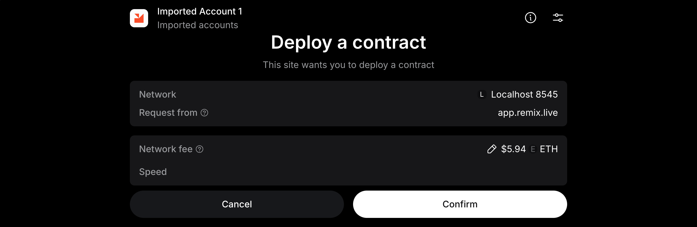
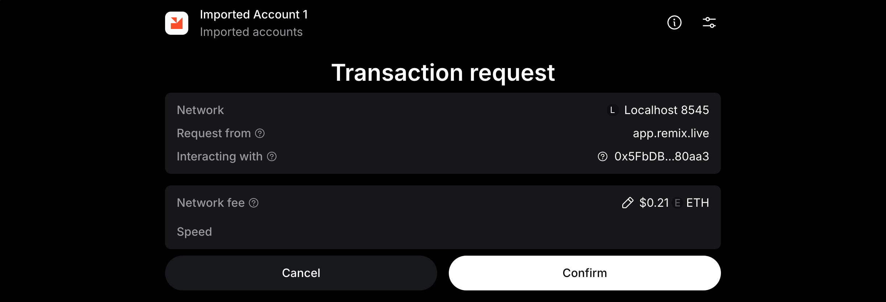
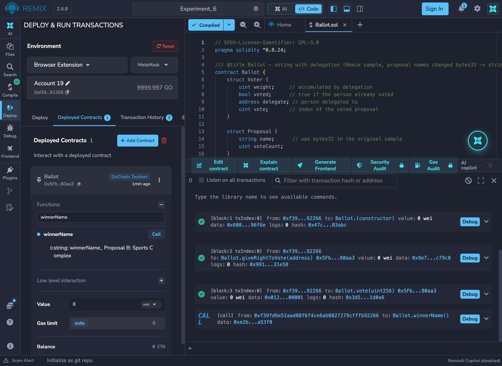

# Experiment 6

## Creation and Deployment of Smart Contract and Transactions using Solidity

## Aim

To understand and deploy the `Ballot` voting smart contract (the Remix IDE sample), changing the proposal names from `bytes32` to `string`, and to exercise its full flow of transactions: giving the right to vote, delegating, voting, and declaring a winner.

## Tasks Performed

1. Opened Remix IDE and the `contracts` folder of the default workspace, and opened `Ballot.sol`.
2. Studied the contract: the `Voter` and `Proposal` structs, the `voters` mapping, the `proposals` array and the `giveRightToVote`, `delegate`, `vote`, `winningProposal` and `winnerName` functions.
3. Changed the proposal name from `bytes32` to `string` and deployed the contract with readable names.
4. Ran the full flow of transactions: gave the right to vote, delegated a vote, voted, and read the winner. Four invalid calls were also run to see each `require` revert.
5. Repeated the deployment and transactions through MetaMask (Browser Extension environment).

## Theory

`Ballot.sol` implements electronic voting with delegation. The chairperson (the deploying account) creates one `Proposal` per name and gives individual addresses the right to vote; each voter has a `weight` (1 by default, increased when others delegate to them), a `voted` flag, an optional `delegate`, and the index of the proposal they voted for. `vote()` adds the voter's weight to a proposal's `voteCount`; `winningProposal()` returns the index with the highest count, and `winnerName()` returns its name.

**Change made for this experiment:** the original sample stores each proposal name as `bytes32`, so deploying it in Remix needs every name converted to a hex string first (hence the web3-type-converter link in the manual). Here `Proposal.name` and the constructor argument are plain `string`, so names such as `"Proposal A: Library Upgrade"` are passed in as-is.

**Tools used:** Remix IDE (web, v2.6.8), Solidity compiler 0.8.34 (the contract declares `pragma solidity ^0.8.24`), the in-browser *Remix VM (Osaka)* test blockchain with its pre-funded accounts, and a short JavaScript script run in Remix's own terminal with the built-in ethers.js v6 runner to repeat the whole voting scenario.

**Wallet integration:** the MetaMask screenshots use Remix's *Browser Extension* environment (Injected Provider) with MetaMask 13.53 connected to a local Hardhat node (chain ID 31337, which Remix labels "GoChain Testnet"), with the compiler EVM version set to Cancun because that node does not support Remix's default Osaka target. The chain is local, not a public testnet, so no faucet funds were used.

## Program

`Ballot.sol` (the Remix sample, with `bytes32` changed to `string`):

::: code2
```solidity
// SPDX-License-Identifier: GPL-3.0
pragma solidity ^0.8.24;

/// @title Ballot - voting with delegation (Remix sample, proposal names changed bytes32 -> string)
contract Ballot {
    struct Voter {
        uint weight;     // accumulated by delegation
        bool voted;      // true if the person already voted
        address delegate; // person delegated to
        uint vote;       // index of the voted proposal
    }

    struct Proposal {
        string name;      // was bytes32 in the original sample
        uint voteCount;
    }

    address public chairperson;
    mapping(address => Voter) public voters;
    Proposal[] public proposals;

    constructor(string[] memory proposalNames) {
        chairperson = msg.sender;
        voters[chairperson].weight = 1;
        for (uint i = 0; i < proposalNames.length; i++) {
            proposals.push(Proposal({name: proposalNames[i], voteCount: 0}));
        }
    }

    function giveRightToVote(address voter) external {
        require(msg.sender == chairperson, "Only chairperson can give right to vote.");
        require(!voters[voter].voted, "The voter already voted.");
        require(voters[voter].weight == 0, "Voter already has the right to vote.");
        voters[voter].weight = 1;
    }

    function delegate(address to) external {
        Voter storage sender = voters[msg.sender];
        require(sender.weight != 0, "You have no right to vote");
        require(!sender.voted, "You already voted.");
        require(to != msg.sender, "Self-delegation is disallowed.");

        while (voters[to].delegate != address(0)) {
            to = voters[to].delegate;
            require(to != msg.sender, "Found loop in delegation.");
        }

        Voter storage delegate_ = voters[to];
        require(delegate_.weight >= 1, "Delegate has no right to vote");
        sender.voted = true;
        sender.delegate = to;

        if (delegate_.voted) {
            proposals[delegate_.vote].voteCount += sender.weight;
        } else {
            delegate_.weight += sender.weight;
        }
    }

    function vote(uint proposal) external {
        Voter storage sender = voters[msg.sender];
        require(sender.weight != 0, "Has no right to vote");
        require(!sender.voted, "Already voted.");
        sender.voted = true;
        sender.vote = proposal;
        proposals[proposal].voteCount += sender.weight;
    }

    function winningProposal() public view returns (uint winningProposal_) {
        uint winningVoteCount = 0;
        for (uint p = 0; p < proposals.length; p++) {
            if (proposals[p].voteCount > winningVoteCount) {
                winningVoteCount = proposals[p].voteCount;
                winningProposal_ = p;
            }
        }
    }

    function winnerName() external view returns (string memory winnerName_) {
        winnerName_ = proposals[winningProposal()].name;
    }
}
```
:::

## Output


*`Ballot.sol` compiles with no errors; the green tick on the Solidity Compiler icon confirms it.*


*Five Remix VM accounts; the contract is deployed with three readable proposal names passed as strings and read back unchanged; the chairperson then gives Alice, Bob and Carol the right to vote.*


*Carol delegates to Bob, so Bob's weight becomes 2. After the votes Proposal B has 3 votes against 1, and `winnerName()` returns "Proposal B: Sports Complex".*


*Four invalid calls (double vote, voting without the right, a non-chairperson granting the right, delegating after voting) each revert with the contract's own `require` message, and the vote counts are unchanged.*

### Deployment and transactions through MetaMask

::: shots

*Remix requests deployment of `Ballot` with the proposal names as a `string[]`; MetaMask shows "Deploy a contract" from app.remix.live.*


*`giveRightToVote(address)` produces a MetaMask "Transaction request" naming the Ballot contract.*
:::


*The constructor (block 1), `giveRightToVote` (block 2) and `vote` (block 3) are mined from the MetaMask account; `winnerName()` returns "Proposal B: Sports Complex".*

## Conclusion

This experiment compiled and deployed the Remix `Ballot` contract on the Remix IDE's built-in Remix VM, with the proposal names changed from `bytes32` to `string`. The change removed the need for any off-chain hex conversion: names go in and come out as readable text. A full election was run: three voters were enfranchised, one delegated to another (raising the delegate's weight to 2), votes were cast, and `winnerName()` correctly returned "Proposal B: Sports Complex" with 3 votes against 1. Four negative tests each reverted with the exact `require` message and left the vote counts untouched, confirming how `require`, `mapping`, `storage` references and `memory` arguments combine to keep a voting contract's state correct.
