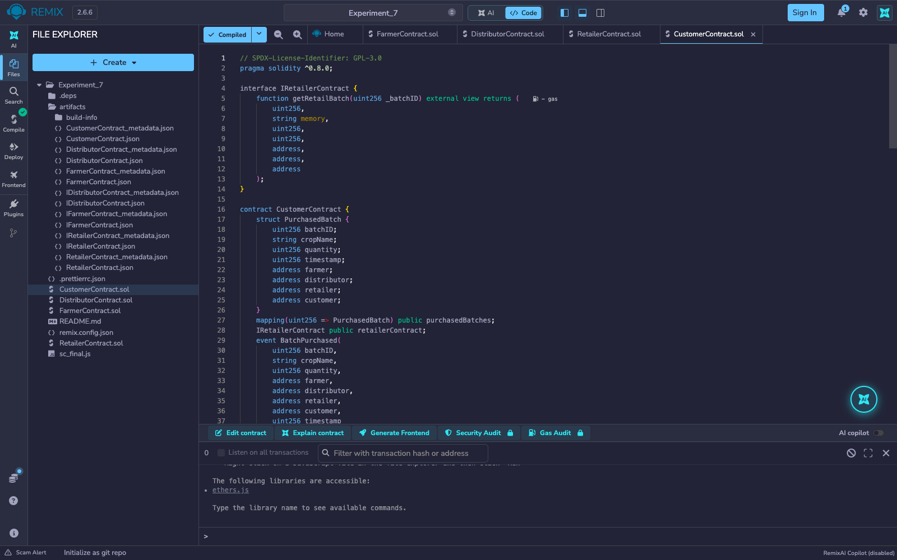
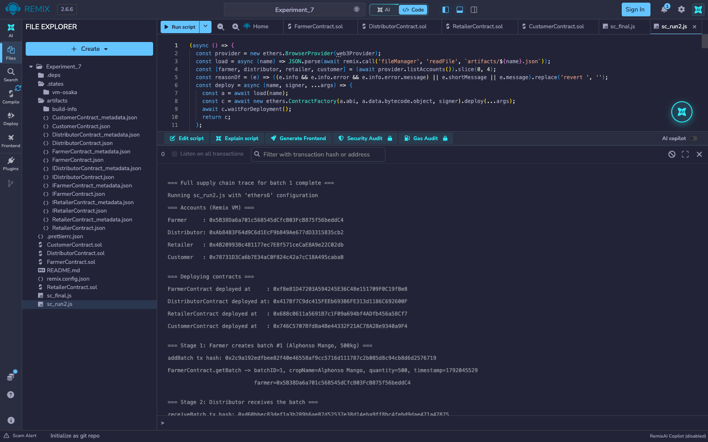
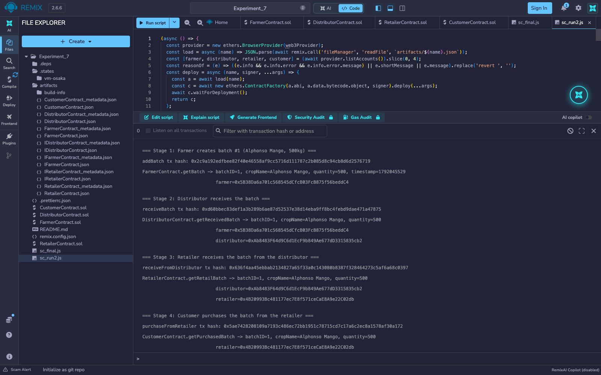
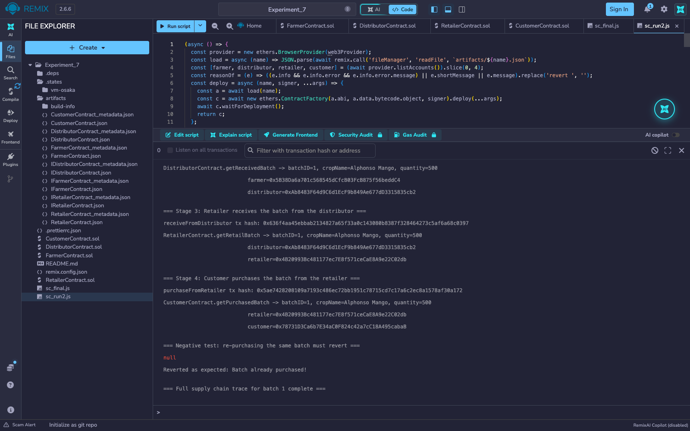

# Experiment 7

## Establish a local Blockchain and deploy a Smart Contract using Remix IDE

## Aim

To establish a local Ethereum blockchain using the Remix IDE's built-in Remix VM and deploy a set of Solidity smart contracts modeling a 4-stage supply chain (Farmer → Distributor → Retailer → Customer), then interact with the deployed contracts to trace one batch through the full chain.

## Theory

Remix IDE is a browser-based Solidity development environment that compiles contracts and deploys them to a chosen execution environment. Its *Remix VM* is a complete local Ethereum blockchain running inside the browser tab: it comes with deterministic, pre-funded test accounts (100 ETH each), mines every transaction into a numbered block with real gas accounting, and needs no wallet extension, faucet or public testnet. Contracts deployed there behave exactly as they would on a real network, which makes it the ideal local chain for developing and testing before moving to a testnet through Metamask. In this experiment the four contracts are compiled with the Solidity compiler plugin and then deployed and exercised from a short script run in Remix's own terminal, which signs transactions from four different Remix VM accounts (the Farmer, Distributor, Retailer and Customer).

The task's contract is a 4-stage supply-chain traceability system, four contracts chained by constructor-injected addresses:

- **`FarmerContract`** — `addBatch(id, cropName, quantity)` records a new batch on-chain with the farmer's address and a timestamp; `getBatch` reads it back.
- **`DistributorContract`** — holds a reference to `FarmerContract` and `receiveBatch(id)` calls into it via the `IFarmerContract` interface to pull the batch's data and record that this distributor received it.
- **`RetailerContract`** — same pattern one stage further down, reading from `DistributorContract` via `IDistributorContract`.
- **`CustomerContract`** — the final stage, reading from `RetailerContract` via `IRetailerContract` and recording the purchase.

Each stage's `require` guards (batch must exist upstream, must not already have been received/purchased at this stage) enforce that the batch can only move forward through the chain once, and each contract only trusts the *interface* of the contract before it — it never touches the earlier contracts' internal storage — which is the standard pattern for composing several independently-deployed contracts into one traceability pipeline.

**Tools used:** Remix IDE (web, v2.6.6), Solidity compiler 0.8.34 (the contracts declare `pragma solidity ^0.8.0`), the in-browser *Remix VM (Osaka)* local blockchain, and a JavaScript script run from Remix's terminal with the built-in ethers.js v6 runner.

## Output

*All four contracts (`FarmerContract`, `DistributorContract`, `RetailerContract`, `CustomerContract`) compile with no errors; the green tick on the Solidity Compiler icon confirms it, and the `artifacts` folder now holds the ABI and bytecode of each one.*

*The Farmer, Distributor, Retailer and Customer accounts, then the four contracts deployed in order, each one's constructor receiving the address of the contract before it (Farmer → Distributor → Retailer → Customer).*

*The Farmer adds batch #1 (Alphonso Mango, 500 kg). The Distributor's `receiveBatch` pulls it from the Farmer contract and the Retailer's `receiveFromDistributor` pulls it from the Distributor contract. Each stage's read-back shows the same batch with the new party's address added.*

*The Customer's `purchaseFromRetailer` completes the trace, so the final record carries the retailer and customer addresses. Trying to purchase the same batch again reverts with "Batch already purchased!".*

## Conclusion

This experiment established a local Ethereum blockchain with Remix IDE's Remix VM and deployed a 4-contract supply-chain traceability system to it. A single batch was walked through all four stages (Farmer, Distributor, Retailer, Customer), with each stage's contract verifying the previous stage's on-chain data through its interface before recording its own step, and each of the 4 deployments and 4 stage transitions was mined as a separate transaction on the local chain. The final negative test, attempting to purchase the same batch a second time, reverted with "Batch already purchased!", confirming that the `require` guards allow a batch to progress through the chain only once.
