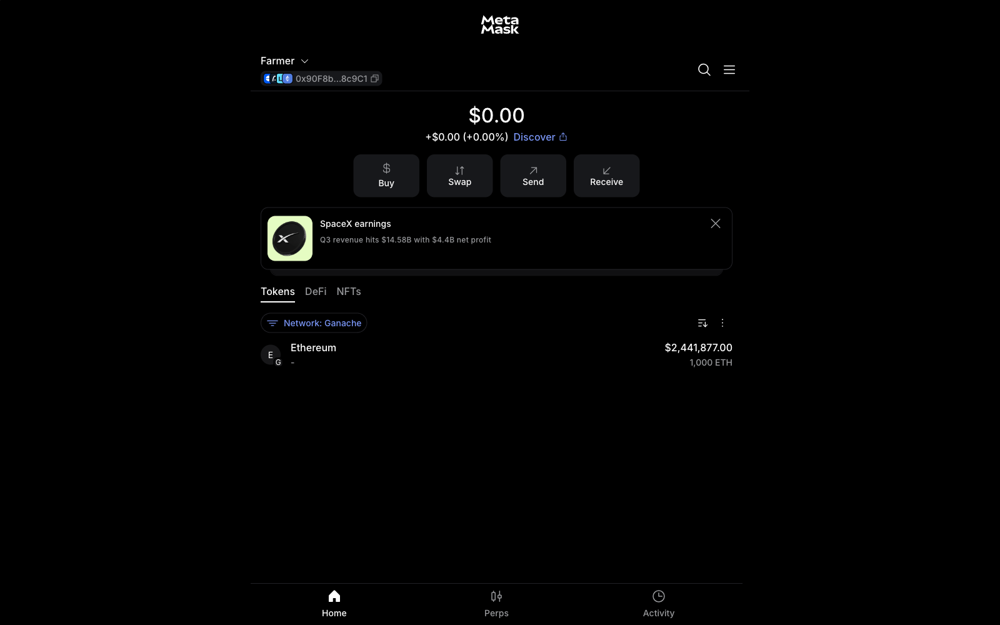
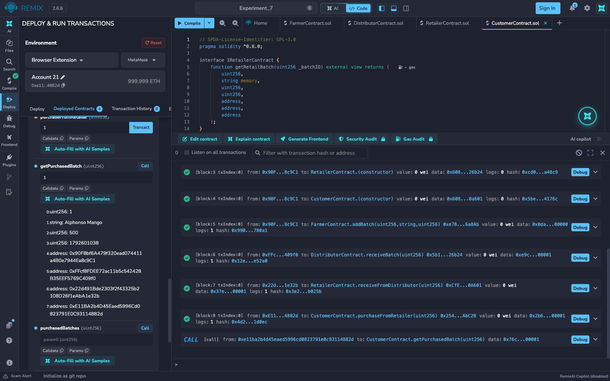

# Experiment 7

## Establish a local Blockchain using Ganache and deploy a Smart Contract through MetaMask and Remix IDE

## Aim

To start a local Ethereum blockchain with Ganache, connect its accounts to MetaMask and Remix IDE, deploy a set of Solidity smart contracts modeling a 4-stage supply chain (Farmer → Distributor → Retailer → Customer) through MetaMask, interact with them, and check the transactions on the Ganache chain.

## Theory

**Ganache** is a personal Ethereum blockchain for development and testing. It mines every transaction instantly, comes with pre-funded test accounts (1000 ETH each) and a deterministic mnemonic, and lets a developer inspect blocks, transactions and balances. The original Ganache desktop UI is no longer maintained, so this experiment uses the same engine through its command-line version (`ganache`, v7.9.2), which listens on `http://127.0.0.1:7545` with chain ID 5777 and prints every RPC call and mined transaction in its terminal.

**MetaMask** is a browser wallet that holds private keys and signs transactions. A local chain is added to it as a custom network (name, RPC URL, chain ID, currency symbol), and Ganache accounts are imported into it by private key. **Remix IDE** talks to MetaMask through the *Browser Extension* (Injected Provider) environment: Remix builds the transaction, MetaMask shows an approval screen, and only after *Confirm* is the transaction signed and sent to the chain.

Steps followed:

1. Start Ganache and note its accounts and private keys.
2. Add Ganache as a custom network in MetaMask and import four Ganache accounts, renamed Farmer, Distributor, Retailer and Customer.
3. Connect Remix IDE to MetaMask (Environment: Browser Extension → MetaMask) and give it those four accounts.
4. Compile the four contracts and deploy them through MetaMask.
5. Call the contract functions, switching MetaMask to the right role's account for each call, and approve each request.
6. Check the transaction details on the Ganache chain.

The task's contract is a 4-stage supply-chain traceability system, four contracts chained by constructor-injected addresses:

- **`FarmerContract`** — `addBatch(id, cropName, quantity)` records a new batch on-chain with the farmer's address and a timestamp; `getBatch` reads it back.
- **`DistributorContract`** — holds a reference to `FarmerContract`; `receiveBatch(id)` calls into it through the `IFarmerContract` interface to pull the batch's data and record that this distributor received it.
- **`RetailerContract`** — the same pattern one stage further down, reading from `DistributorContract` through `IDistributorContract`.
- **`CustomerContract`** — the final stage, reading from `RetailerContract` through `IRetailerContract` and recording the purchase.

Each stage's `require` guards (the batch must exist upstream and must not already have been received or purchased at this stage) let a batch move forward through the chain only once, and each contract trusts only the *interface* of the contract before it.

**Tools used:** Ganache CLI 7.9.2 (`--server.port 7545 --chain.chainId 5777 --wallet.deterministic`), MetaMask 13.53, Remix IDE (web, v2.6.8) with Solidity compiler 0.8.34 and the EVM version set to Shanghai, which is the newest hard fork Ganache supports. The terminal screenshots were taken from a real terminal running in the browser.

## Output

*Steps 1 and 2: `ganache` starts a local chain with ten accounts holding 1000 ETH each, their private keys and the mnemonic. It reports "RPC Listening on 127.0.0.1:7545" with chain ID 5777.*

*Step 3: Ganache is added to MetaMask as a custom network with RPC URL `127.0.0.1:7545`, chain ID 5777 and currency symbol ETH.*

*Step 4: the first Ganache account is imported into MetaMask by its private key. On the Ganache network it shows a balance of 1,000 ETH.*

*Step 5: four Ganache accounts are imported and renamed Farmer, Distributor, Retailer and Customer, so each stage of the supply chain is signed by a different account.*

*Step 6: when Remix is set to Browser Extension → MetaMask, MetaMask asks to approve app.remix.live's use of the Ganache network.*

*The Deploy & Run Transactions panel shows Environment "Browser Extension / MetaMask", the network label "Ganache (5777)" and the Farmer account with 1000 ETH.*

*Step 7: all four contracts (`FarmerContract`, `DistributorContract`, `RetailerContract`, `CustomerContract`) compile with no errors; the green tick on the Solidity Compiler icon confirms it.*

*Step 8: Remix requests deployment of `FarmerContract`. MetaMask shows "Deploy a contract" from app.remix.live on the Ganache network, signed by the Farmer account. The other three contracts were deployed the same way, each with the previous contract's address as its constructor argument.*

*Step 9, stage 1: `addBatch(1, "Alphonso Mango", 500)` on `FarmerContract` produces a transaction request in the Farmer account.*

*Stage 2: after switching MetaMask to the Distributor account, `receiveBatch(1)` on `DistributorContract` is approved by the Distributor.*

*Stage 3: with the Retailer account selected, `receiveFromDistributor(1)` on `RetailerContract` is approved.*

*Stage 4: the Customer account approves `purchaseFromRetailer(1)` on `CustomerContract`.*

*After the four stages, `getPurchasedBatch(1)` returns batch 1, "Alphonso Mango", 500 kg, with four different addresses recorded: the farmer (0x90F8…), distributor (0xFFcf…), retailer (0x22d4…) and customer (0xE11B…).*

*The Remix terminal logs each transaction as mined and successful. Blocks 5 to 8 come from four different accounts (Farmer 0x90F…, Distributor 0xFFc…, Retailer 0x22d…, Customer 0xE11…).*

*Step 10, transaction details on Ganache: the Ganache terminal logs every RPC call and, for each mined transaction, its hash, gas usage, block number and block time (here block 8, the customer's purchase, 229,346 gas).*

*A script reads the Ganache chain over RPC and lists all eight blocks: four contract creations by the Farmer account, then `addBatch` (Farmer), `receiveBatch` (Distributor), `receiveFromDistributor` (Retailer) and `purchaseFromRetailer` (Customer), each with its gas used and a success status, followed by the account balances (each account has paid a small gas fee).*

### Negative test on the Remix VM

*A repeat run of the chain on Remix's built-in Remix VM shows the duplicate-purchase check: trying to purchase the same batch again reverts with "Batch already purchased!".*

## Conclusion

This experiment started a local Ethereum blockchain with Ganache, connected four of its accounts to MetaMask as the Farmer, Distributor, Retailer and Customer, and used Remix IDE's Browser Extension environment to deploy a 4-contract supply-chain traceability system through MetaMask. Each deployment and each stage transition was an approval screen in MetaMask and a separate mined transaction on the Ganache chain, signed by the account of the role that performed it. The final record for batch 1 carries the four different role addresses, which shows that each stage verified the previous stage's on-chain data through its interface before recording its own step. The transactions, gas usage and balances were checked on the Ganache chain, and the negative test confirmed that a batch cannot be purchased twice.
