# Experiment 7

## Establish a local Blockchain using Ganache and deploy a Smart Contract through MetaMask and Remix IDE

## Aim

To start a local Ethereum blockchain with Ganache, connect its accounts to MetaMask and Remix IDE, deploy a set of Solidity smart contracts modeling a 4-stage supply chain (Farmer → Distributor → Retailer → Customer) through MetaMask, interact with them, and check the transactions on the Ganache chain.

## Tasks Performed

1. Installed and started Ganache (CLI v7.9.2) as a local blockchain with ten funded accounts.
2. Connected the Ganache accounts to MetaMask: added the Ganache network and imported four accounts as Farmer, Distributor, Retailer and Customer.
3. Connected Remix IDE to MetaMask (Environment: Browser Extension).
4. Wrote the mini-project contracts: a four-stage supply chain (`FarmerContract`, `DistributorContract`, `RetailerContract`, `CustomerContract`).
5. Compiled the contracts and deployed them through the MetaMask accounts on Ganache.
6. Checked the transaction details on the Ganache chain (its log and a transaction list read over RPC).
7. Interacted with the contracts: moved one batch through all four stages, and tried a repeat purchase that reverted.

## Theory

**Ganache** is a personal Ethereum blockchain for development and testing. It mines every transaction instantly, comes with pre-funded test accounts (1000 ETH each) and a deterministic mnemonic, and lets a developer inspect blocks, transactions and balances. The original Ganache desktop UI is no longer maintained, so this experiment uses the same engine through its command-line version (`ganache`, v7.9.2), which listens on `http://127.0.0.1:7545` with chain ID 5777 and prints every RPC call and mined transaction in its terminal.

**MetaMask** is a browser wallet that holds private keys and signs transactions. A local chain is added to it as a custom network (name, RPC URL, chain ID, currency symbol), and Ganache accounts are imported into it by private key. **Remix IDE** talks to MetaMask through the *Browser Extension* (Injected Provider) environment: Remix builds the transaction, MetaMask shows an approval screen, and only after *Confirm* is the transaction signed and sent to the chain.

Steps followed:

1. Start Ganache and note its accounts and private keys.
2. Add Ganache as a custom network in MetaMask and import four Ganache accounts, renamed Farmer, Distributor, Retailer and Customer.
3. Connect Remix IDE to MetaMask (Environment: Browser Extension → MetaMask) and give it those four accounts.
4. Compile the four contracts and deploy them through MetaMask.
5. Call the contract functions, switching MetaMask to the right role's account for each call, and approve each request.
6. Check the transaction details on the Ganache chain.

The task's contract is a 4-stage supply-chain traceability system, four contracts chained by constructor-injected addresses:

- **`FarmerContract`** — `addBatch(id, cropName, quantity)` records a new batch on-chain with the farmer's address and a timestamp; `getBatch` reads it back.
- **`DistributorContract`** — holds a reference to `FarmerContract`; `receiveBatch(id)` calls into it through the `IFarmerContract` interface to pull the batch's data and record that this distributor received it.
- **`RetailerContract`** — the same pattern one stage further down, reading from `DistributorContract` through `IDistributorContract`.
- **`CustomerContract`** — the final stage, reading from `RetailerContract` through `IRetailerContract` and recording the purchase.

Each stage's `require` guards (the batch must exist upstream and must not already have been received or purchased at this stage) let a batch move forward through the chain only once, and each contract trusts only the *interface* of the contract before it.

**Tools used:** Ganache CLI 7.9.2 (`--server.port 7545 --chain.chainId 5777 --wallet.deterministic`), MetaMask 13.53, Remix IDE (web, v2.6.8) with Solidity compiler 0.8.34 and the EVM version set to Shanghai, which is the newest hard fork Ganache supports. The terminal screenshots were taken from a real terminal running in the browser.

## Program

The four contracts, in the order they are deployed (each takes the previous contract's address as a constructor argument):

::: code2
```solidity
// SPDX-License-Identifier: GPL-3.0
pragma solidity ^0.8.0;

contract FarmerContract {
    struct Batch {
        uint256 batchID;
        string cropName;
        uint256 quantity;
        uint256 timestamp;
        address farmer;
    }
    mapping(uint256 => Batch) public batches;
    event BatchCreated(
        uint256 batchID,
        string cropName,
        uint256 quantity,
        uint256 timestamp,
        address farmer
    );
    function addBatch(uint256 _batchID, string memory _cropName, uint256 _quantity) public {
        require(_batchID != 0, "Invalid batch ID");
        require(batches[_batchID].batchID == 0, "Batch already exists!");

        batches[_batchID] = Batch({
            batchID: _batchID,
            cropName: _cropName,
            quantity: _quantity,
            timestamp: block.timestamp,
            farmer: msg.sender
        });
        emit BatchCreated(_batchID, _cropName, _quantity, block.timestamp, msg.sender);
    }
    function getBatch(uint256 _batchID) public view returns (
        uint256,
        string memory,
        uint256,
        uint256,
        address
    ) {
        Batch memory b = batches[_batchID];
        require(b.batchID != 0, "Batch does not exist!");
        return (b.batchID, b.cropName, b.quantity, b.timestamp, b.farmer);
    }
}

// SPDX-License-Identifier: GPL-3.0
pragma solidity ^0.8.0;

interface IFarmerContract {
    function getBatch(uint256 _batchID) external view returns (
        uint256,
        string memory,
        uint256,
        uint256,
        address
    );
}

contract DistributorContract {
    struct ReceivedBatch {
        uint256 batchID;
        string cropName;
        uint256 quantity;
        uint256 timestamp;
        address farmer;
        address distributor;
    }
    mapping(uint256 => ReceivedBatch) public receivedBatches;
    IFarmerContract public farmerContract;
    event BatchReceived(
        uint256 batchID,
        string cropName,
        uint256 quantity,
        address farmer,
        address distributor,
        uint256 timestamp
    );
    constructor(address _farmerContractAddress) {
        farmerContract = IFarmerContract(_farmerContractAddress);
    }
    function receiveBatch(uint256 _batchID) public {
        (
            uint256 id,
            string memory cropName,
            uint256 quantity,
            , // ignore farmer timestamp
            address farmer
        ) = farmerContract.getBatch(_batchID);
        require(id != 0, "Batch does not exist in FarmerContract");
        require(receivedBatches[_batchID].batchID == 0, "Batch already received!");
        receivedBatches[_batchID] = ReceivedBatch({
            batchID: id,
            cropName: cropName,
            quantity: quantity,
            timestamp: block.timestamp,
            farmer: farmer,
            distributor: msg.sender
        });
        emit BatchReceived(id, cropName, quantity, farmer, msg.sender, block.timestamp);
    }
    function getReceivedBatch(uint256 _batchID) public view returns (
        uint256,
        string memory,
        uint256,
        uint256,
        address,
        address
    ) {
        ReceivedBatch memory rb = receivedBatches[_batchID];
        require(rb.batchID != 0, "Batch not received!");
        return (
            rb.batchID,
            rb.cropName,
            rb.quantity,
            rb.timestamp,
            rb.farmer,
            rb.distributor
        );
    }
}

// SPDX-License-Identifier: GPL-3.0
pragma solidity ^0.8.0;

interface IDistributorContract {
    function getReceivedBatch(uint256 _batchID) external view returns (
        uint256,
        string memory,
        uint256,
        uint256,
        address,
        address
    );
}

contract RetailerContract {
    struct RetailBatch {
        uint256 batchID;
        string cropName;
        uint256 quantity;
        uint256 timestamp;
        address farmer;
        address distributor;
        address retailer;
    }
    mapping(uint256 => RetailBatch) public retailBatches;
    IDistributorContract public distributorContract;
    event BatchReceivedAtRetailer(
        uint256 batchID,
        string cropName,
        uint256 quantity,
        address farmer,
        address distributor,
        address retailer,
        uint256 timestamp
    );
    constructor(address _distributorContractAddress) {
        distributorContract = IDistributorContract(_distributorContractAddress);
    }

    function receiveFromDistributor(uint256 _batchID) public {
        (
            uint256 id,
            string memory cropName,
            uint256 quantity,
            , // ignore distributor timestamp
            address farmer,
            address distributor
        ) = distributorContract.getReceivedBatch(_batchID);
        require(id != 0, "Batch does not exist in DistributorContract");
        require(retailBatches[_batchID].batchID == 0, "Batch already received at Retailer!");
        retailBatches[_batchID] = RetailBatch({
            batchID: id,
            cropName: cropName,
            quantity: quantity,
            timestamp: block.timestamp,
            farmer: farmer,
            distributor: distributor,
            retailer: msg.sender
        });
        emit BatchReceivedAtRetailer(
            id,
            cropName,
            quantity,
            farmer,
            distributor,
            msg.sender,
            block.timestamp
        );
    }
    function getRetailBatch(uint256 _batchID) public view returns (
        uint256,
        string memory,
        uint256,
        uint256,
        address,
        address,
        address
    ) {
        RetailBatch memory rb = retailBatches[_batchID];
        require(rb.batchID != 0, "Batch not received at retailer!");

        return (
            rb.batchID,
            rb.cropName,
            rb.quantity,
            rb.timestamp,
            rb.farmer,
            rb.distributor,
            rb.retailer
        );
    }
}

// SPDX-License-Identifier: GPL-3.0
pragma solidity ^0.8.0;

interface IRetailerContract {
    function getRetailBatch(uint256 _batchID) external view returns (
        uint256,
        string memory,
        uint256,
        uint256,
        address,
        address,
        address
    );
}

contract CustomerContract {
    struct PurchasedBatch {
        uint256 batchID;
        string cropName;
        uint256 quantity;
        uint256 timestamp;
        address farmer;
        address distributor;
        address retailer;
        address customer;
    }
    mapping(uint256 => PurchasedBatch) public purchasedBatches;
    IRetailerContract public retailerContract;
    event BatchPurchased(
        uint256 batchID,
        string cropName,
        uint256 quantity,
        address farmer,
        address distributor,
        address retailer,
        address customer,
        uint256 timestamp
    );
    constructor(address _retailerContractAddress) {
        retailerContract = IRetailerContract(_retailerContractAddress);
    }
    function purchaseFromRetailer(uint256 _batchID) public {
        (
            uint256 id,
            string memory cropName,
            uint256 quantity,
            , // ignore retailer timestamp
            address farmer,
            address distributor,
            address retailer
        ) = retailerContract.getRetailBatch(_batchID);
        require(id != 0, "Batch does not exist in RetailerContract");
        require(purchasedBatches[_batchID].batchID == 0, "Batch already purchased!");
        purchasedBatches[_batchID] = PurchasedBatch({
            batchID: id,
            cropName: cropName,
            quantity: quantity,
            timestamp: block.timestamp,
            farmer: farmer,
            distributor: distributor,
            retailer: retailer,
            customer: msg.sender
        });
        emit BatchPurchased(
            id,
            cropName,
            quantity,
            farmer,
            distributor,
            retailer,
            msg.sender,
            block.timestamp
        );
    }
    function getPurchasedBatch(uint256 _batchID) public view returns (
        uint256,
        string memory,
        uint256,
        uint256,
        address,
        address,
        address,
        address
    ) {
        PurchasedBatch memory pb = purchasedBatches[_batchID];
        require(pb.batchID != 0, "Batch not purchased!");
        return (
            pb.batchID,
            pb.cropName,
            pb.quantity,
            pb.timestamp,
            pb.farmer,
            pb.distributor,
            pb.retailer,
            pb.customer
        );
    }
}
```
:::

## Output

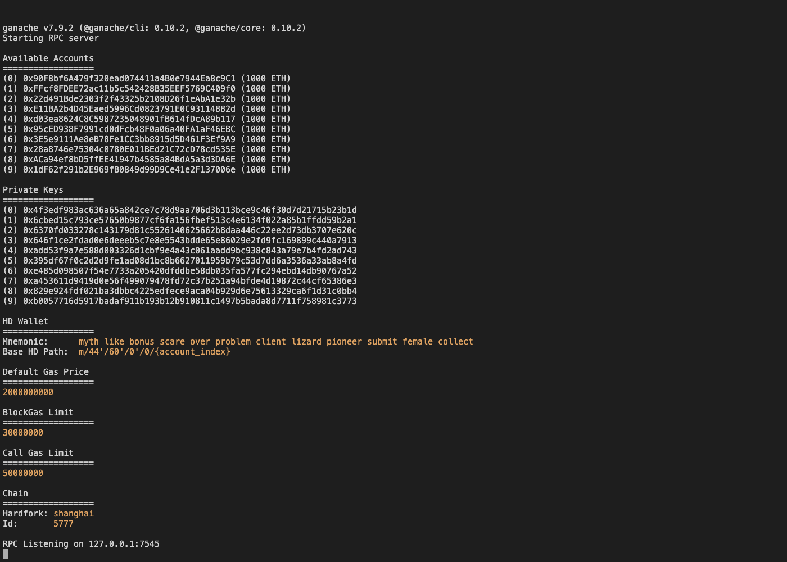
*Task 1: `ganache` starts a local chain with ten accounts holding 1000 ETH each. It reports "RPC Listening on 127.0.0.1:7545" with chain ID 5777.*

::: shots
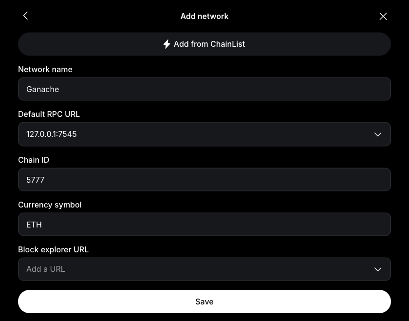
*Task 2: Ganache added to MetaMask as a custom network (RPC `127.0.0.1:7545`, chain ID 5777, symbol ETH).*

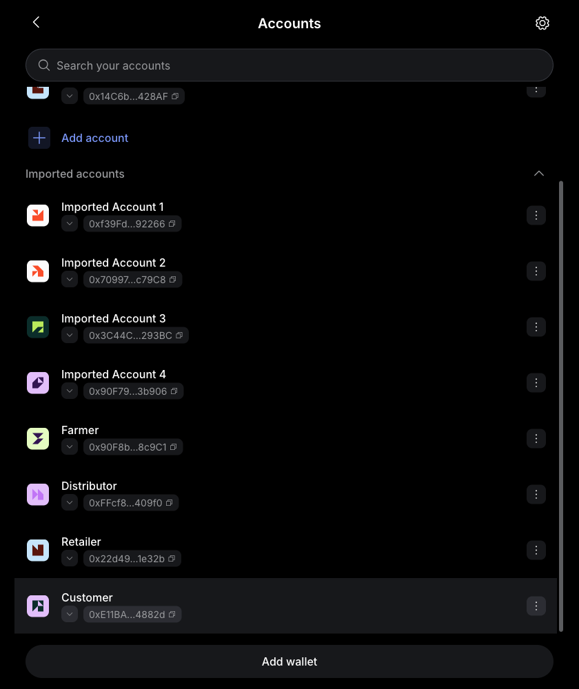
*Task 2: four Ganache accounts imported into MetaMask and renamed Farmer, Distributor, Retailer and Customer.*

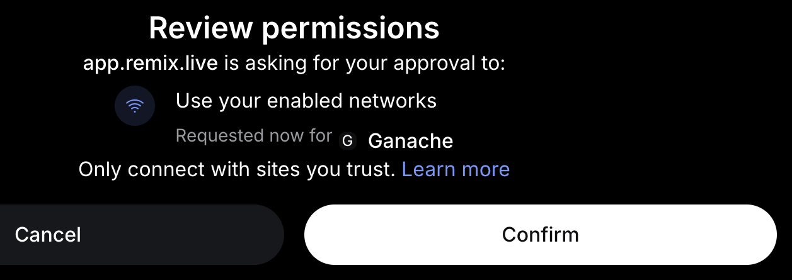
*Task 3: MetaMask asks to approve app.remix.live's use of the Ganache network.*

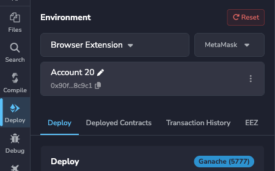
*Task 3: Remix shows Environment "Browser Extension / MetaMask" and the network label "Ganache (5777)".*
:::

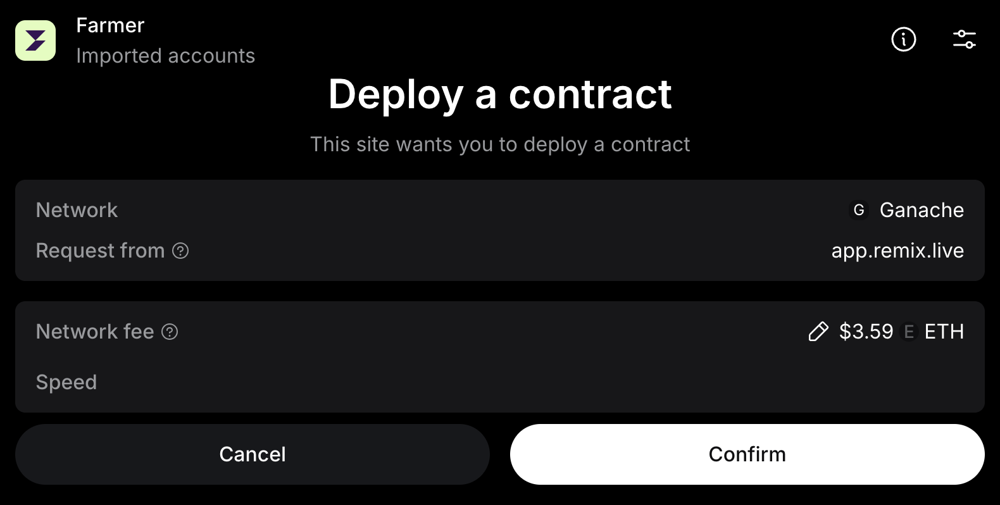
*Task 5: MetaMask shows "Deploy a contract" for `FarmerContract` from app.remix.live on the Ganache network. The other three contracts were deployed the same way, each with the previous contract's address as its constructor argument.*


*Task 5: all four contracts compile with no errors; the green tick on the Solidity Compiler icon confirms it.*

### Moving one batch through the four stages (Task 7)

::: shots
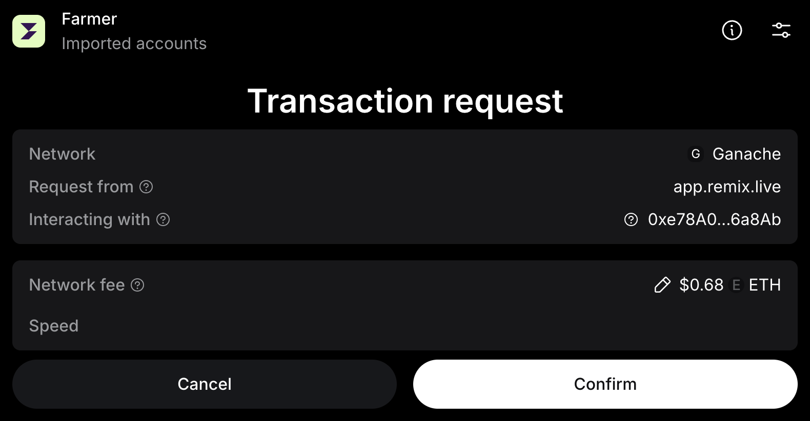
*Stage 1: `addBatch(1, "Alphonso Mango", 500)` on `FarmerContract`, approved by the Farmer account.*


*Stage 2: `receiveBatch(1)` on `DistributorContract`, approved by the Distributor.*

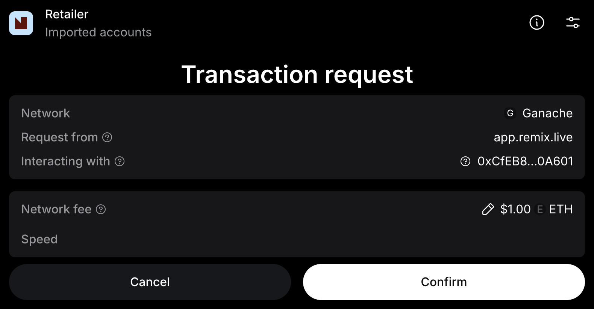
*Stage 3: `receiveFromDistributor(1)` on `RetailerContract`, approved by the Retailer.*

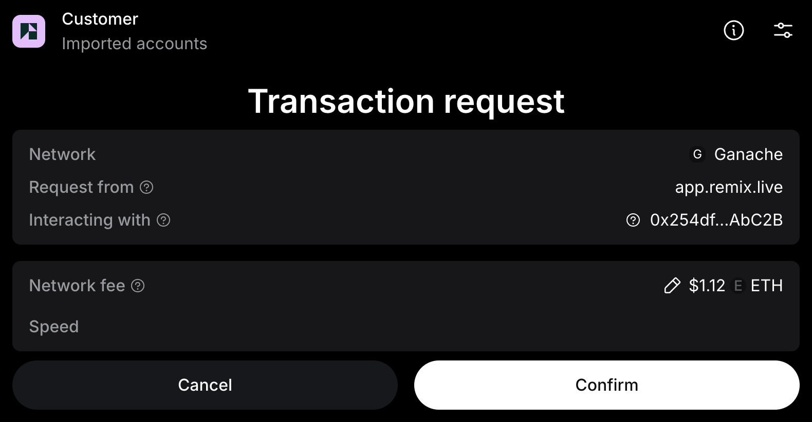
*Stage 4: `purchaseFromRetailer(1)` on `CustomerContract`, approved by the Customer.*
:::

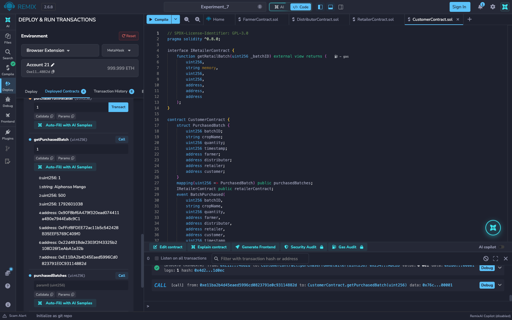
*`getPurchasedBatch(1)` returns batch 1, "Alphonso Mango", 500 kg, with four different addresses recorded: the farmer (0x90F8…), distributor (0xFFcf…), retailer (0x22d4…) and customer (0xE11B…).*

### Transaction details on Ganache (Task 6)

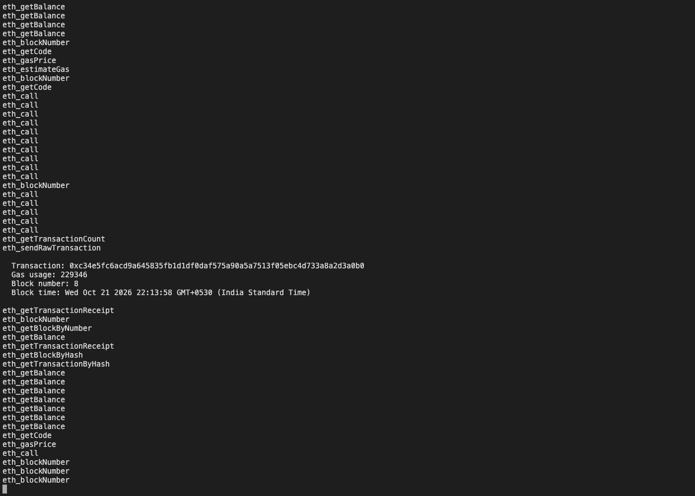
*Ganache logs each mined transaction with its hash, gas used, block number and block time (here block 8, the customer's purchase, 229,346 gas).*

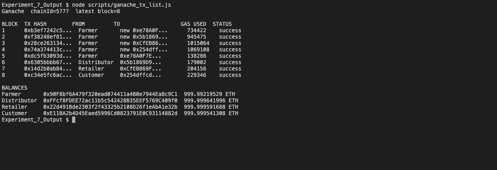
*A script reads the chain over RPC and lists all eight blocks: four contract creations by the Farmer account, then `addBatch`, `receiveBatch`, `receiveFromDistributor` and `purchaseFromRetailer`, each with gas used and a success status, followed by the account balances.*


*Negative test on the Remix VM: a second purchase of the same batch reverts with "Batch already purchased!".*

## Conclusion

This experiment started a local Ethereum blockchain with Ganache, connected four of its accounts to MetaMask as the Farmer, Distributor, Retailer and Customer, and used Remix IDE's Browser Extension environment to deploy a 4-contract supply-chain traceability system through MetaMask. Each deployment and each stage transition was an approval screen in MetaMask and a separate mined transaction on the Ganache chain, signed by the account of the role that performed it. The final record for batch 1 carries the four different role addresses, which shows that each stage verified the previous stage's on-chain data through its interface before recording its own step. The transactions, gas usage and balances were checked on the Ganache chain, and the negative test confirmed that a batch cannot be purchased twice.
