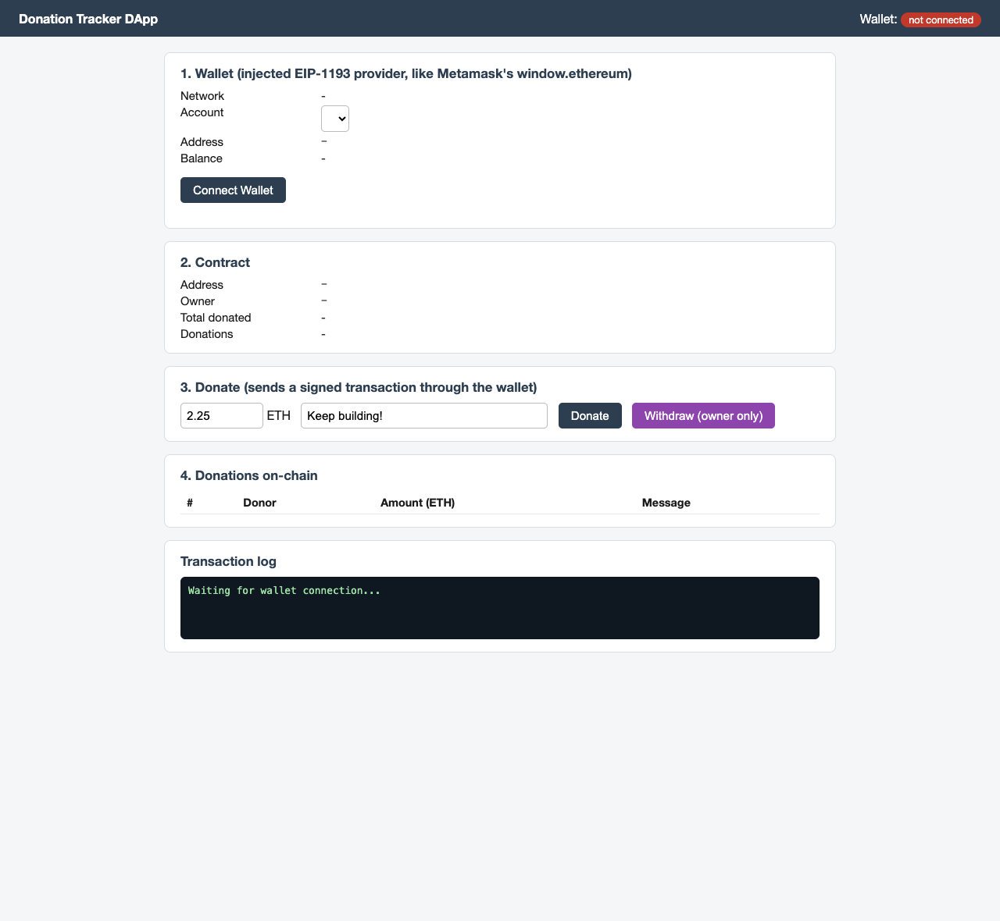
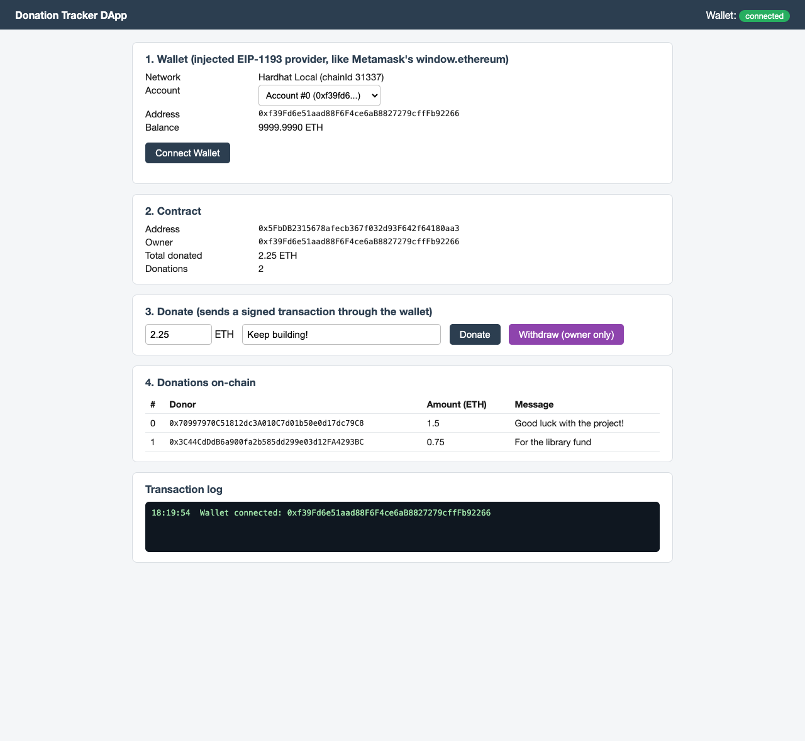
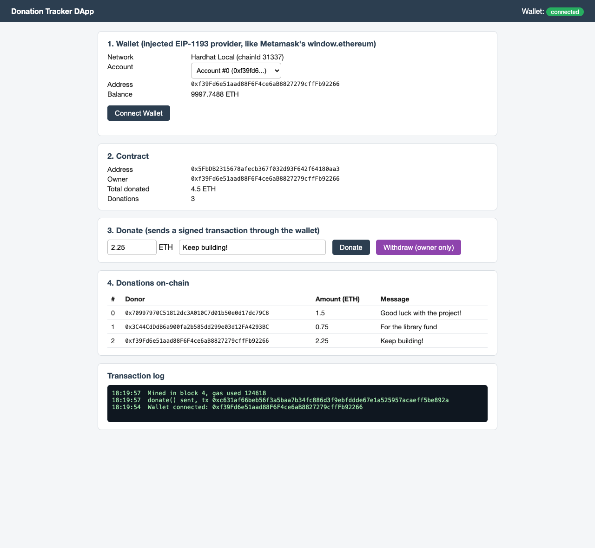
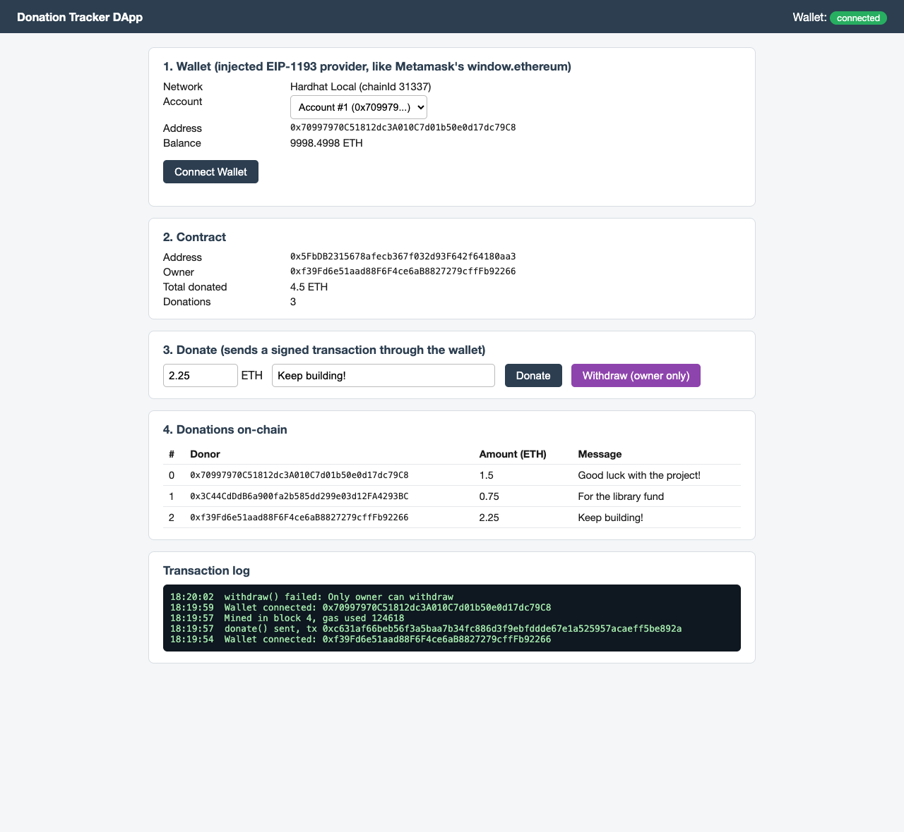
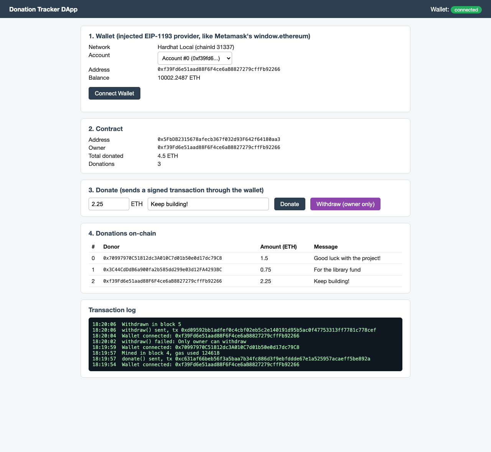

# Experiment 8

## Configuring a Cryptocurrency Wallet and integrating it with a DApp

## Aim

To configure a wallet that holds funded accounts and to integrate it with a decentralized application (DApp): a web front end that connects to the wallet, reads a smart contract's state, and sends signed transactions to it.

## Theory

A **cryptocurrency wallet** does not store coins; it stores the private keys that control accounts on the blockchain and uses them to sign transactions. A browser wallet such as Metamask exposes itself to web pages as an injected provider, `window.ethereum`, which follows the **EIP-1193** standard: the page calls `ethereum.request({method, params})` (for example `eth_requestAccounts` to ask the user to connect, then `eth_sendTransaction`), and the wallet signs and forwards the call to whichever network it is pointed at. The page never sees a private key.

A **DApp** is a front end plus smart contracts instead of a conventional back-end server:

1. **Smart contract (back end)** — `DonationTracker.sol`: `donate(message)` is `payable` and records the donor, amount and message; `withdraw()` is restricted to the owner and sends the collected balance to them; `DonationReceived` and `Withdrawn` events are emitted.
2. **Wallet** — holds the user's account and signs.
3. **Front end** — `dapp/index.html` uses `ethers.js` (`BrowserProvider`, `Contract`) over `window.ethereum` to read `owner()`, `totalDonated()` and the donation list, and to call `donate()` / `withdraw()`.

**Integration steps:** (1) deploy the contract and publish its address and ABI to the front end; (2) the page asks the wallet to connect (`eth_requestAccounts`) and checks the network; (3) reads go straight to the node, while writes are signed by the wallet and mined into a block; (4) the page refreshes from on-chain state after each confirmed transaction.

**Tools used:** Node.js 24, Hardhat 2.29 with `@nomicfoundation/hardhat-toolbox` (bundles `ethers.js` v6), Solidity 0.8.24, a static HTML page served with `python3 -m http.server`, and screenshots taken with a headless browser. A Hardhat node (port 8548) with its pre-funded accounts stands in for the wallet's network; because Metamask is a browser extension that could not be installed here, a small **local EIP-1193 provider** in `index.html` plays Metamask's role: it exposes `window.ethereum`, offers an account selector, and relays signing requests to the node. The DApp code is identical to what it would be with Metamask, but no real Metamask wallet was used.

## Output

**1. Deploy the DApp's contract and publish its address/ABI**

```
=== Accounts (Hardhat local network, used as the 'wallet' accounts) ===
Owner: 0xf39Fd6e51aad88F6F4ce6aB8827279cffFb92266
Alice: 0x70997970C51812dc3A010C7d01b50e0d17dc79C8
Bob  : 0x3C44CdDdB6a900fa2b585dd299e03d12FA4293BC

=== 1. Deploy DonationTracker (the DApp's back end) ===
DonationTracker deployed at: 0x5FbDB2315678afecb367f032d93F642f64180aa3
Wrote dapp/deployment.json (address + ABI for the front end)

=== 2. Seed two donations from the command line (before the browser is opened) ===
totalDonated: 2.25 ETH
donationCount: 2
```
*The contract is deployed, its address and ABI are written to `dapp/deployment.json` for the front end, and two donations (1.5 ETH from Alice, 0.75 ETH from Bob) are seeded so the page has data to show.*


*Step 2: the DApp front end on first load, with the wallet showing "not connected" and no contract data read yet.*


*Step 3: after "Connect Wallet", the page shows the network (Hardhat Local, chainId 31337), the connected account and its balance, and reads the contract's owner, 2.25 ETH total and 2 donations from the chain.*


*Step 4: clicking "Donate" sends a signed `donate()` transaction. It is mined in block 4, the total rises to 4.5 ETH, a third row appears in the on-chain donations table, and the transaction hash and gas used are shown in the log.*


*Step 5: after switching the wallet to Account #1, "Withdraw" is rejected by the contract's `require` with "Only owner can withdraw"; no funds move and the total stays 4.5 ETH.*


*Step 6: back on Account #0 (the owner), `withdraw()` is mined in block 5 and the owner's balance rises to 10002.2487 ETH, having received the 4.5 ETH collected while paying gas.*

*(Console log saved as `deploy_output.log` and the Hardhat node's server-side log as `hardhat_node.log`, both in this folder; the contract is `contracts/DonationTracker.sol` and the front end is `dapp/index.html`.)*

## Conclusion

This experiment integrated a wallet with a DApp: a web page that connects to an injected EIP-1193 provider, reads a `DonationTracker` contract's live state with `ethers.js`, and sends signed transactions that are mined into blocks and reflected back in the page. A donation raised the on-chain total from 2.25 to 4.5 ETH and added a record visible in the table; the contract's access control was verified from the UI, as a non-owner's withdrawal was rejected on-chain with the contract's own message while the owner's succeeded and moved the funds. Metamask was not used in this run: a local provider imitating its `window.ethereum` interface stood in for it, so the front-end code would work unchanged with a real Metamask wallet pointed at the same network.
