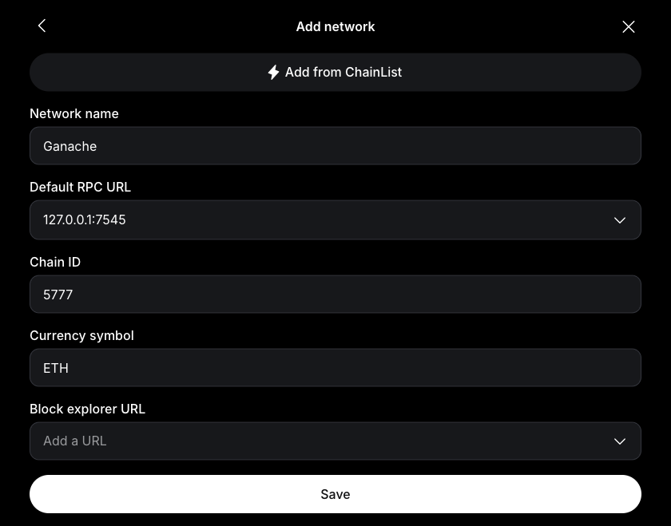
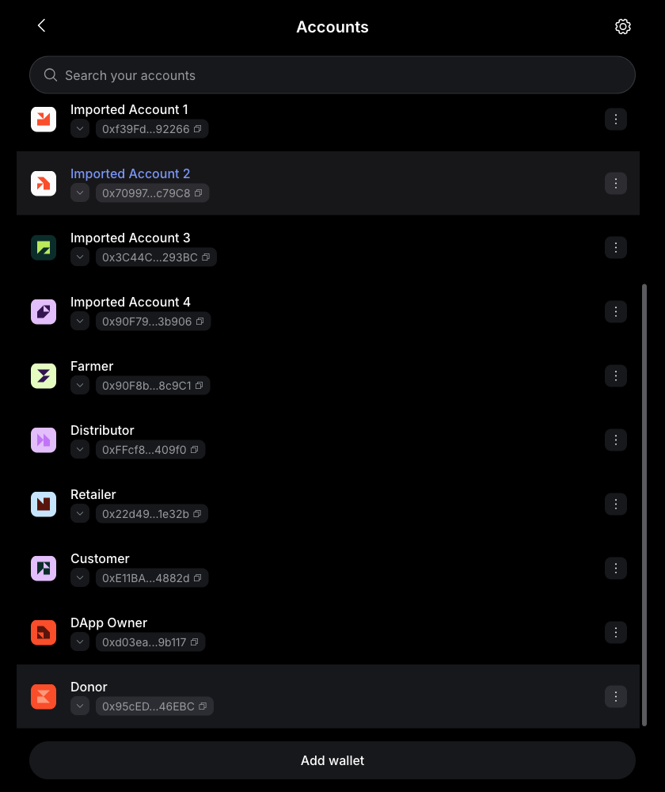
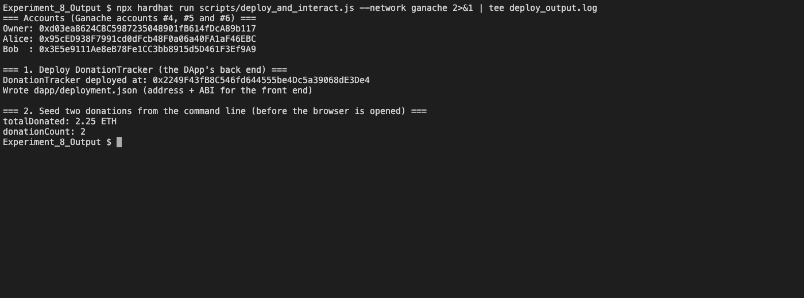
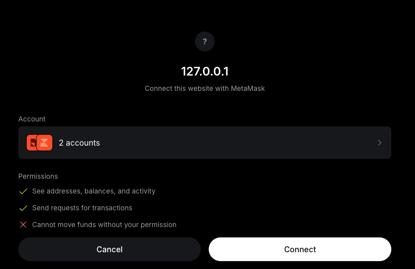
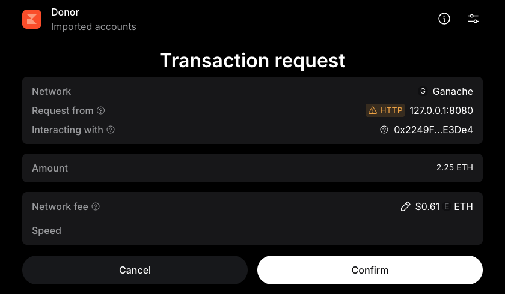
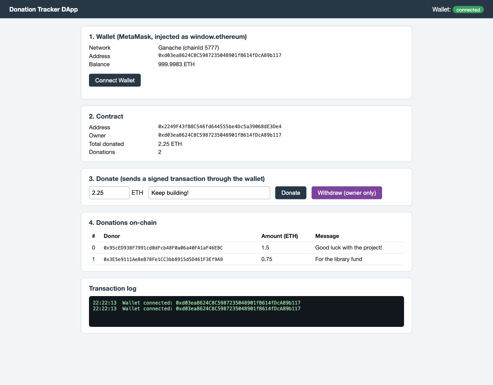
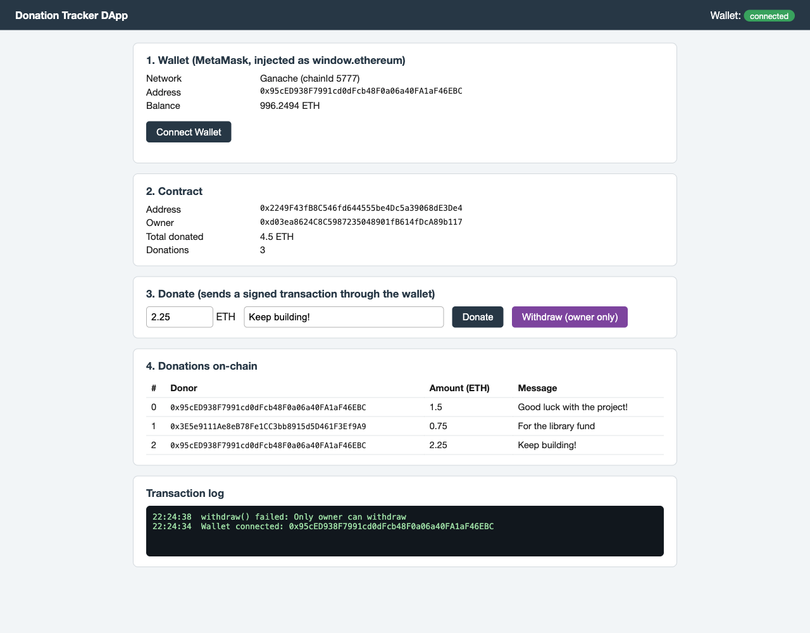
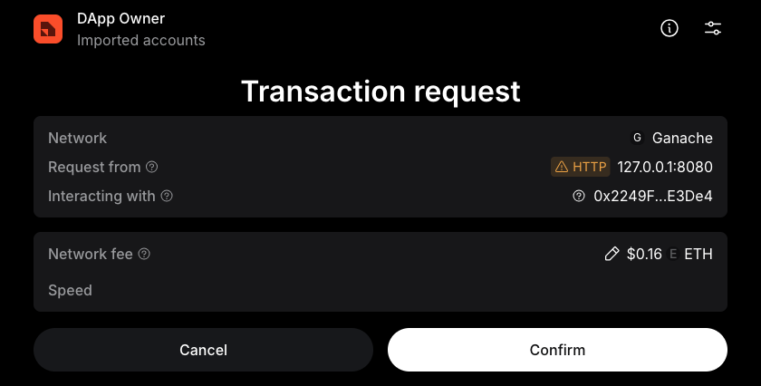
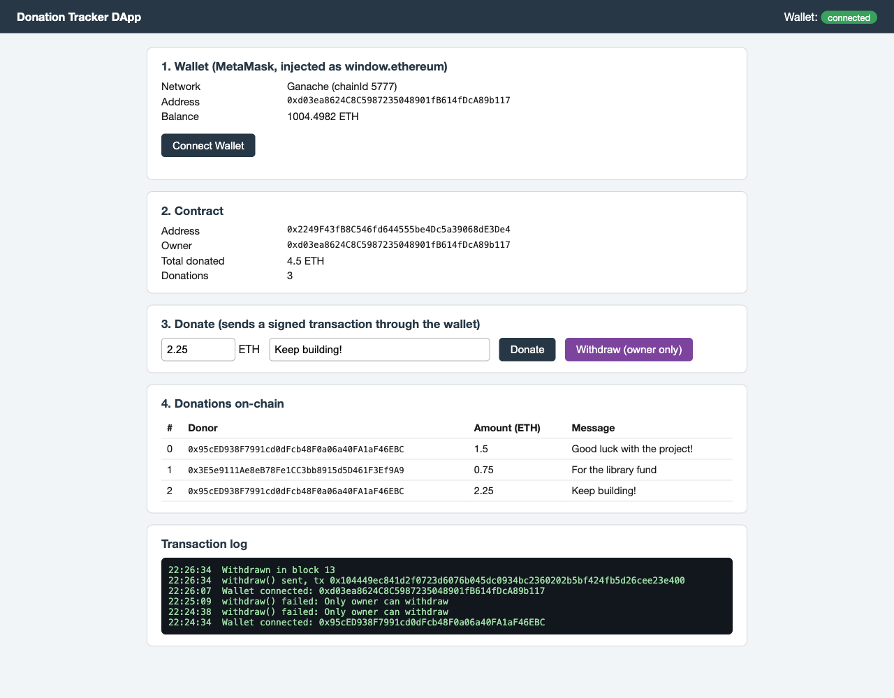

# Experiment 8

## Configuring a Cryptocurrency Wallet and integrating it with a DApp

## Aim

To configure the MetaMask wallet with a local blockchain and funded accounts, and to integrate it with a decentralized application (DApp): a web front end that connects to MetaMask, reads a smart contract's state, and sends transactions that the user approves in the wallet.

## Tasks Performed

1. Configured MetaMask for a local blockchain: added the Ganache network and imported funded accounts ("DApp Owner" and "Donor").
2. Wrote and deployed the `DonationTracker` smart contract to Ganache, and published its address and ABI to the front end.
3. Built a DApp front end (`dapp/index.html`, `ethers.js`) that connects to MetaMask, switches to the right network and reads the contract's state.
4. Sent a donation from the DApp, approved in MetaMask, and watched the page update.
5. Tested the owner-only `withdraw()`: rejected for a non-owner, approved and completed for the owner.

## Theory

A **cryptocurrency wallet** does not store coins; it stores the private keys that control accounts on the blockchain and uses them to sign transactions. A browser wallet such as MetaMask exposes itself to web pages as an injected provider, `window.ethereum`, which follows the **EIP-1193** standard: the page calls `ethereum.request({method, params})` (for example `eth_requestAccounts` to ask the user to connect, then `eth_sendTransaction`), and the wallet asks the user for approval, signs, and forwards the call to whichever network it is pointed at. The page never sees a private key.

A **DApp** is a front end plus smart contracts instead of a conventional back-end server:

1. **Smart contract (back end)** — `DonationTracker.sol`: `donate(message)` is `payable` and records the donor, amount and message; `withdraw()` is restricted to the owner and sends the collected balance to them; `DonationReceived` and `Withdrawn` events are emitted.
2. **Wallet** — MetaMask holds the user's accounts and signs.
3. **Front end** — `dapp/index.html` uses `ethers.js` (`BrowserProvider`, `Contract`) over `window.ethereum` to read `owner()`, `totalDonated()` and the donation list, and to call `donate()` and `withdraw()`.

**Integration steps:** (1) configure MetaMask with the local network and funded accounts; (2) deploy the contract and publish its address and ABI to the front end (`deployment.json`); (3) the page asks MetaMask to connect (`eth_requestAccounts`) and makes sure the wallet is on the right network (`wallet_switchEthereumChain`); (4) reads go straight to the node, while writes are approved and signed in MetaMask and mined into a block; (5) the page refreshes from on-chain state after each confirmed transaction, and again whenever the user switches account or network in MetaMask.

**Tools used:** Ganache CLI 7.9.2 as the local blockchain (`--server.port 7545 --chain.chainId 5777 --wallet.deterministic`, the same chain as Experiment 7), MetaMask 13.53 with Ganache added as a custom network, Node.js 24, Hardhat 2.29 with `@nomicfoundation/hardhat-toolbox` (bundles `ethers.js` v6) for deploying the contract, Solidity 0.8.24 compiled for the Shanghai fork, and a static HTML page served with `python3 -m http.server`. The contract owner and the donor are two different MetaMask accounts imported from Ganache ("DApp Owner" and "Donor").

## Program

Smart contract `DonationTracker.sol`, and the front-end script from `dapp/index.html`:

::: code2
```solidity
// SPDX-License-Identifier: MIT
pragma solidity ^0.8.24;

/// @title DonationTracker - a small DApp back end: donations with a message, owner-only withdrawal
contract DonationTracker {
    struct Donation {
        address donor;
        uint256 amount;
        string message;
        uint256 timestamp;
    }

    address public owner;
    uint256 public totalDonated;
    Donation[] private donations;

    event DonationReceived(address indexed donor, uint256 amount, string message);
    event Withdrawn(address indexed owner, uint256 amount);

    constructor() {
        owner = msg.sender;
    }

    function donate(string calldata message) external payable {
        require(msg.value > 0, "Donation must be greater than 0");
        donations.push(Donation(msg.sender, msg.value, message, block.timestamp));
        totalDonated += msg.value;
        emit DonationReceived(msg.sender, msg.value, message);
    }

    function donationCount() external view returns (uint256) {
        return donations.length;
    }

    function getDonation(uint256 i) external view returns (address, uint256, string memory, uint256) {
        Donation storage d = donations[i];
        return (d.donor, d.amount, d.message, d.timestamp);
    }

    function withdraw() external {
        require(msg.sender == owner, "Only owner can withdraw");
        uint256 bal = address(this).balance;
        require(bal > 0, "Nothing to withdraw");
        (bool ok, ) = owner.call{value: bal}("");
        require(ok, "Transfer failed");
        emit Withdrawn(owner, bal);
    }
}
```
:::

::: code2
```html
<script src="ethers.umd.min.js"></script>
<script>
// window.ethereum is injected by the MetaMask extension (EIP-1193); the page never sees a private key.
if (!window.ethereum) { document.addEventListener("DOMContentLoaded", () => { document.getElementById("log").textContent = "MetaMask not found. Install the extension and reload."; }); }
const $ = id => document.getElementById(id);
// Ganache puts the revert text under info.error.data.data.reason; fall back to ethers' own fields
const why = e => (e.info && e.info.error && e.info.error.data && e.info.error.data.data && e.info.error.data.data.reason) || e.reason || e.shortMessage || e.message;
const log = s => { $("log").textContent = (new Date().toLocaleTimeString() + "  " + s + "\n") + ($("log").textContent.startsWith("Waiting") ? "" : $("log").textContent); };
let provider, signer, contract, dep, connecting = false;
const TARGET = {chainId: "0x1691", chainName: "Ganache", rpcUrls: ["http://127.0.0.1:7545"],
                nativeCurrency: {name: "Ether", symbol: "ETH", decimals: 18}};
// Ask MetaMask to move to the network the contract lives on (adds it first if MetaMask does not know it)
async function ensureNetwork() {
  const cur = await window.ethereum.request({method: "eth_chainId"});
  if (cur === TARGET.chainId) return;
  try { await window.ethereum.request({method: "wallet_switchEthereumChain", params: [{chainId: TARGET.chainId}]}); }
  catch (e) {
    if (e.code === 4902) await window.ethereum.request({method: "wallet_addEthereumChain", params: [TARGET]});
    else throw e;
  }
}

async function refresh() {
  const me = await signer.getAddress();
  $("addr").textContent = me;
  $("bal").textContent = Number(ethers.formatEther(await provider.getBalance(me))).toFixed(4) + " ETH";
  $("owner").textContent = await contract.owner();
  $("total").textContent = ethers.formatEther(await contract.totalDonated()) + " ETH";
  const n = Number(await contract.donationCount()); $("count").textContent = n;
  $("rows").innerHTML = "";
  for (let i = 0; i < n; i++) {
    const [d, a, m] = await contract.getDonation(i);
    $("rows").innerHTML += `<tr><td>${i}</td><td class="mono">${d}</td><td>${ethers.formatEther(a)}</td><td>${m}</td></tr>`;
  }
}
async function connect() {
  connecting = true;
  dep = await (await fetch("deployment.json")).json();
  await window.ethereum.request({method: "eth_requestAccounts"});
  await ensureNetwork();
  provider = new ethers.BrowserProvider(window.ethereum);
  signer = await provider.getSigner();
  const net = await provider.getNetwork();
  $("net").textContent = "Ganache (chainId " + net.chainId + ")";
  $("status").textContent = "connected"; $("status").className = "badge";
  contract = new ethers.Contract(dep.address, dep.abi, signer);
  $("caddr").textContent = dep.address;
  log("Wallet connected: " + await signer.getAddress());
  await refresh();
  connecting = false;
}
$("connect").onclick = () => connect().catch(e => { connecting = false; log("ERROR " + (e.shortMessage || e.message)); });
if (window.ethereum) {
  // re-read everything when the user switches account or network inside MetaMask
  const again = () => { if (contract && !connecting) connect().catch(e => { connecting = false; log("ERROR " + (e.shortMessage || e.message)); }); };
  window.ethereum.on("accountsChanged", again);
  window.ethereum.on("chainChanged", again);
}
$("donate").onclick = async () => {
  try {
    const tx = await contract.donate($("msg").value, {value: ethers.parseEther($("amount").value)});
    log("donate() sent, tx " + tx.hash); const rc = await tx.wait();
    log("Mined in block " + rc.blockNumber + ", gas used " + rc.gasUsed); await refresh();
  } catch (e) { log("donate() failed: " + why(e)); }
};
$("withdraw").onclick = async () => {
  try {
    const tx = await contract.withdraw(); log("withdraw() sent, tx " + tx.hash); const rc = await tx.wait();
    log("Withdrawn in block " + rc.blockNumber); await refresh();
  } catch (e) { log("withdraw() failed: " + why(e)); }
};
</script></body></html>
```
:::

## Output

::: shots

*Step 1: the local Ganache chain is added to MetaMask as a custom network with RPC URL `127.0.0.1:7545`, chain ID 5777 and currency symbol ETH (the same setup as in Experiment 7).*


*Two more Ganache accounts are imported by private key and renamed "DApp Owner" and "Donor". They sit below the accounts imported for Experiment 7.*
:::


*Step 2: `hardhat run` deploys `DonationTracker` to Ganache from the owner account and writes its address and ABI to `dapp/deployment.json` for the front end. Two donations (1.5 ETH and 0.75 ETH) are seeded from the command line so the page has data to show.*

::: shots

*Clicking "Connect Wallet" makes MetaMask ask whether the website (127.0.0.1) may see the two selected accounts and request transactions. The wallet lists what the site can and cannot do ("Cannot move funds without your permission").*


*Step 4: after switching MetaMask to the "Donor" account, clicking "Donate" produces a MetaMask transaction request: the network (Ganache), the requesting site, the contract being called, and an amount of 2.25 ETH.*
:::


*After "Connect", the page shows the network (Ganache, chain ID 5777), the connected account (the DApp Owner) and its balance, and reads the contract's owner, 2.25 ETH total and 2 donations from the chain.*


*After approval, the donation is mined in block 12 and the page refreshes: the total rises to 4.5 ETH, a third row appears in the on-chain donations table, and the transaction hash is shown in the log. The donor's balance has dropped by the donation plus gas.*


*Step 5: with the Donor account selected, "Withdraw" is rejected by the contract's `require` with "Only owner can withdraw"; no funds move and no transaction is sent.*

::: shots

*Step 6: after switching MetaMask to the "DApp Owner" account, "Withdraw" shows a transaction request to the same contract.*
:::


*Once approved, `withdraw()` is mined in block 13 and the owner's balance rises from 999.9983 to 1004.4982 ETH, which is the 4.5 ETH collected minus gas.*

*(The deployment log is `deploy_output.log` in this folder; the contract is `contracts/DonationTracker.sol` and the front end is `dapp/index.html`.)*

## Conclusion

This experiment configured MetaMask with a local Ganache blockchain and funded accounts and integrated it with a DApp: a web page that connects to MetaMask's injected EIP-1193 provider, reads a `DonationTracker` contract's live state with `ethers.js`, and sends transactions that are approved in MetaMask and mined into blocks. A donation from the Donor account raised the on-chain total from 2.25 to 4.5 ETH and added a record to the table. The contract's access control was verified from the UI: the Donor's withdrawal was rejected on-chain with the contract's own message, while the owner's withdrawal went through MetaMask and moved the 4.5 ETH to the owner's account. The page follows account and network changes made in the wallet, which is how a real DApp is expected to behave.
