# Experiment 9

## Creating a Token (ERC-20)

## Aim

To create an ERC-20 token in Remix IDE by completing the LearnEth *Solidity ERC20 Token Course*, and to deploy an ERC-20 token with the Mintable, Burnable and Pausable extensions to the **Sepolia public testnet**, then exercise its standard functions and events.

## Tasks Performed

1. Opened the **LearnEth** plugin in Remix and the *Solidity ERC20 Token Course* (6 chapters: Introduction, Interface, Token Creation, Interaction, Testnet Deployment, Extensions).
2. Completed all 6 chapters. The two chapters with a graded assignment passed the Check Answer test: chapter 1 (quiz: answers 2, 3, 2) and chapter 3 (`EduCoin`, symbol `EDC`, 1000 tokens minted). Chapters 2, 4, 5 and 6 are reading and hands-on chapters (the `IERC20` interface, interaction, MetaMask deployment, extensions), carried out below on the experiment's own token.
3. Set up a MetaMask wallet with the owner account and funded it with Sepolia test ETH from a faucet (3.67 ETH), then connected it to Remix (*Browser Extension*, *Sepolia Testnet - MetaMask*).
4. Compiled the course token extended with Mintable, Burnable and Pausable features as `VESToken` (OpenZeppelin 5.x).
5. **Deployed `VESToken` to Sepolia from Remix through MetaMask** (initial supply 1000 VEST) and sent 100 VEST to a second account from Remix. A second instance was deployed with a script to run `transfer`, `approve`/`allowance`/`transferFrom`, `mint`, `burn`, `pause` and `unpause` on the live network.
6. Verified the token, its holders and the transactions on the Sepolia block explorer.

## Theory

A **token** is a smart contract that keeps a ledger of balances (`mapping(address => uint256)`) on top of an existing blockchain, so that a new asset can be created, owned and transferred without a new chain. **ERC-20** is the Ethereum standard interface for *fungible* tokens, where every unit is interchangeable, which lets wallets and exchanges handle any compliant token the same way.

**ERC-20 interface**

| Kind | Members | Purpose |
|---|---|---|
| Attributes | `name()`, `symbol()`, `decimals()`, `totalSupply()` | Token metadata and supply (`decimals = 18` means 1 token = 10^18 base units) |
| Functions | `balanceOf(owner)`, `transfer(to, value)`, `approve(spender, value)`, `allowance(owner, spender)`, `transferFrom(from, to, value)` | Read balances, move tokens, and delegate spending to another address |
| Events | `Transfer(from, to, value)`, `Approval(owner, spender, value)` | Emitted on every movement / approval so wallets and explorers can index them |

**ERC-20 vs ERC-721.** ERC-20 tokens are *fungible*: balances are plain amounts and any unit equals any other (currencies, voting or utility tokens). ERC-721 tokens are *non-fungible*: each token has a unique `tokenId` and an owner (`ownerOf(tokenId)`), so each one is distinct (collectibles, certificates, property deeds).

**Extensions** (from OpenZeppelin, all used in this experiment's `VESToken`):

- **Mintable** — an owner-restricted `mint(to, amount)` creates new tokens, so total supply can grow after deployment.
- **Burnable** — `burn(amount)` lets a holder destroy their own tokens, permanently reducing total supply.
- **Pausable** — the owner can `pause()` to halt every transfer (an emergency stop) and `unpause()` to resume.

**Tools used:** Remix IDE 2.6.8 with the LearnEth plugin, Solidity 0.8.x, OpenZeppelin Contracts 5.6 (the course itself uses 4.4.0), MetaMask 13.53, ethers.js v6, and the Sepolia block explorer (Blockscout).

The deployment and the first transfer were signed in MetaMask from Remix; the full function-by-function test (mint, burn, pause, allowance) was run on a second instance with an ethers.js script (below), which also used a second account as the token holder.

## Program

Chapter 3 assignment, `EduCoin.sol`, and the final `VESToken.sol` (ERC-20 with Mintable, Burnable and Pausable extensions):

::: code2
```solidity
// SPDX-License-Identifier: MIT
pragma solidity ^0.8.3;

import "@openzeppelin/contracts@4.4.0/token/ERC20/ERC20.sol";

contract EduCoin is ERC20 {
    constructor() ERC20("EduCoin", "EDC") {
        _mint(msg.sender, 1000 * 10 ** decimals());
    }
}
```
:::

::: code2
```solidity
// SPDX-License-Identifier: MIT
pragma solidity ^0.8.24;

import "@openzeppelin/contracts/token/ERC20/ERC20.sol";
import "@openzeppelin/contracts/token/ERC20/extensions/ERC20Burnable.sol";
import "@openzeppelin/contracts/token/ERC20/extensions/ERC20Pausable.sol";
import "@openzeppelin/contracts/access/Ownable.sol";

/// @title VESToken - an ERC-20 token with Mintable, Burnable and Pausable extensions
contract VESToken is ERC20, ERC20Burnable, ERC20Pausable, Ownable {
    constructor(uint256 initialSupply)
        ERC20("VES Token", "VEST")
        Ownable(msg.sender)
    {
        _mint(msg.sender, initialSupply * 10 ** decimals());
    }

    // Mintable: only the owner can create new tokens
    function mint(address to, uint256 amount) public onlyOwner {
        _mint(to, amount);
    }

    // Pausable: only the owner can halt / resume all transfers
    function pause() public onlyOwner { _pause(); }
    function unpause() public onlyOwner { _unpause(); }

    // Required override: ERC20 and ERC20Pausable both hook into _update
    function _update(address from, address to, uint256 value)
        internal
        override(ERC20, ERC20Pausable)
    {
        super._update(from, to, value);
    }
}
```
:::

`scripts/sepolia_token.js` (deploys `VESToken` to Sepolia and exercises it):

::: code2
```javascript
// Run: node --env-file=../.env --env-file=<donor.env> scripts/sepolia_token.js
// SEPOLIA_PRIVATE_KEY = funded owner account, DONOR_PRIVATE_KEY = second account (holder / spender).
const { ethers } = require("ethers");
const artifact = require("../artifacts/contracts/VESToken.sol/VESToken.json");

const provider = new ethers.JsonRpcProvider("https://ethereum-sepolia-rpc.publicnode.com");
const owner = new ethers.Wallet(process.env.SEPOLIA_PRIVATE_KEY, provider);
const donor = new ethers.Wallet(process.env.DONOR_PRIVATE_KEY, provider);
const tok = (v) => ethers.formatUnits(v, 18);
const log = {};

async function send(label, txPromise) {
  const rc = await (await txPromise).wait();
  log[label] = rc.hash;
  console.log(`${label.padEnd(22)} ${rc.hash}  block ${rc.blockNumber}`);
}
async function show(t, label) {
  console.log(`${label}: owner ${tok(await t.balanceOf(owner.address))} | donor ${tok(await t.balanceOf(donor.address))} | supply ${tok(await t.totalSupply())} VEST`);
}

async function main() {
  console.log("Network:", (await provider.getNetwork()).name, "Owner:", owner.address, "Donor:", donor.address);
  const f = new ethers.ContractFactory(artifact.abi, artifact.bytecode, owner);
  const t = await f.deploy(1000);
  const rc = await t.deploymentTransaction().wait();
  log.deploy = rc.hash; log.address = await t.getAddress();
  console.log("deploy                 ", log.address, " tx", rc.hash);
  console.log("name/symbol/decimals   ", await t.name(), await t.symbol(), await t.decimals());
  await show(t, "after deploy");

  await send("transfer_250", t.transfer(donor.address, ethers.parseUnits("250", 18)));
  await show(t, "after transfer");
  await send("approve_100", t.approve(donor.address, ethers.parseUnits("100", 18)));
  console.log("allowance(owner,donor) ", tok(await t.allowance(owner.address, donor.address)));
  await send("transferFrom_40", t.connect(donor).transferFrom(owner.address, donor.address, ethers.parseUnits("40", 18)));
  await send("mint_500", t.mint(owner.address, ethers.parseUnits("500", 18)));
  await send("burn_100", t.burn(ethers.parseUnits("100", 18)));
  await show(t, "after mint+burn");
  await send("pause", t.pause());
  try { await t.connect(donor).transfer.staticCall(owner.address, 1n); } catch (e) { console.log("transfer while paused ->", e.revert ? e.revert.name : e.shortMessage); }
  await send("unpause", t.unpause());
  await send("transfer_after", t.connect(donor).transfer(owner.address, ethers.parseUnits("10", 18)));
  await show(t, "final");
  console.log(JSON.stringify(log, null, 2));
}
main().catch((e) => { console.error(e); process.exit(1); });
```
:::

## Output

### LearnEth: Solidity ERC20 Token Course

::: shots
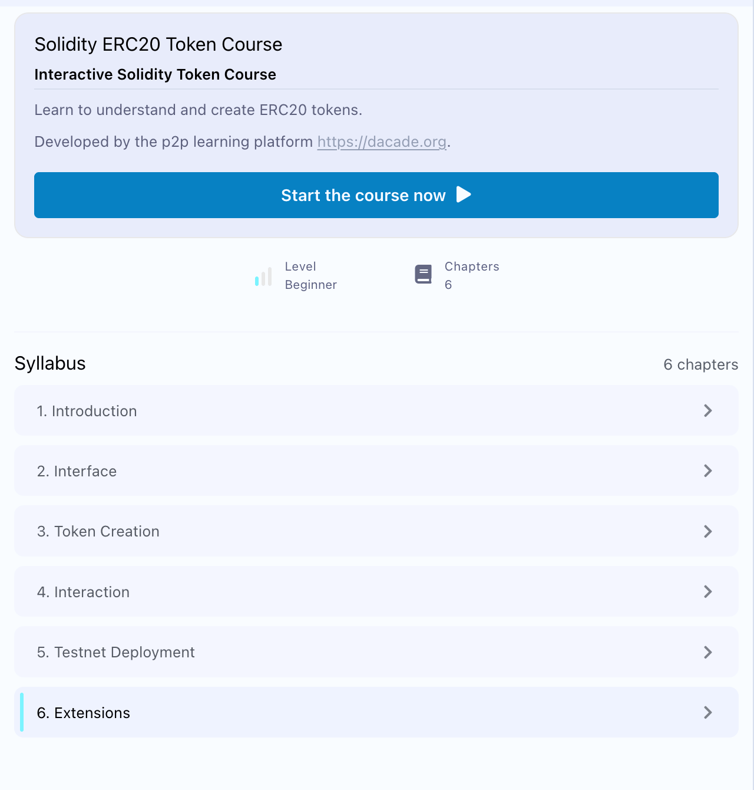
*The six chapters of the course.*

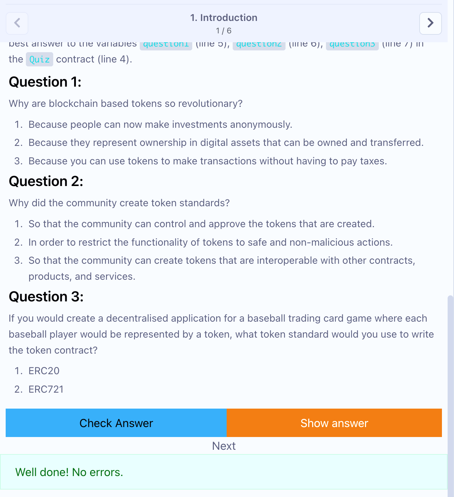
*Chapter 1: quiz answers 2, 3, 2 accepted ("Well done! No errors.").*
:::

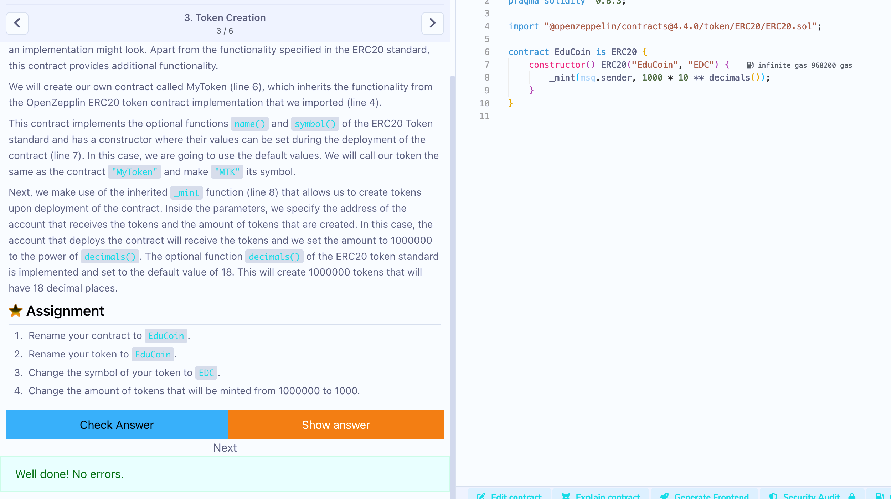
*Chapter 3, Token Creation: the contract renamed `EduCoin`, symbol `EDC`, 1000 tokens minted, accepted by Check Answer.*

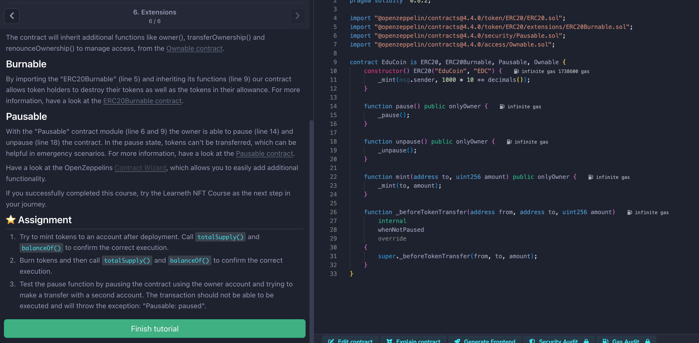
*Chapter 6, Extensions: the final contract, `ERC20` + `ERC20Burnable` + `Pausable` + `Ownable`, with `mint`, `pause` and `unpause`; its assignments (mint, burn, pause) are carried out on Sepolia below.*

### Deployment from Remix through MetaMask (Sepolia)

::: shots
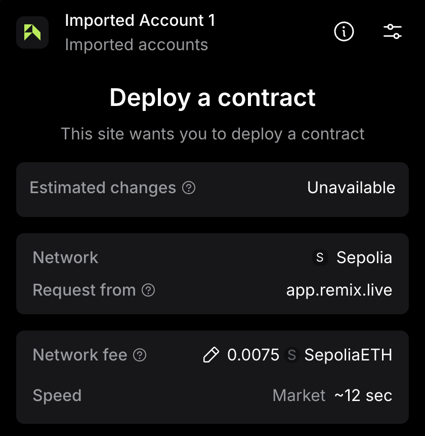
*MetaMask's "Deploy a contract" request on the Sepolia network, from app.remix.live (initial supply 1000).*

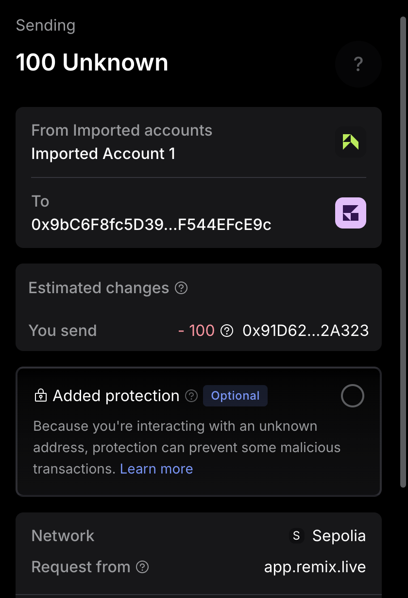
*Remix `transfer(to, 100e18)`: MetaMask shows 100 tokens leaving Imported Account 1 for the second account (the token is "Unknown" to MetaMask).*
:::

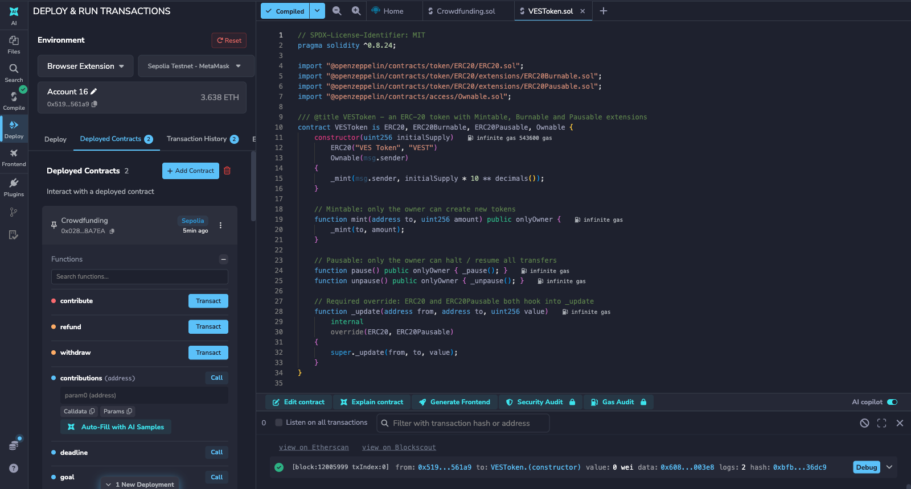
*Remix with *Browser Extension / Sepolia Testnet - MetaMask*: `VESToken` (0x91D6...A323) deployed, the constructor mined in block 12005999.*

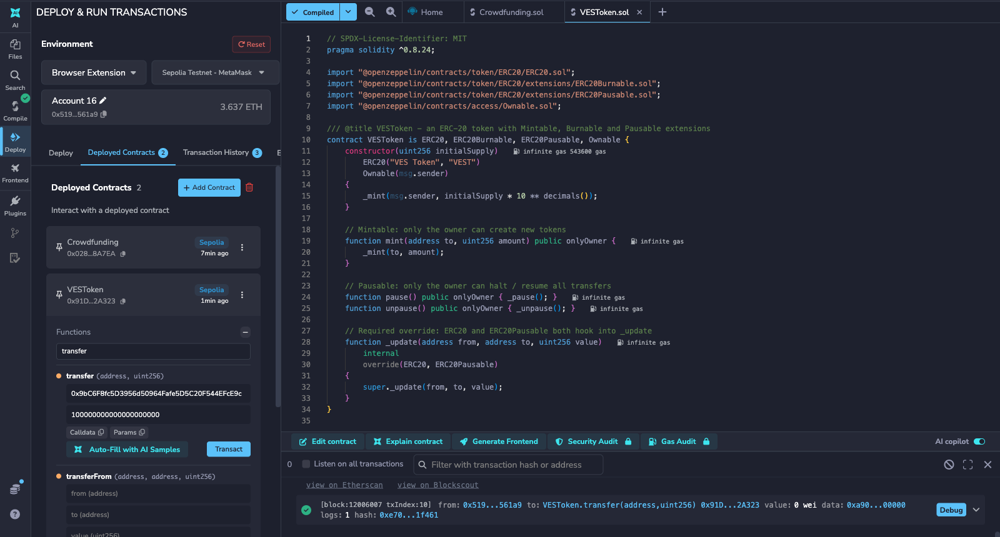
*`VESToken.transfer` of 100 VEST mined in block 12006007, sent from the MetaMask account.*

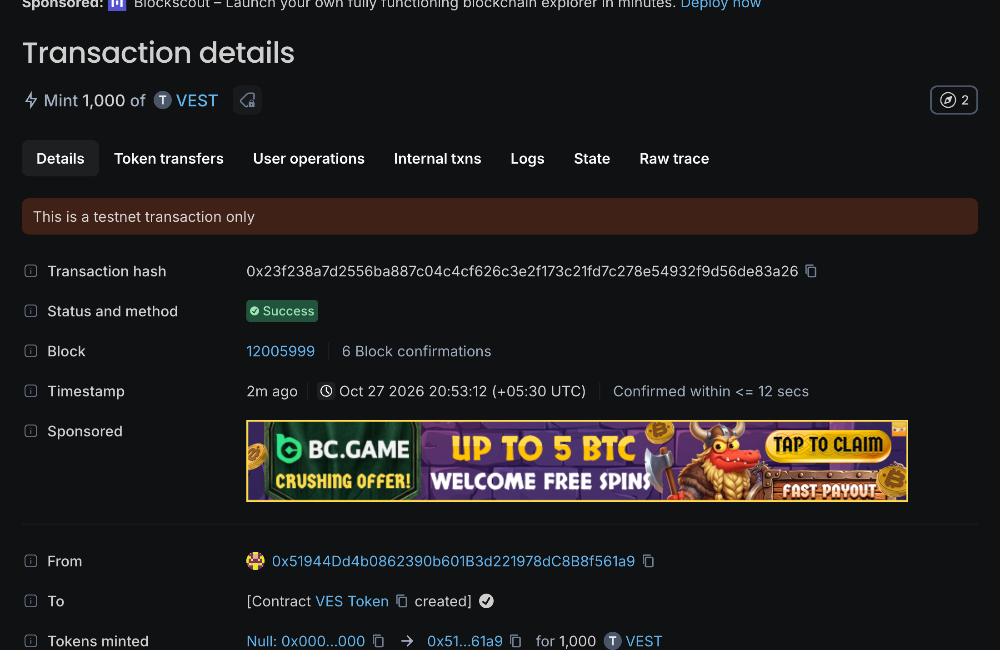
*The explorer shows the contract creation and the mint of 1,000 VEST to the deployer.*

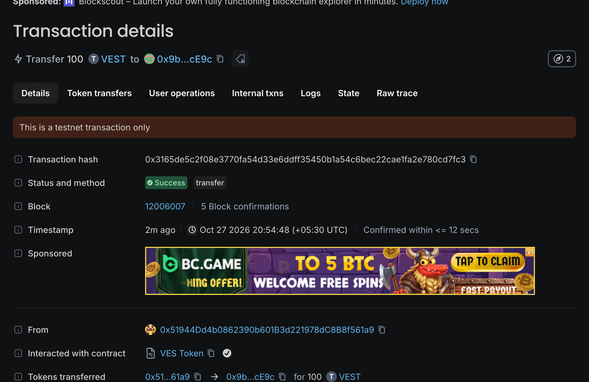
*The transfer of 100 VEST: status Success, block 12006007.*

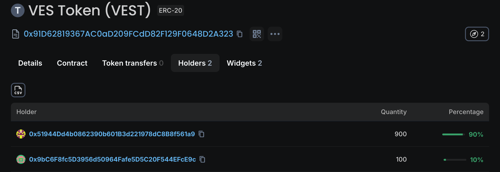
*Holders: the deployer holds 900 VEST (90%) and the second account 100 VEST (10%).*

### Full function test on the Sepolia testnet (script)

Output of `sepolia_token.js` (chain ID 11155111):

```text
Network: sepolia Owner: 0x51944Dd4b0862390b601B3d221978dC8B8f561a9 Donor: 0x9bC6F8fc5D3956d50964Fafe5D5C20F544EFcE9c
deploy                  0x66A8aE5e6d0284433Eb4b30b0Aa87254d64976DC  tx 0x3bb88e94323c42bf140d5dcce8ea22726082d536cc1064f27e6c5601c5414ea0
name/symbol/decimals    VES Token VEST 18n
after deploy: owner 1000.0 | donor 0.0 | supply 1000.0 VEST
transfer_250           0x86d5632b614f5989540af37ee15bacffbf2152b95ccb7e471f1fad3fac6ba4d8  block 12005591
after transfer: owner 750.0 | donor 250.0 | supply 1000.0 VEST
approve_100            0x7ff0c33b01cc498b2b46dca33e304555b02feff3051b814cb8686d3f18219e86  block 12005592
allowance(owner,donor)  100.0
transferFrom_40        0x1a6c734d45558b4be622cd87f44e6d0ff68522597eda011790c0b91aae484d34  block 12005594
mint_500               0x5ea41dbf31f7eada1cd419b42e5fb9f18154d9a3780e87c2bd5d651eb9dbb41b  block 12005595
burn_100               0x6bd5ce16e71aa101deff4ac589805cc678c6b39ef021ec67b479515d813c9b08  block 12005596
after mint+burn: owner 1110.0 | donor 290.0 | supply 1400.0 VEST
pause                  0x5cffe4802f7e077eaebb5ce65041ddf663df257c273149de964696c15b73b649  block 12005598
transfer while paused -> EnforcedPause
unpause                0xb40205d8af8d48edf3a3c2e9439586f49090d89b11a6732aba8444c04b5181b8  block 12005600
transfer_after         0xd09a7155b095b3dac806a78a45293085096e358e6de7062261a57b3c7a63ea14  block 12005601
final: owner 1120.0 | donor 280.0 | supply 1400.0 VEST
```

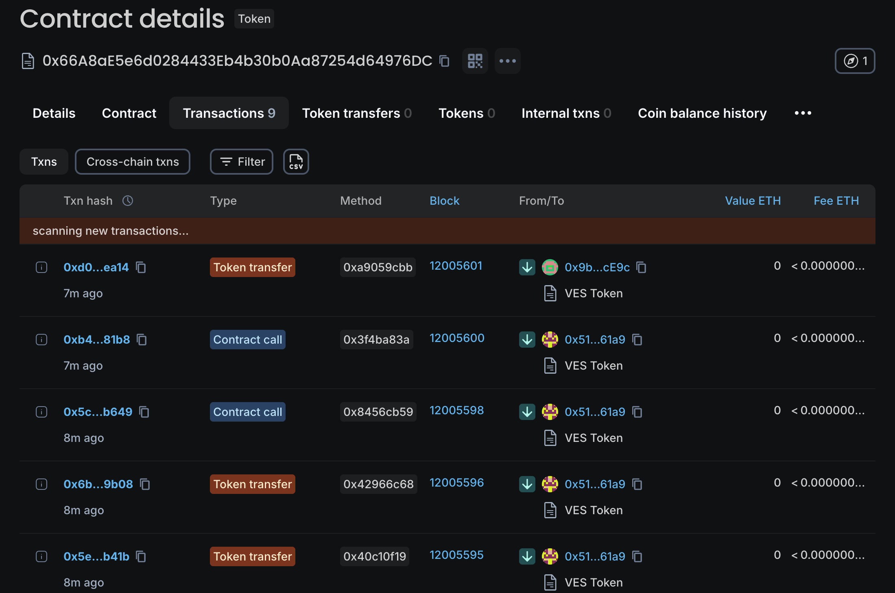
*The scripted token instance on the explorer: contract creation, `transfer`, `approve`, `transferFrom`, `mint`, `burn`, `pause`, `unpause` and the final `transfer`, in order, with status and block numbers.*

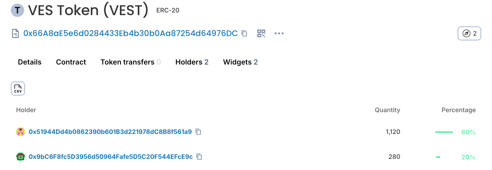
*Token holders: the owner holds 1,120 VEST (80%) and the second account 280 VEST (20%), which adds up to the total supply of 1,400 VEST.*

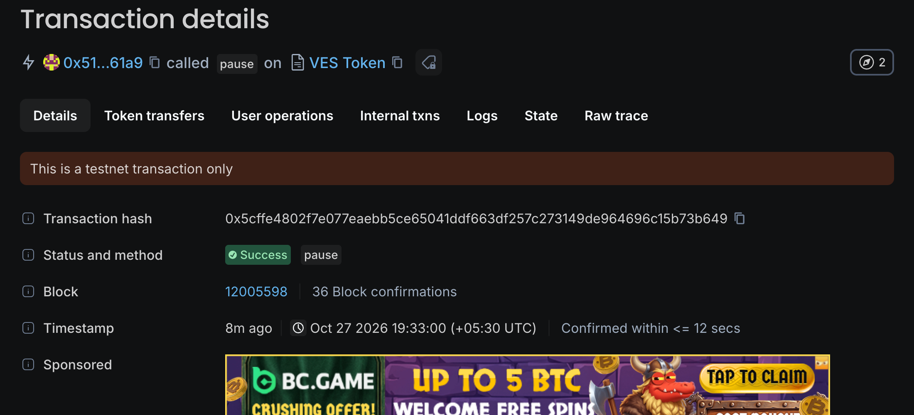
*The `pause()` transaction: status Success, called by the owner on `VES Token`.*

## Conclusion

An ERC-20 token was created and deployed to the public **Sepolia testnet** (`VES Token`, `VEST`, 18 decimals), after completing the six chapters of the LearnEth ERC20 course. On the live network, `transfer` and `transferFrom` moved balances, `approve` set the allowance, the owner minted 500 and burned 100 tokens (total supply 1000 → 1400), and a transfer attempted while the token was paused was rejected with `EnforcedPause` until `unpause()`. The explorer's holders list (1,120 + 280 = 1,400 VEST) agrees with the script's final balances, so total supply stayed consistent with the sum of balances throughout.
