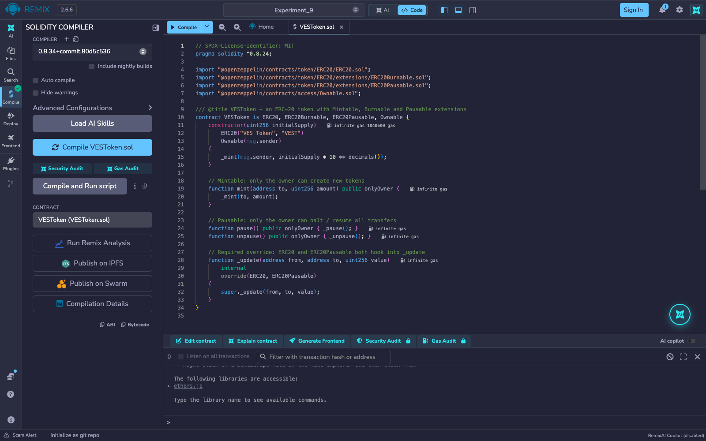
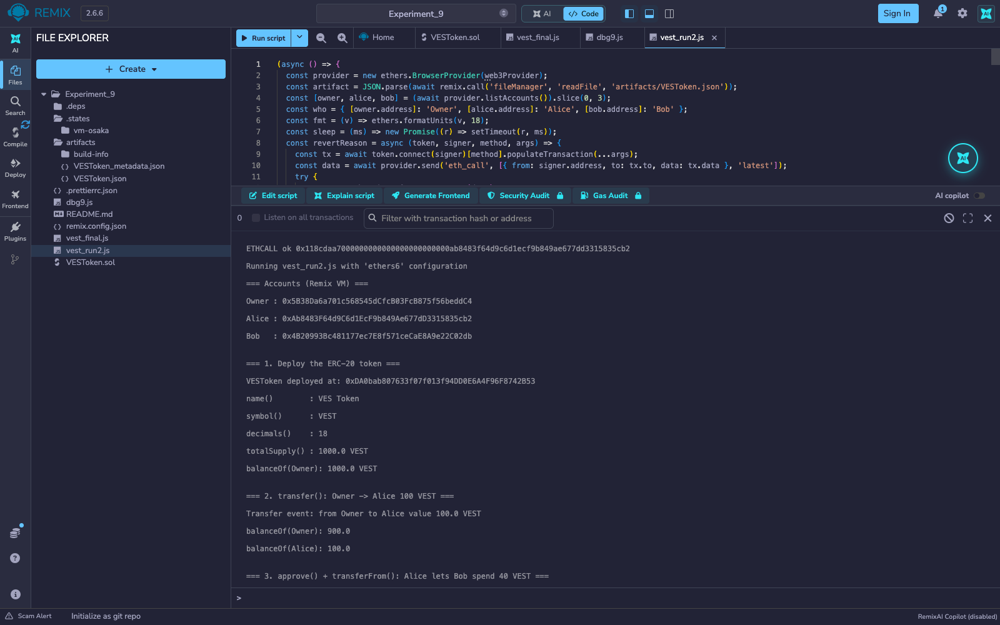
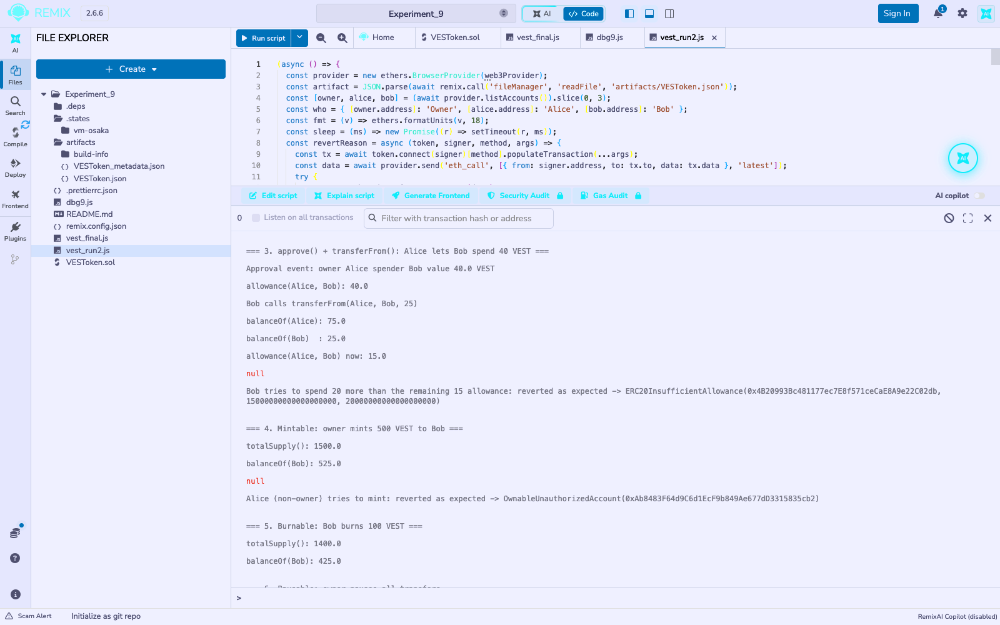
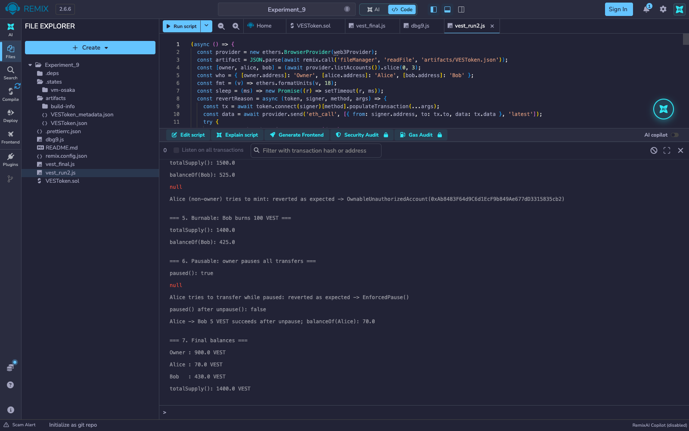
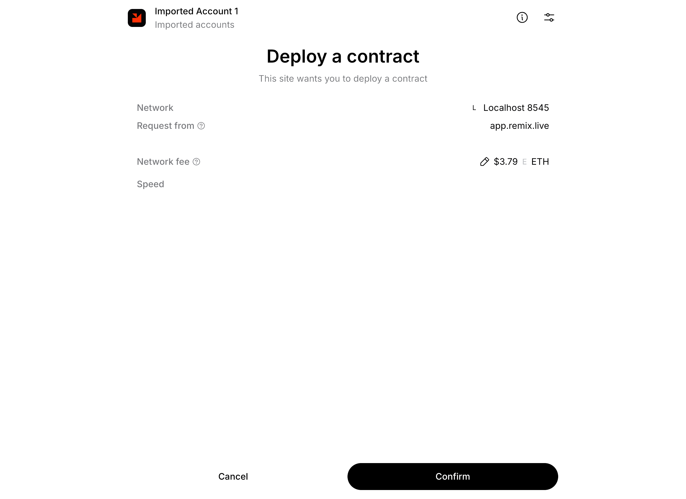
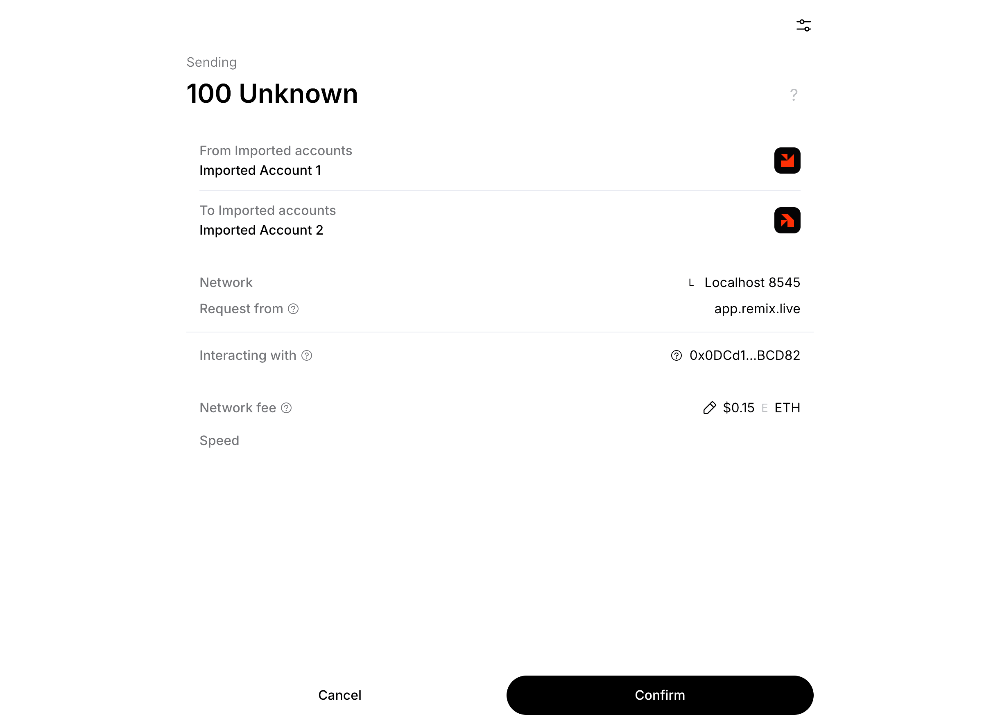
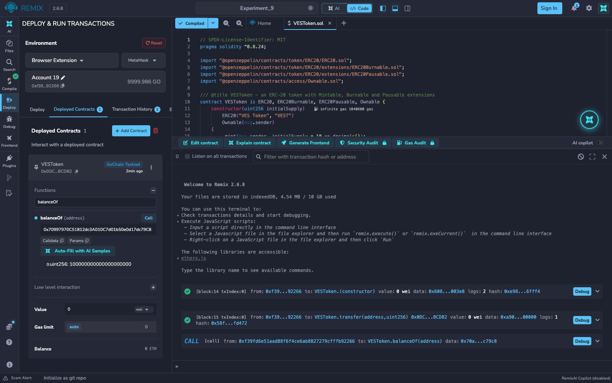

# Experiment 9

## Creating a Token (ERC-20)

## Aim

To create an ERC-20 token in Solidity with the Mintable, Burnable and Pausable extensions, deploy it, and exercise its standard functions and events (`transfer`, `approve`, `transferFrom`, `Transfer`, `Approval`).

## Theory

A **token** is a smart contract that keeps a ledger of balances (`mapping(address => uint256)`) on top of an existing blockchain, so that a new asset can be created, owned and transferred without a new chain. **ERC-20** is the Ethereum standard interface for *fungible* tokens, where every unit is interchangeable, which lets wallets and exchanges handle any compliant token the same way.

**ERC-20 interface**

| Kind | Members | Purpose |
|---|---|---|
| Attributes | `name()`, `symbol()`, `decimals()`, `totalSupply()` | Token metadata and supply (`decimals = 18` means 1 token = 10^18 base units) |
| Functions | `balanceOf(owner)`, `transfer(to, value)`, `approve(spender, value)`, `allowance(owner, spender)`, `transferFrom(from, to, value)` | Read balances, move tokens, and delegate spending to another address |
| Events | `Transfer(from, to, value)`, `Approval(owner, spender, value)` | Emitted on every movement / approval so wallets and explorers can index them |

**ERC-20 vs ERC-721.** ERC-20 tokens are *fungible*: balances are plain amounts and any unit equals any other (currencies, voting or utility tokens). ERC-721 tokens are *non-fungible*: each token has a unique `tokenId` and an owner (`ownerOf(tokenId)`), so each one is distinct (collectibles, certificates, property deeds).

**Extensions** (from OpenZeppelin, all used in this experiment's `VESToken`):

- **Mintable** — an owner-restricted `mint(to, amount)` creates new tokens, so total supply can grow after deployment.
- **Burnable** — `burn(amount)` lets a holder destroy their own tokens, permanently reducing total supply.
- **Pausable** — the owner can `pause()` to halt every transfer (an emergency stop) and `unpause()` to resume.

**Tools used:** Remix IDE (web, v2.6.8), Solidity compiler 0.8.34 (the contract declares `pragma solidity ^0.8.24`), OpenZeppelin Contracts 5.x (imported by Remix straight from npm through the `@openzeppelin/contracts/...` import paths), the in-browser *Remix VM (Osaka)* test blockchain, and a JavaScript script run from Remix's terminal with the built-in ethers.js v6 runner. The token was deployed to the Remix VM, not to a public testnet.

**Wallet integration:** the MetaMask screenshots use Remix's *Browser Extension* environment (Injected Provider) with MetaMask 13.53 connected to a local Hardhat node (chain ID 31337, which Remix labels "GoChain Testnet"), with the compiler EVM version set to Cancun because that node does not support Remix's default Osaka target. The chain is local, not a public testnet, so no faucet funds were used.

## Output

*`VESToken.sol` and its OpenZeppelin imports (`ERC20`, `ERC20Burnable`, `ERC20Pausable`, `Ownable`) compile with no errors in Remix; the green tick on the Solidity Compiler icon confirms it.*

*`VESToken` is deployed with an initial supply of 1000 VEST, all credited to the deployer, and its name, symbol, decimals and supply are read back. Owner then transfers 100 VEST to Alice, and the decoded `Transfer` event and both balances confirm it.*

*Alice approves Bob for 40 VEST (an `Approval` event), Bob spends 25 through `transferFrom` and the allowance falls to 15, and a further 20 VEST attempt is rejected with `ERC20InsufficientAllowance`. The owner then mints 500 VEST to Bob, raising total supply to 1500, while a non-owner's mint is rejected with `OwnableUnauthorizedAccount`.*

*Bob's `burn(100)` lowers total supply to 1400. While the contract is paused, Alice's transfer reverts with `EnforcedPause()`, and after `unpause()` transfers work again. The final balances (900 + 70 + 430) sum to the total supply of 1400.*

### Deployment and transfer through MetaMask

*Remix requests deployment of `VESToken` with an initial supply of 1000. MetaMask shows "Deploy a contract" from app.remix.live on Localhost 8545, with the network fee and the Confirm button.*

*Calling `transfer(to, 100e18)` from Remix produces a MetaMask confirmation to send 100 tokens (shown as "Unknown" because MetaMask does not know this local token) from Imported Account 1 to Imported Account 2, interacting with the `VESToken` contract.*

*The Remix terminal logs the constructor (block 14) and the `transfer` (block 15), both successful and sent from the MetaMask account. Calling `balanceOf` on the recipient returns 100000000000000000000, i.e. 100 VEST at 18 decimals.*

## Conclusion

This experiment created an ERC-20 token, `VESToken (VEST)`, and deployed it in Remix IDE on the Remix VM. All the standard behaviours were exercised: balances and metadata, direct transfers with `Transfer` events, the approve-then-`transferFrom` allowance flow with `Approval` events, and its failure when the allowance is exceeded. The three extensions each behaved as expected: minting grew the supply from 1000 to 1500 (owner only), burning shrank it to 1400, and pausing froze all transfers until the owner resumed them. Total supply stayed consistent with the sum of balances throughout (1400 = 900 + 70 + 430).
